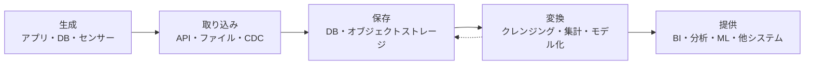
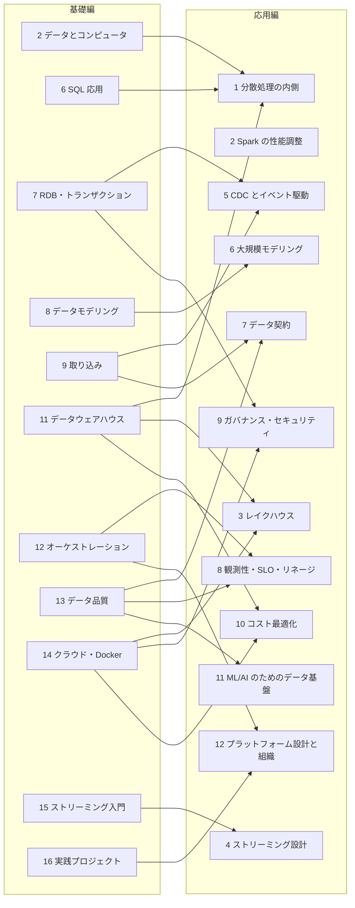

# 第1章 データエンジニアとは

## この章でできるようになること

- データエンジニアの役割を、一言と具体例で説明できる。
- データが価値になるまでの流れ（生成・取り込み・保存・変換・提供）と、その全体を支える土台を言える。
- アナリスト、サイエンティスト、機械学習エンジニアとの違いを、「何を作る人か」で言い分けられる。
- 「売上ダッシュボードを作って」と頼まれたとき、作り始める前に何を確かめるべきかを挙げられる。
- この本のどの章が、仕事のどの部分に対応しているかがわかる。

## データエンジニアは何をする人か

データエンジニアは、データを使いたい人のところへ、使える形で、決まった時間までに届ける仕組みを作り、動かし続ける人です。

「使える形で」が肝心です。会社の中でデータは、たいてい使われる場所とは別の場所で生まれます。注文は通販サイトのデータベースに入り、行動ログはアプリのサーバーが吐き出し、顧客の一覧は誰かが Excel で管理しています。これらはそのままでは分析にも機械学習にも使えません。形式がばらばらで、重複や欠けがあり、売上の定義すらチームごとに違うことがあります。

『Fundamentals of Data Engineering』の著者らは、データエンジニアリングを、生のデータを取り込み、分析や機械学習などの下流の用途を支える高品質で一貫した情報を作り出す、仕組みと処理の開発・実装・保守と定義しています（原文の趣旨を日本語にまとめたものです。参考文献 1）。注目したいのは、成果物が一回きりの集計結果ではなく、仕組みだという点です。今日の売上表を一度作るのは分析の仕事で、明日も来月も同じ表が自動で正しく更新される状態を保つのがデータエンジニアの仕事です。

この仕事が独立した職種になった背景には、データの量と種類が増えたこと、そしてそれを扱う道具が増えたことがあります。Maxime Beauchemin は 2017 年の文章で、データエンジニアリングをビジネスインテリジェンスやデータウェアハウスの仕事の上位集合のようなもので、ソフトウェアエンジニアリングの要素をより多く持つ分野と説明しました（参考文献 2）。表の整理だけでなく、コードを書き、テストし、運用するところまでが仕事に入る、ということです。

## 通しの例: 「売上ダッシュボードを作って」

この本では、架空の通販「ねぼすけ商店」のデータを全章で使います。朝が苦手な人向けの小さな雑貨店で、顧客・商品・注文・注文明細・行動ログがあります。データは `examples/common/neboske_shop.py` が作ります。重複や欠けなどの欠陥が、現実のデータに近い形で意図的に入っています。

ある日、店長から頼まれます。

> 売上ダッシュボードを作ってほしい。日ごとの売上が見られればいい。

簡単そうに聞こえます。ところが、作り始める前に決めることがいくつもあります。

{{ table("b01-dashboard-questions") }}

この表の左の列は、どれも技術の選択ではなく、ビジネスの側と話して決めることです。「売上」ひとつとっても、キャンセルされた注文を含めると数字が大きくなり、店長が思っている数字と合わなくなります。データエンジニアの最初の仕事は、コードを書くことよりも、この確認です。

とはいえ、手を動かさないと見えないこともあります。まず最小の版を作ってみます。ねぼすけ商店の注文と明細から、キャンセル以外の日別売上を出す SQL です。

```sql
SELECT substr(o.ordered_at, 1, 10) AS day,
       count(DISTINCT o.order_id) AS orders,
       sum(i.quantity * i.unit_price) AS sales
FROM orders AS o
JOIN order_items AS i USING (order_id)
WHERE o.status <> 'cancelled'
GROUP BY day
ORDER BY day
```

SQL は第5章と第6章で順に学ぶので、今は読めなくても構いません。「注文と明細をつないで、キャンセルを除き、日付ごとに数量×単価を足す」と読んでください。全体を動かすコードは `examples/b01/daily_sales.py` にあります（DuckDB という、手元のファイルで動く分析向けのデータベースを使います）。

```console
$ python examples/b01/daily_sales.py
```

実行すると、次のように出ました。

```text
[('SHIPPED', 59), ('cancelled', 528), ('delivered', 977), ('placed', 511), ('shipped', 925)]
(925, 984)
('2026-01-04', 1, 4900)
('2026-01-07', 1, 19400)
('2026-01-08', 1, 10350)
キャンセルを除いた売上 34,321,900 円 / 明細すべての合計 41,665,750 円
```

1 行目に注目してください。`status` に `shipped` と `SHIPPED` が別の値として入っています。同じ「発送済み」なのに、大文字と小文字が違うだけで別の値になっています。もし `status = 'shipped'` と書いて発送済みを数えていたら、59 件の注文が黙って落ちていました。次の SQL は、そろえずに数えた件数と、`lower()` で小文字にそろえて数えた件数を並べたものです。

```sql
SELECT count(*) FILTER (WHERE status = 'shipped') AS exact,
       count(*) FILTER (WHERE lower(status) = 'shipped') AS lowered
FROM orders
```

出力の 2 行目 `(925, 984)` がその結果で、差の 59 件が表記ゆれで漏れる分です。日別売上の SQL は発送済みを条件にしていないので影響を受けませんが、「発送済みの件数」を出すダッシュボードならこの差がそのまま誤りになります。

最後の行からは、キャンセルを含めるかどうかで売上が 700 万円以上変わることもわかります。ダッシュボードは数字を出しますが、その数字が何を数えたものかを決めるのは人です。

この例には、ライフサイクルのほぼすべてが小さく入っています。次の節で一つずつ見ていきます。

## データエンジニアリングのライフサイクル

データが生まれてから使われるまでの流れを、データエンジニアリングのライフサイクルと呼びます。『Fundamentals of Data Engineering』は、これを生成・保存・取り込み・変換・提供の 5 段階で整理しています（参考文献 1）。同書では保存を他の段階の下に敷く形で描いていますが、この本では仕事の順序に合わせて、生成・取り込み・保存・変換・提供の順に説明します。



実際には、保存は一度で終わりません。取り込んだ生のデータを置き、変換した結果をまた置きます。図の点線は、その行き来を表しています。

### 生成

データが生まれる場所（ソースシステム）です。ねぼすけ商店なら、注文を受け付けるアプリのデータベースと、画面の操作を記録する行動ログです。データエンジニアはここのデータを使う側で、たいていは持ち主ではありません。持ち主であるアプリの開発チームが、ある日カラム名を変えたり、DB を別の製品に移したりします。それに気づける関係を作っておくことが、仕事の一部です。

ソースを見るときに確かめることの例は、データがどのくらいの頻度で増えるか、重複や遅れて届くデータがあるか、構造（スキーマ）が変わるとき誰に知らされるか、読む処理が元のシステムを遅くしないか、などです（参考文献 1 の第 2 章に、評価の質問の一覧があります）。ねぼすけ商店の行動ログには、同じ `event_id` が 2 回届く欠陥と、発生の翌日以降に届く遅延が入れてあります。

### 取り込み

ソースシステムから、データを自分たちの側へ移す工程です。API を呼ぶ、ファイルを受け取る、データベースから読む、といった方法があり、データベースの変更だけを拾って流す CDC（変更データキャプチャ）という方法もあります。一定時間ごとにまとめて運ぶ（バッチ）か、発生のたびに流す（ストリーミング）かを選びます。全件を毎回取り直すと遅く、差分だけを取ると取りこぼしが怖い、という判断が必ず出てきます。第9章で扱います。

### 保存

取り込んだデータを置く工程で、ほかのすべての段階の下に敷かれています。置き場所はリレーショナルデータベース、データウェアハウス、オブジェクトストレージ（ファイルを大量に安く置けるクラウドの置き場）などで、それぞれ得意なことが違います。何を速く読みたいのか、どれだけの期間、いくらで持つのかで選びます。次の第2章で、そもそもデータがコンピュータの中でどう置かれ、どれだけの速さで動くのかを見ます。

### 変換

生のデータを、使える形に直す工程です。重複を除く、表記をそろえる、型を直す、複数のテーブルをつなぐ、日ごと・顧客ごとに集計する、といった処理です。先ほどの `lower(status)` も変換です。変換の結果は再び保存され、次の人が使います。第5章から第8章で SQL とモデリングを学び、第10章で変換を管理する道具（dbt）を使います。

### 提供

データを実際に使ってもらう工程です。ダッシュボードで見せる（BI ツールという、データを表やグラフにして見せる道具を使います）、アナリストが SQL で自由に問い合わせる、機械学習の学習データにする、別のシステムへ書き戻す（リバース ETL。集計結果を業務システムへ戻すことです）、など用途は様々です。ここまで届いて、はじめてデータは価値を持ちます。どんなに美しい仕組みを作っても、ダッシュボードの数字が朝に間に合わなければ、使う人にとっては存在しないのと同じです。

## 全体を貫く土台

ライフサイクルの各段階の下には、すべてに共通する関心事が流れています。同書はこれを「底流（undercurrents）」と呼び、セキュリティ、データ管理、DataOps、データアーキテクチャ、オーケストレーション、ソフトウェアエンジニアリングの 6 つを挙げています（参考文献 1）。

- **セキュリティ**: 誰がどのデータを見てよいか。顧客のメールアドレスのような個人情報をどう守るか。最小限の権限だけを与える考え方は、段階を問わず効きます。
- **データ管理**: データの意味や出どころの記録、品質、ライフサイクルの管理です。「この列は何か」「どこから来たか」に答えられる状態です。
- **DataOps**: 開発と運用の習慣をデータの仕事に持ち込むことです。変更を自動でテストし、監視し、障害が起きたら早く気づいて直します。
- **オーケストレーション**: 複数の処理を正しい順序で、決まった時間に、失敗したら再実行できる形で動かす仕組みです。第12章で扱います。
- **ソフトウェアエンジニアリング**: コードを読みやすく書き、バージョン管理し、テストします。データエンジニアの成果物はコードなので、ここが弱いと他のすべてが崩れます。
- **データアーキテクチャ**: 全体をどういう構成で作るか。この本では、第8章のモデリングと第14章の基盤の話に分けて出てきます。

ダッシュボードの例で言えば、「前日分が朝 6 時までに出る」は、オーケストレーションと DataOps の話です。「顧客のメールアドレスをアナリストに見せてよいか」はセキュリティの話です。技術の名前を覚える前に、こうした関心事の区別が頭にあると、新しい道具に出会っても位置づけがわかります。

## 隣の職種との違い

データを扱う職種は、境目があいまいです。会社によって呼び名も担当も違うので、「この肩書ならこう」と決めつけず、何を作る人かで考えると整理できます。

{{ table("b01-roles") }}

アナリストは、データから問いに答えます。サイエンティストは、データから予測や発見を作ります。機械学習エンジニアは、モデルを本番で動かし続けます。そのどれもが、きれいで、時間どおりに届き、意味が決まったデータを必要としています。データエンジニアはその手前を受け持ち、全員のお客さんを同時に抱える立場です。

アナリティクスエンジニアは、比較的新しい呼び名です。dbt Labs の説明では、データアナリストの仕事の一部が、分析そのものより、変換のコードを書いてテストし、文書化することに移っていく中で生まれた役割です（参考文献 3）。データエンジニアが取り込みや基盤を、アナリティクスエンジニアが分析用のモデルを受け持つ分け方が多いものの、小さな組織では同じ人が両方をやります。

境目があいまいなのは、組織の大きさに左右されるからです。社員が数十人なら、一人が取り込みからダッシュボードまでをすべてやることがあります。大きな組織では、基盤だけを作るチームと、その上で変換だけを作るチームに分かれます。どちらが「正しい」わけでもありません。この本の目標は、全体を一通りできる人になることです。そうすれば、どの規模の職場でも自分の持ち場がどこで、隣が何を必要としているかがわかります。

## 仕事の一日

職場や時期で大きく違いますが、一日の流れを例として並べると、次のようになります。実在の誰かの記録ではなく、よくある仕事を並べたものです。

- **朝**: 夜間に動いたパイプライン（データを取り込んで変換し、届けるまでの一連の処理）の結果を確かめます。失敗した処理があれば原因を調べます。ソースの仕様変更、遅延、容量不足などが典型です。ダッシュボードの数字が出ていなければ、利用者が気づく前に直します。
- **午前**: アナリストや事業側と話します。新しい指標を出したいという依頼なら、前に見た表のとおり、定義と元データと更新頻度を確かめます。
- **午後**: 手を動かして作ります。新しいソースの取り込みを書く、変換の SQL を直す、テストを足す。変更は Git で管理し、他の人にレビューしてもらいます。
- **随時**: 障害対応と改善です。再実行して直るのか、データを直す必要があるのかを見分け、同じことが起きないよう検知の仕組みを足します。コストの確認もここに入ります。

見てのとおり、運用と会話の比重が大きい仕事です。作ることだけが仕事ではなく、作ったものを動かし続けること、人と決めることも同じくらい大きな比重を占めます。

## 現場で迷う判断の例

依頼を聞くと、「リアルタイムで見たい」と言われることがよくあります。ここで、そのまま作り始めてはいけません。次のように聞き返します。

- その数字を見て、誰が、何を決めるのか。
- 1 時間前の数字では、決める内容が変わるのか。
- 変わるなら、何分の遅れまで許せるのか。

仕入れの発注を朝に一度決める人にとって、毎朝 6 時に更新される前日の売上で十分です。キャンペーン中に広告の予算をその場で動かす人は、数分の遅れが問題になるかもしれません。答えが「毎朝で足りる」なら、日次のバッチ処理で済みます。バッチは作りやすく、失敗してもやり直しやすく、費用も小さく済みます。ストリーミングは、必要が確かめられたときに選びます。ストリーミングの仕組みの入口は第15章で扱います。

もうひとつ、よくある迷いは「作り込むか、まず動かすか」です。最初から全部の欠陥に対応した完璧な仕組みを目指すと、いつまでも使われません。かといって、確認なしで動かすと、前節のような黙った漏れを抱えたまま使われ続けます。目安は、数字が間違っていたときの被害の大きさです。社内の参考値なら素早く出して、後から直します。請求や経営の報告に使われる数字は、先にテストと定義の確認を入れます。この判断を、依頼のたびに言葉にして共有してください。

## データエンジニアに必要な力

必要な力は、大きく 3 つに分かれます。

1. **コードを書く力**: Python と SQL を中心に、読みやすく、テストできるコードを書きます。第3章から第6章がここに当たります。
2. **データの性質を知る力**: 型、文字コード、日時、重複、欠損、遅延といった、データが壊れる典型的な原因を知っていることです。第2章と第13章がここに当たります。
3. **人と決める力**: 定義を確かめる、変更を知らせてもらう、障害を報告する。技術より後回しにされがちですが、データの仕事で起きる問題の多くは、ここから生まれます。

3 つのうち、一番学びにくいのは 3 番目です。道具の使い方は本で学べますが、「売上とは何か」を職場で合意する作業は、場数を踏んで身につけることが多いからです。

## この本の地図

基礎編は 16 章、応用編は 12 章です。基礎編は、この仕事の全体を一通りできるようになるための章で、応用編は、規模や要求が上がったときに必要になる設計と運用を扱います。

基礎編は、大きく 4 つのまとまりで進みます。

- 第1章〜第4章: 土台。役割、コンピュータとデータの性質、Linux・Git、Python。
- 第5章〜第8章: データベースと SQL とモデリング。
- 第9章〜第13章: 取り込み、変換、ウェアハウス、オーケストレーション、品質。パイプラインの本体です。
- 第14章〜第16章: クラウドとコンテナ、ストリーミング入門、最後の実践プロジェクトとキャリア。

応用編の各章は、基礎編のいくつかの章を深く掘ります。関係は次のとおりです。矢印の元が基礎編の章、先が応用編の章です。



基礎編だけで、小さな職場の一人目のデータエンジニアとして仕事を任されるところまで行けるように書いています。応用編を読むかどうかは、仕事で行き詰まった場所を見て決めれば十分です。

## 学び方

この本はコードを動かすことを前提にしています。各章のコード例は `examples/` に置いてあり、書いてあるコードと同じものがテストで動くことを確かめています。読むだけで済ませず、手元で一度動かしてください。動かして初めて、出力の細部（先ほどの `SHIPPED` のような）に気づきます。

道具の名前はいずれ変わります。変わりにくいのは、データが壊れる原因、速さを決める要因、仕組みが満たすべき条件といった考え方です。この本が「なぜそうするか」を先に書くのはそのためです。

## よくある失敗

**道具の名前から入る。** 「Spark を覚えたい」「Snowflake を触りたい」から始めると、何のための道具かがわからないまま操作だけ覚えることになります。ダッシュボードの例のように、まず解きたい問いを決め、必要になった道具を選びます。

**一度動いたら終わりだと考える。** 手元でクエリが一度通ることと、毎日安定して動くことは別です。前者は分析、後者がデータエンジニアリングです。失敗したときの再実行、遅れて届くデータ、重複への耐性まで含めて「動く」と考えます。

**定義を確かめずに数字を出す。** 売上、アクティブユーザー、解約といった指標は、人によって意味が違います。数字を出す前に定義を文章で確認し、定義をコードとドキュメントに残します。

**ソースの持ち主と話さない。** 取り込み元のテーブルは、持ち主の都合で変わります。変更の連絡先を決めておかないと、ある朝突然パイプラインが止まります。

**全部を一人で抱える。** 運用を含めた仕事なので、自分だけが知っている仕組みは危険です。コードをレビューしてもらい、手順を書き残し、誰かが代わりに動かせる状態にします。

## まとめ

- データエンジニアは、データを使える形で、決まった時間に届ける仕組みを作り、動かし続ける人です。
- ライフサイクルは、生成・取り込み・保存・変換・提供の流れで、その下をセキュリティ、データ管理、DataOps、オーケストレーション、ソフトウェアエンジニアリング、データアーキテクチャが支えます。
- アナリストやサイエンティストなどの隣の職種は、データエンジニアが届けたデータのお客さんです。境目は組織によって動きます。
- 「ダッシュボードを作って」の最初の仕事は、売上の定義、元データ、欠陥、更新頻度、壊れたときの動きを確かめることです。
- この本は、基礎編 16 章で全体を一通りできるようになり、応用編 12 章で規模が上がったときの設計を深く掘る構成です。

## 練習問題

**問1.** ねぼすけ商店の店長が「先月の新規顧客数を出して」と頼んできました。作り始める前に確かめることを、この章の表にならって 4 つ挙げてください。

??? note "解答例"
    例えば次のようなことです。

    1. 「新規顧客」の定義。会員登録した日なのか、初めて注文した日なのか。
    2. 「先月」の区切り。日本時間の月初・月末でよいか（第2章で扱う、日時とタイムゾーンの問題です）。
    3. 重複登録の扱い。同じメールアドレスで二重に登録された人を、1 人と数えるか 2 人と数えるか。ねぼすけ商店には実際にそのデータがあります。
    4. 更新の頻度と使い道。月に一度の報告用なのか、毎日見るダッシュボードなのか。

    定義がずれたまま数字を出すと、後で必ず「前の数字と合わない」という話になります。

**問2.** 次の作業は、ライフサイクルのどの段階にあたりますか。生成・取り込み・保存・変換・提供から選んでください。(a) アプリの注文データを毎晩ファイルに書き出して運ぶ。(b) `status` の表記ゆれを小文字にそろえる。(c) 集計結果を BI ツールに接続して表示する。(d) 取り込んだファイルをオブジェクトストレージの決まったフォルダに置く。

??? note "解答例"
    (a) 取り込み。(b) 変換。(c) 提供。(d) 保存。

    段階の境目は絶対ではなく、ひとつの処理が複数にまたがることもあります。たとえば(a)でファイルに書き出す部分を、元のアプリ側の仕事（生成の側）とみなす職場もあります。見るべきは、いまの作業がデータの流れのどこにあり、前後に何が必要かを説明できることです。

**問3.** アナリストから「ダッシュボードの数字が昨日と今日で合わない」と相談されました。データエンジニアとして、最初に調べる候補を 3 つ挙げてください。

??? note "解答例"
    - 遅れて届いたデータ。昨日の時点では届いていなかった分が、今日になって取り込まれたのかもしれません（ねぼすけ商店の行動ログには遅延があります）。
    - 重複や再実行。同じデータが二重に取り込まれた、または失敗した処理を再実行して件数が変わった可能性があります。
    - 定義やコードの変更。集計の SQL やステータスの扱いが、昨日から変わっていないかを Git の履歴で確かめます。

    元のシステムの値が実際に変わった（キャンセルや返品）可能性も、忘れずに確認します。

**問4.** （手を動かす）`examples/b01/daily_sales.py` と同じ DuckDB のデータベースに対して、`status = 'shipped'` で数えた注文の件数と、`lower(status) = 'shipped'` で数えた件数を比べてください。DB は `examples.common.neboske_shop.write_duckdb("shop.duckdb")` で作れます。差は何件で、なぜ生じますか。

??? note "解答例"
    差は 59 件です。本文の出力で `shipped` が 925 件、`SHIPPED` が 59 件だったので、`lower()` を付けると 984 件になります。ねぼすけ商店には、同じ発送済みの注文が大文字と小文字の 2 つの表記で入っているためです。表記ゆれによる漏れはエラーにならず、数字が少し小さくなるだけなので気づきにくい種類の問題です。第13章では、こうした欠陥を自動で検知する方法を学びます。

## 参考文献

1. Joe Reis, Matt Housley. *Fundamentals of Data Engineering*. O'Reilly Media, 2022. 第 1 章 (Data Engineering Described) と第 2 章 (The Data Engineering Lifecycle)。データエンジニアリングの定義、ライフサイクルの 5 段階、底流の 6 つ。
2. Maxime Beauchemin. "The Rise of the Data Engineer". 2017 年 1 月 20 日. <https://www.freecodecamp.org/news/the-rise-of-the-data-engineer-91be18f1e603/>
3. Claire Carroll. "What is analytics engineering?". dbt Labs, 2019 年 3 月 26 日. <https://www.getdbt.com/blog/what-is-analytics-engineering>
4. DuckDB Documentation. <https://duckdb.org/docs/stable/>（`examples/b01/daily_sales.py` で使っている SQL エンジン）

!!! tip "さらに深く"
    組織の中でデータエンジニアの役割をどう分けるかは、応用編 第12章「プラットフォーム設計と組織」で扱います。
