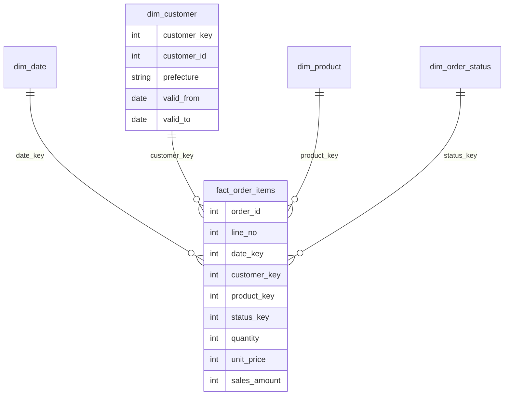

# 第8章 データモデリング

## この章でできるようになること

- 業務の質問から、ファクトとディメンションを決める手順を踏める。
- ファクトの粒度を先に宣言し、粒度が曖昧なときに何が壊れるかを説明できる。
- ねぼすけ商店の注文データから、DuckDB でスタースキーマを作り、元データと売上が一致することを確かめられる。
- 代理キー・適合ディメンション・日付ディメンションの役割を言える。
- SCD タイプ 1 とタイプ 2 を実装し、「当時の値」と「今の値」の集計を使い分けられる。
- ファクトの基本の 3 種類（トランザクション・定期スナップショット・累積スナップショット）と、ワイドテーブルとの比較を説明できる。

## モデルとは何か、なぜ要るのか

データモデリングは、データをどんな表に分けて持つかを設計することです。第7章の正規化は、アプリが正しく書き込むためのモデルでした。この章は、分析する人が正しく速く読むためのモデルです。

ここで使う考え方の多くは、Ralph Kimball らが体系化したディメンショナルモデリングです。出典は『The Data Warehouse Toolkit』（参考文献 1）と、Kimball Group が公開している技法の一覧（参考文献 2）です。Fundamentals of Data Engineering の第8章も、この手法をモデリングの代表的な選択肢として紹介しています（参考文献 3）。ほかに Inmon の手法や Data Vault などもあり、この章では、代表的な手法である Kimball の流れを扱います。

モデルがないと、質問のたびに分析者がソースの表を結合し直します。結合の書き方が人によって違えば、「売上」の数字も違ってきます。モデルは、結合と定義を一度だけデータエンジニアが決めて、全員が同じ数字を見られるようにするものです。

## 業務の質問から作る 4 つの手順

モデルは、表の形からではなく、業務の質問から作ります。Kimball の 4 つの手順（参考文献 2）を、店長の質問「月別・都道府県別・カテゴリ別の売上が見たい」に当てはめます。

{{ table("b08-four-steps") }}

順番が大事です。特に 2 番目の**粒度**（grain）を先に決めます。粒度は「ファクトの 1 行が何を表すか」を業務の言葉で書いた宣言です。「注文明細の 1 行」と宣言すれば、数量も単価も明細の値で持てます。「注文の 1 行」と宣言すると、1 つの注文に複数の商品があるため、商品別の集計ができなくなります。粒度を決めずに列を並べ始めると、あとで 1 行の意味が人によって違い、合計が合わなくなります。

もうひとつの注意は、ファクトの数値の**加算性**です。数量や売上金額は、どの軸で足しても意味があります（加算できる）。単価は、足すと意味がありません。平均を取るか、売上金額を数量で割ります。このように足せない値は、ファクトに置いても集計では扱いを決めておきます。

## ファクトとディメンション

ファクトは、業務で起きた出来事の測定値の表です。注文明細なら、数量・単価・売上金額です。ディメンションは、その出来事を切る軸の表で、「誰が」（顧客）、「何を」（商品）、「いつ」（日付）といった説明の属性を持ちます。ファクトは行数が多く狭い表に、ディメンションは多くの場合、行数が少なく広い表になります。

ファクトが中央にあり、ディメンションが周りを囲む形が、星に似ているのでスタースキーマと呼ばれます。ファクトは、ディメンションを指す外部キーと、測定値を持ちます（図の線は、ディメンションの 1 行に対してファクトが多数ぶら下がることを表します）。



## ねぼすけ商店のスタースキーマを作る

`examples/b08/star_schema.py` が、第1章から使うデータをもとに、DuckDB の中でスタースキーマを作ります。動かすのは Docker 内でも WSL でも構いません（`duckdb` と `pyarrow` が入った環境で、リポジトリのルートから実行します）。

```bash
cd examples/b08
python star_schema.py
```

この章の SQL は DuckDB で動かします。DuckDB 独自の書き方が混ざるので、PostgreSQL での書き方と並べておきます（変わりやすい点なので、手元の版のドキュメントで確かめてください）。

{{ table("b08-duckdb-vs-pg") }}

### 日付ディメンション

日付ディメンションは、1 日 1 行の表です。年・月・曜日・週末かどうか、といった日付の属性を前もって持たせておきます。ファクトの側は、日付そのものではなく `20260301` のような整数のキー（date_key）で指します。

```sql
CREATE OR REPLACE TABLE dim_date AS
SELECT strftime(d, '%Y%m%d')::INTEGER AS date_key,
       d::DATE AS date,
       year(d) AS year,
       month(d) AS month,
       strftime(d, '%Y-%m') AS year_month,
       isodow(d) AS iso_weekday,
       isodow(d) >= 6 AS is_weekend
FROM range(DATE '2026-01-01', DATE '2027-01-01', INTERVAL 1 DAY) AS t(d);
INSERT INTO dim_date VALUES (99991231, DATE '9999-12-31', 9999, 12, '9999-12', 0, false)
```

DuckDB の `range(開始, 終了, INTERVAL 1 DAY)` で日付を生成しています。PostgreSQL では `generate_series` を使います。`isodow` は月曜が 1、日曜が 7 の曜日番号です。

日付ディメンションを独立させる理由は、SQL の関数では書きにくい情報を持たせられることです。祝日、会計年度、「月末日かどうか」、セール期間などです。それらを一度表に入れておけば、BI ツール（データを表やグラフにして見せる道具。第1章）で「祝日の売上」を、結合だけで切れます。`date_key` を `20260301` のような整数にするのは、並べ替えが日付順になり、パーティション（第11章）のキーにも使いやすく、結合が整数どうしで済むためです。最後の 1 行（9999-12-31）は、後で使う「まだ起きていない」を表す特別な行です。

### 商品と注文状態のディメンション

```sql
CREATE OR REPLACE TABLE dim_product AS
SELECT row_number() OVER (ORDER BY product_id)::INTEGER AS product_key,
       product_id, name, category
FROM products
```

```sql
CREATE OR REPLACE TABLE dim_order_status AS
SELECT row_number() OVER (ORDER BY status)::INTEGER AS status_key,
       status, status <> 'cancelled' AS is_sales
FROM (SELECT DISTINCT lower(status) AS status FROM orders)
```

`dim_order_status` は、第1章の `SHIPPED` の表記ゆれを `lower()` でそろえる場所でもあります。「売上に数える状態か」を `is_sales` という属性にしておけば、売上の定義（キャンセルを除く）がモデルの中に 1 度だけ書かれ、集計する人が `WHERE status <> 'cancelled'` を書き忘れずに済みます。

### 顧客ディメンション

顧客は、後で履歴を持たせるので、版を表す列（`valid_from`、`valid_to`、`is_current`）を最初から持たせます。

```sql
CREATE OR REPLACE SEQUENCE customer_key_seq START 1;
CREATE OR REPLACE TABLE dim_customer (
    customer_key INTEGER, customer_id INTEGER, name VARCHAR, email VARCHAR, prefecture VARCHAR,
    valid_from DATE, valid_to DATE, is_current BOOLEAN);
INSERT INTO dim_customer VALUES (-1, -1, '不明', NULL, '不明', DATE '1900-01-01', DATE '9999-12-31', true);
INSERT INTO dim_customer
SELECT nextval('customer_key_seq'), customer_id, name, email, prefecture,
       CAST(registered_at AS TIMESTAMP)::DATE, DATE '9999-12-31', true
FROM customers ORDER BY customer_id
```

`valid_to` の `9999-12-31` は「今も有効」を表す約束の値です。`customer_key` が代理キーで、`customer_id` が業務システムの番号（自然キー）です。先頭の `-1` の行は、次の節で説明する「不明」の行です。

### ファクト

粒度「注文明細の 1 行」を宣言し、ディメンションのキーと測定値を並べます。

```sql
CREATE OR REPLACE TABLE fact_order_items AS
SELECT i.order_id, i.line_no,
       d.date_key,
       COALESCE(c.customer_key, -1) AS customer_key,
       p.product_key,
       s.status_key,
       i.quantity,
       i.unit_price,
       i.quantity * i.unit_price AS sales_amount
FROM order_items AS i
JOIN orders AS o USING (order_id)
JOIN dim_date AS d ON d.date = CAST(o.ordered_at AS TIMESTAMP)::DATE
LEFT JOIN dim_customer AS c ON c.customer_id = o.customer_id
     AND CAST(o.ordered_at AS TIMESTAMP)::DATE >= c.valid_from
     AND CAST(o.ordered_at AS TIMESTAMP)::DATE < c.valid_to
JOIN dim_product AS p ON p.product_id = i.product_id
JOIN dim_order_status AS s ON s.status = lower(o.status)
```

`order_id` と `line_no` はディメンションを持たない識別子で、退化ディメンション（degenerate dimension）と呼びます。顧客は、注文した日にその顧客が持っていた版の代理キーを引きます（`valid_from` 以上、`valid_to` 未満）。`LEFT JOIN` と `COALESCE(..., -1)` で、対応するディメンションの行がない場合も、行を落とさず「不明」にします。

### 業務の質問に答える

```sql
SELECT d.year_month, c.prefecture, p.category, sum(f.sales_amount) AS sales
FROM fact_order_items AS f
JOIN dim_date AS d USING (date_key)
JOIN dim_customer AS c USING (customer_key)
JOIN dim_product AS p USING (product_key)
JOIN dim_order_status AS s USING (status_key)
WHERE s.is_sales
GROUP BY 1, 2, 3
ORDER BY 1, 2, 3
```

先頭の数行を出力すると次のとおりです。

```text
[('2026-01', '京都', '寝具', 22000), ('2026-01', '京都', '朝食', 73750), ('2026-01', '京都', '目覚まし', 37350)]
```

質問に答える SQL は、結合してグループ化するだけの定型になりました。大事なのは、この数字が元のデータと合うことの確認です。`test_b08_modeling.py` は、スタースキーマの売上の合計（34,321,900 円）が、元の明細から `lower(status) <> 'cancelled'` で直接計算した値と等しいこと、ファクトの行数が明細の行数と同じ 7,469 であることを確かめます。第1章のキャンセル除外の売上と同じ値です。モデルを作ったら、元のデータとの突き合わせを必ずテストにします。

## モデルを検証する

モデルは、作った直後と、毎回の取り込みのあとに、3 つを確かめます。(1) 孤児：ファクトのキーが指すディメンションの行が、実在するか。(2) 粒度：宣言した粒度（`order_id` と `line_no` の組）が、本当に一意か。(3) 「不明」の割合：不明の行を指しているファクトが、どれだけあるか。

```sql
SELECT (SELECT count(*) FROM fact_order_items WHERE date_key NOT IN (SELECT date_key FROM dim_date)) AS date_orphans,
       (SELECT count(*) FROM fact_order_items WHERE customer_key NOT IN (SELECT customer_key FROM dim_customer)) AS customer_orphans,
       (SELECT count(*) FROM fact_order_items WHERE product_key NOT IN (SELECT product_key FROM dim_product)) AS product_orphans,
       (SELECT count(*) FROM fact_order_items WHERE status_key NOT IN (SELECT status_key FROM dim_order_status)) AS status_orphans
```

```sql
SELECT count(*) AS rows, count(DISTINCT (order_id, line_no)) AS distinct_grain FROM fact_order_items
```

```sql
SELECT count(*) FILTER (WHERE customer_key = -1) AS unknown_rows, count(*) AS rows FROM fact_order_items
```

```text
(0, 0, 0, 0)
(7469, 7469)
(0, 7469)
```

孤児は 4 つとも 0、行数と一意な粒度の数は同じ 7,469、不明は 0 件です。どれも、0 や一致が正常で、ずれたら取り込みを止めて調べます。こうした確認を毎回自動で回す方法は、第13章で扱います。

## 代理キーと「不明」の行

**代理キー**は、データウェアハウスの中だけで振る、意味のない連番のキーです。業務システムの番号（自然キー）をそのまま使わない理由は 3 つあります。

- 履歴を持つため。次の節の SCD タイプ 2 では、同じ顧客に複数の版が必要で、版ごとに別のキーが要ります。
- 業務システムが番号を付け替えたり、別のシステムの番号と衝突したりしても、影響を受けないため。
- 結合が整数どうしになり、列が小さくなるため。

もうひとつ、ディメンションに「不明」の行（キー -1）を置きます。対応する顧客がファクトの時点で見つからないとき、外部キーを NULL にすると、内部結合で行が黙って落ちて、売上の合計が減ります。「不明」の行を指しておけば、数字は合ったまま、「不明の分がいくらあるか」を見られます。累積スナップショットで使う `99991231` の日付も、同じ考え方です。

## スノーフレーク

商品ディメンションの `category` を、さらに別の表（`dim_category`）に出すと、スノーフレークスキーマ（雪の結晶のように枝分かれする形）になります。ディメンションの中でも第3正規形を保つやり方です。

```sql
CREATE OR REPLACE TABLE dim_category AS
SELECT row_number() OVER (ORDER BY category)::INTEGER AS category_key, category
FROM (SELECT DISTINCT category FROM dim_product);
CREATE OR REPLACE TABLE dim_product_sf AS
SELECT p.product_key, p.product_id, p.name, c.category_key
FROM dim_product AS p JOIN dim_category AS c USING (category)
```

カテゴリ別の売上を出すのに、結合が 1 つ増えます。

```sql
SELECT c.category, sum(f.sales_amount) AS sales
FROM fact_order_items AS f
JOIN dim_product_sf AS p USING (product_key)
JOIN dim_category AS c USING (category_key)
JOIN dim_order_status AS s USING (status_key)
WHERE s.is_sales
GROUP BY 1
ORDER BY 1
```

結果は、`dim_product` に直接 `category` を持つスターの結果と一致します（テストで確かめています）。ただ、ディメンションは数千〜数万行と小さいことが多く、重複の削減による節約は少ないのに、結合が増えて SQL は読みにくくなります。そのため、基本はスターにして、スノーフレークは、ディメンションが非常に大きく、属性が頻繁に更新されるといった理由があるときに選びます。

## SCD: ゆっくり変わるディメンション

顧客は引っ越し、商品は名前や価格が変わります。ディメンションの属性が変わったとき、過去のファクトをどう見せるか、という問題が SCD（Slowly Changing Dimension）です。Kimball は、いくつかのタイプに整理しています（参考文献 2）。

{{ table("b08-scd-types") }}

### タイプ 1: 上書き

商品名の入力ミスを直すなら、履歴はいりません。そのまま上書きします。

```sql
UPDATE dim_product SET name = '枕(標準・改良版)'
WHERE product_id = 1
```

過去の注文も、新しい名前で見えるようになります。簡単ですが、一度上書きすると元の値には戻れません。「先月のレポートの数字が、今日見ると変わっている」ことが起きるので、それが許されるかどうかを先に確認します。

### タイプ 2: 版を足す

顧客が引っ越したときに、引っ越し前の注文は旧住所の都道府県で集計したい、という要件はよくあります。タイプ 2 は、属性が変わったら行を書き換えず、新しい行（新しい代理キー）を足します。各行は、有効な期間 `[valid_from, valid_to)`（`valid_from` を含み、`valid_to` は含まない半開区間）を持ち、今の版は `is_current` が真です。

処理は 4 つの SQL です。デモでは、`customers_today`（今日の顧客マスタ）を、顧客 3 人の都道府県だけ変えた `customers` のコピーとして作ります。`?` は DuckDB のパラメータで、値は Python から渡します（`.py から動かす` 前提の SQL です）。

```sql
CREATE OR REPLACE TABLE customers_today AS
SELECT customer_id, name, email,
       CASE WHEN customer_id IN (SELECT unnest(?)) THEN
            CASE WHEN prefecture = '沖縄' THEN '北海道' ELSE '沖縄' END
            ELSE prefecture END AS prefecture
FROM customers
```

1 つ目の SQL で、今日のマスタと今のディメンションを比べ、変わった顧客を見つけます。

```sql
CREATE OR REPLACE TEMP TABLE scd2_changes AS
SELECT t.customer_id, t.name, t.email, t.prefecture
FROM customers_today AS t
JOIN dim_customer AS c ON c.customer_id = t.customer_id AND c.is_current
WHERE c.name IS DISTINCT FROM t.name
   OR c.email IS DISTINCT FROM t.email
   OR c.prefecture IS DISTINCT FROM t.prefecture
```

`IS DISTINCT FROM` は、NULL どうしを「同じ」と扱う比較です。`<>` では、メールアドレスが NULL の顧客が毎回「変わった」と判定されてしまいます。次に、変わった顧客の現行の行を閉じて、新しい版の行を足します。

```sql
UPDATE dim_customer SET valid_to = ?, is_current = false
WHERE is_current AND customer_id IN (SELECT customer_id FROM scd2_changes)
```

```sql
INSERT INTO dim_customer
SELECT nextval('customer_key_seq'), customer_id, name, email, prefecture, ?, DATE '9999-12-31', true
FROM scd2_changes
```

4 つ目は、まだディメンションに無い新規の顧客を足す SQL です。

```sql
INSERT INTO dim_customer
SELECT nextval('customer_key_seq'), t.customer_id, t.name, t.email, t.prefecture, ?, DATE '9999-12-31', true
FROM customers_today AS t
WHERE t.customer_id NOT IN (SELECT customer_id FROM dim_customer)
```

4 つを 1 つのトランザクションにまとめたのが次の関数です。途中で失敗しても、行を閉じただけで新しい版がない、という状態を残さないよう、例外が出たら `ROLLBACK` して、例外はそのまま上へ渡します。

```python
def apply_scd2(con: duckdb.DuckDBPyConnection, as_of: date) -> int:
    """customers_today を取り込み、変更を履歴の行として残す。変更のあった顧客の数を返す。

    全体を 1 つのトランザクションにして、どこで失敗しても ROLLBACK する（行を閉じただけの状態を残さない）。
    """
    con.execute("BEGIN")
    try:
        null_ids, duplicate_ids = con.execute(SOURCE_PROBLEMS_SQL).fetchone()
        if null_ids or duplicate_ids:
            raise ValueError(f"customers_today に NULL の ID が {null_ids} 件、重複した ID が {duplicate_ids} 件あります")
        con.execute(FIND_CHANGES_SQL)
        if con.execute(STALE_AS_OF_SQL, [as_of]).fetchone()[0]:
            raise ValueError("as_of が、現在の版の valid_from より前（または同じ）です")
        changed = con.execute("SELECT count(*) FROM scd2_changes").fetchone()[0]
        con.execute(CLOSE_OLD_SQL, [as_of])
        con.execute(OPEN_NEW_SQL, [as_of])
        con.execute(ADD_NEW_CUSTOMERS_SQL, [as_of])
        con.execute("COMMIT")
    except Exception:
        con.execute("ROLLBACK")
        raise
    return changed
```

`run_scd2_demo` は、4 月 1 日に顧客 3 人が沖縄へ引っ越したとして、この関数を動かします（顧客は、その日の前後に注文がある人から選んでいます）。出力は次のとおりです。

```text
movers [1, 6, 7]
changed 3
changed_again 0
history [(1, '愛知', datetime.date(2026, 3, 20), datetime.date(2026, 4, 1), False), (1, '沖縄', datetime.date(2026, 4, 1), datetime.date(9999, 12, 31), True)]
```

顧客 1 の履歴の前後を表にすると、次のとおりです（表は `write_history_csv` が実行結果から書いた CSV です）。

{{ table("b08-scd2-history") }}

変更前は 1 行で、変更後は愛知の版が 4 月 1 日で閉じ、新しい代理キー 506 の沖縄の版が今も有効です。同じ入力でもう一度流した `changed_again` が 0 なのは、再実行しても履歴が増えないという意味で、冪等になっているということです。バッチは失敗して再実行されるものなので、この性質は大事です（第12章）。

ファクトを付け直したあとで、3 人の売上を 2 通りに集計します。

```sql
SELECT c.prefecture, sum(f.sales_amount)
FROM fact_order_items AS f JOIN dim_customer AS c USING (customer_key)
WHERE c.customer_id IN (SELECT unnest(?)) GROUP BY 1 ORDER BY 1
```

```sql
SELECT cur.prefecture, sum(f.sales_amount)
FROM fact_order_items AS f
JOIN dim_customer AS c USING (customer_key)
JOIN dim_customer AS cur ON cur.customer_id = c.customer_id AND cur.is_current
WHERE c.customer_id IN (SELECT unnest(?)) GROUP BY 1 ORDER BY 1
```

```text
as_was [('宮城', 8700), ('愛知', 12750), ('沖縄', 52000), ('石川', 104400)]
as_is [('沖縄', 177850)]
```

前者は注文した時点の都道府県（as-was）で、引っ越し前の売上は元の県に残ります。後者は今の都道府県（as-is）で、全額が沖縄になります。合計は同じ 177,850 円ですが、見せる軸が違います。どちらが正しいかは、業務の質問で決まります。「当時の地域別の売上」なら as-was、「今の顧客の居住地ごとの購入額」なら as-is です。タイプ 2 は両方を同じデータから出せます。

実装の注意をいくつか挙げます。

- **ファクトを読み込む時点の版を引く**。日次の取り込みなら、その日の現行版の代理キーを入れます。上のデモは履歴を作ってから付け直しています。
- **遅れて届く情報**。この章のデータで、行動ログの一部は顧客の登録日より前の時刻を持ち、`valid_from` の外に出るため `-1`（不明）になります（`fact_events`）。これが、不明の行が必要な実例です。
- **MERGE 文**。PostgreSQL 15 以降（参考文献 5）や、DuckDB 2.0.0（この本の環境で、MERGE が動くことを確かめました。参考文献 4）などには、1 つの文で更新と挿入をする `MERGE` があります。タイプ 2 では、変わった行を「閉じる」と「新しい版を足す」の両方が必要なので、1 回の MERGE では書きにくく、この章は UPDATE と INSERT の 2 本にしています。
- **履歴の保存先の増加**。属性が頻繁に変わるディメンションにタイプ 2 を使うと、行が際限なく増えます。変わりやすい属性は別のミニディメンションに分ける手法（タイプ 4）もあります（参考文献 2）。

### SCD2 の落とし穴と確認クエリ

タイプ 2 は、黙って壊れる場所が 5 つあります。それぞれ、拒否するか確認クエリで見つけます。どの確認も「0 行」が正常です。

1. **ソースの `customer_id` が NULL や重複している。** 同じ顧客の変更が 2 行になり、現行の行が 2 つできます。`apply_scd2` は、取り込む前にこの SQL で確かめ、問題があれば例外にします。

```sql
SELECT count(*) - count(customer_id) AS null_ids,
       count(customer_id) - count(DISTINCT customer_id) AS duplicate_ids
FROM customers_today
```

2. **`as_of` が、現在の版の `valid_from` より前（または同じ）。** 区間が空や逆転になります。変わる顧客についてだけ、次の SQL で数えて、1 件でもあれば拒否します。同じ日に 2 回変わる属性は、この章の作りでは扱えません。

```sql
SELECT count(*) FROM dim_customer
WHERE is_current AND valid_from >= ? AND customer_id IN (SELECT customer_id FROM scd2_changes)
```

3. **期間の隙間や重なり。** 顧客ごとに `valid_from` の順に並べ、次の版の `valid_from` と今の `valid_to` が違う行を探します。

```sql
SELECT customer_id, valid_from, valid_to, next_from FROM (
    SELECT customer_id, valid_from, valid_to,
           lead(valid_from) OVER (PARTITION BY customer_id ORDER BY valid_from) AS next_from
    FROM dim_customer)
WHERE next_from IS NOT NULL AND next_from <> valid_to
```

4. **現行の行が 1 つでない。**

```sql
SELECT customer_id, count(*) FILTER (WHERE is_current) AS current_rows
FROM dim_customer GROUP BY customer_id
HAVING count(*) FILTER (WHERE is_current) <> 1
```

5. **ソースから消えた顧客。** 退会かもしれませんし、ソース側の事故かもしれません。この章の関数は何もせず、次の SQL で見つけるだけにしています。履歴の行を閉じるか、そのまま残すかは、業務に確認して決めます。

```sql
WHERE t.customer_id NOT IN (SELECT customer_id FROM dim_customer)
"""


# 取り込む前の確認: ソースの customer_id が NULL や重複だと、現行の行が 2 つできてしまう。
SOURCE_PROBLEMS_SQL = """
SELECT count(*) - count(customer_id) AS null_ids,
       count(customer_id) - count(DISTINCT customer_id) AS duplicate_ids
FROM customers_today
"""
# 変わる顧客の現行の行が、as_of と同じかそれより新しい valid_from を持つと、区間が空や逆転になる。
STALE_AS_OF_SQL = """
SELECT count(*) FROM dim_customer
WHERE is_current AND valid_from >= ? AND customer_id IN (SELECT customer_id FROM scd2_changes)
"""


def apply_scd2(con: duckdb.DuckDBPyConnection, as_of: date) -> int:
    """customers_today を取り込み、変更を履歴の行として残す。変更のあった顧客の数を返す。

    全体を 1 つのトランザクションにして、どこで失敗しても ROLLBACK する（行を閉じただけの状態を残さない）。
    """
    con.execute("BEGIN")
    try:
        null_ids, duplicate_ids = con.execute(SOURCE_PROBLEMS_SQL).fetchone()
        if null_ids or duplicate_ids:
            raise ValueError(f"customers_today に NULL の ID が {null_ids} 件、重複した ID が {duplicate_ids} 件あります")
        con.execute(FIND_CHANGES_SQL)
        if con.execute(STALE_AS_OF_SQL, [as_of]).fetchone()[0]:
            raise ValueError("as_of が、現在の版の valid_from より前（または同じ）です")
        changed = con.execute("SELECT count(*) FROM scd2_changes").fetchone()[0]
        con.execute(CLOSE_OLD_SQL, [as_of])
        con.execute(OPEN_NEW_SQL, [as_of])
        con.execute(ADD_NEW_CUSTOMERS_SQL, [as_of])
        con.execute("COMMIT")
    except Exception:
        con.execute("ROLLBACK")
        raise
    return changed


# 取り込んだあとの確認クエリ。どれも「0 行」が正常。
GAPS_OR_OVERLAPS_SQL = """
SELECT customer_id, valid_from, valid_to, next_from FROM (
    SELECT customer_id, valid_from, valid_to,
           lead(valid_from) OVER (PARTITION BY customer_id ORDER BY valid_from) AS next_from
    FROM dim_customer)
WHERE next_from IS NOT NULL AND next_from <> valid_to
"""
BAD_CURRENT_SQL = """
SELECT customer_id, count(*) FILTER (WHERE is_current) AS current_rows
FROM dim_customer GROUP BY customer_id
HAVING count(*) FILTER (WHERE is_current) <> 1
"""
# ソースから消えた顧客。この章の apply_scd2 は何もしない（消すか閉じるかは業務に聞いて決める）。
VANISHED_SQL = """
SELECT customer_id FROM dim_customer
WHERE is_current AND customer_id > 0
  AND customer_id NOT IN (SELECT customer_id FROM customers_today WHERE customer_id IS NOT NULL)
```

`test_b08_modeling.py` は、重複や NULL の入力を `ValueError` で拒否すること、途中で失敗しても `dim_customer` が元のままで、そのままやり直せること、壊した行を確認クエリが見つけることを確かめています。

## ファクトの基本の 3 種類

ファクトの行が何を表すかによって、基本の 3 種類があります（参考文献 2。出来事の記録だけを持つ factless（数値の無い）ファクトなど、ほかの種類もあります）。

{{ table("b08-fact-types") }}

`fact_order_items` はトランザクションファクトです。出来事が起きたら 1 行足し、更新しません。

### 定期スナップショット

「月末時点の、顧客ごとの累計購入額」のように、出来事ではなく、ある時点の状態を決まった間隔で残すのが定期スナップショットです。出来事の合計から後で計算もできますが、毎回全履歴を集計すると重く、また在庫や残高のように、出来事の記録から再構成しにくいものでは、状態を直接残します。売上の無い顧客にも毎月の行を作るのが特徴です。

```sql
CREATE OR REPLACE TABLE fact_customer_month_snapshot AS
WITH month_ends AS (
    SELECT date_key, date FROM dim_date
    WHERE date = last_day(date) AND date <= (SELECT max(d.date) FROM fact_order_items AS f
                                              JOIN dim_date AS d USING (date_key))
),
sales AS (
    SELECT c.customer_id, d.date, f.sales_amount
    FROM fact_order_items AS f
    JOIN dim_customer AS c USING (customer_key)
    JOIN dim_date AS d USING (date_key)
    JOIN dim_order_status AS s USING (status_key)
    WHERE s.is_sales
)
SELECT m.date_key AS snapshot_date_key, c.customer_id,
       COALESCE(sum(s.sales_amount), 0) AS cumulative_sales
FROM month_ends AS m
CROSS JOIN (SELECT DISTINCT customer_id FROM dim_customer WHERE customer_id > 0) AS c
LEFT JOIN sales AS s ON s.customer_id = c.customer_id AND s.date <= m.date
GROUP BY m.date_key, c.customer_id
```

テストでは、月ごとの行数がどの月も顧客数（505）と等しいこと、累計が減らないことを確かめています。残高のような値は、日付の軸で足すと意味を失います（月末の残高を 1 か月分足しても「年間の残高」にはなりません）。このような値を半加算と呼び、日付の軸では平均や期末の値を使います。

### 累積スナップショット

注文は、受付・出荷・配達と進みます。その流れ全体を 1 行で持ち、節目が来るたびに同じ行を更新するのが累積スナップショットです。まだ起きていない節目は、NULL ではなく、先ほどの日付ディメンションの `99991231` を指します。

```sql
CREATE OR REPLACE TABLE fact_order_fulfillment (
    order_id INTEGER, placed_date_key INTEGER,
    shipped_date_key INTEGER DEFAULT 99991231, delivered_date_key INTEGER DEFAULT 99991231,
    days_to_ship INTEGER, days_to_deliver INTEGER)
```

```sql
UPDATE fact_order_fulfillment AS f
SET shipped_date_key = ?,
    days_to_ship = (SELECT date_diff('day', p.date, s.date) FROM dim_date AS p, dim_date AS s
                    WHERE p.date_key = f.placed_date_key AND s.date_key = ?)
WHERE order_id = ?
```

注文 1001 を受け付け、出荷し、配達する間の同じ 1 行は、次のように変わります（`fulfillment_demo` の出力）。

```text
[(1001, 20260301, 99991231, 99991231, None, None)]
[(1001, 20260301, 20260302, 99991231, 1, None)]
[(1001, 20260301, 20260302, 20260305, 1, 4)]
```

出荷までの日数や配達までの日数は、節目と節目の差としてファクトの中に持ちます。「受付から出荷まで平均何日か」が、1 行の列の平均で答えられます。

## ディメンションの設計パターン

**ロールプレイングディメンション。** 1 つのファクトが、同じ種類の軸を何度も使うことがあります。累積スナップショットの受付日・出荷日・配達日は、どれも日付です。日付ディメンションを 3 つ作らず、同じ `dim_date` を 3 つの役割で結合します（SQL では別名を 3 つ付けます）。

```sql
SELECT f.order_id, placed.date AS placed_on, shipped.date AS shipped_on, delivered.date AS delivered_on
FROM fact_order_fulfillment AS f
JOIN dim_date AS placed ON placed.date_key = f.placed_date_key
JOIN dim_date AS shipped ON shipped.date_key = f.shipped_date_key
JOIN dim_date AS delivered ON delivered.date_key = f.delivered_date_key
```

```text
[(1001, datetime.date(2026, 3, 1), datetime.date(2026, 3, 2), datetime.date(2026, 3, 5))]
```

**ジャンクディメンション。** 支払い方法やギフトかどうかのように、値の種類が少ないフラグが何個もあるとき、ファクトに列を並べず、組み合わせを 1 つの小さな表にまとめます。ファクトの列は 1 本のキーで済みます。次の例の `is_gift` と `payment_method` は、ねぼすけ商店のデータには無い、説明用の仮の列です。

```sql
CREATE OR REPLACE TABLE dim_order_flags AS
SELECT row_number() OVER (ORDER BY payment_method, is_gift)::INTEGER AS flags_key, payment_method, is_gift
FROM (VALUES ('card'), ('cod'), ('bank')) AS p(payment_method)
CROSS JOIN (VALUES (true), (false)) AS g(is_gift)
```

3 種類の支払い方法と 2 通りのギフトで、組み合わせは 6 行です。

## 適合ディメンションとバスマトリクス

複数のファクトが、同じ意味のディメンションを共有することを、適合ディメンション（conformed dimension）と呼びます。注文のファクトと行動ログのファクトが、同じ `dim_date` と `dim_customer` を指していれば、2 つの数字を同じ軸（月・都道府県）で並べられます。どのファクトがどのディメンションを共有しているかの表を、バスマトリクスと呼びます（参考文献 2）。

{{ table("b08-bus-matrix") }}

行動ログのファクトは、次のように作ります。`events` には完全に重複した行が 40 件あるので、`DISTINCT` で除いています。

```sql
CREATE OR REPLACE TABLE fact_events AS
SELECT d.date_key, COALESCE(c.customer_key, -1) AS customer_key, e.event_type, count(*) AS events
FROM (SELECT DISTINCT * FROM events) AS e
JOIN dim_date AS d ON d.date = CAST(e.event_time AS TIMESTAMP)::DATE
LEFT JOIN dim_customer AS c ON c.customer_id = e.customer_id
     AND CAST(e.event_time AS TIMESTAMP)::DATE >= c.valid_from
     AND CAST(e.event_time AS TIMESTAMP)::DATE < c.valid_to
GROUP BY ALL
```

（`GROUP BY ALL` は DuckDB の書き方で、SELECT の集計されていない列すべてでグループ化します。他の製品では列を書き並べます。）ファクトを並べるときは、**ファクトごとに先に同じ粒度へ集計して**から結合します。

```sql
WITH s AS (
    SELECT d.year_month, c.prefecture, sum(f.sales_amount) AS sales
    FROM fact_order_items AS f
    JOIN dim_date AS d USING (date_key) JOIN dim_customer AS c USING (customer_key)
    JOIN dim_order_status AS st USING (status_key)
    WHERE st.is_sales GROUP BY 1, 2),
v AS (
    SELECT d.year_month, c.prefecture, sum(e.events) AS views
    FROM fact_events AS e
    JOIN dim_date AS d USING (date_key) JOIN dim_customer AS c USING (customer_key)
    WHERE e.event_type = 'view' GROUP BY 1, 2)
SELECT year_month, prefecture, s.sales, v.views
FROM s FULL JOIN v USING (year_month, prefecture)
ORDER BY 1, 2
```

出力の先頭は次のとおりです。

```text
[('2026-01', '不明', None, 272), ('2026-01', '京都', 201650, 12), ('2026-01', '北海道', 135800, 2)]
```

1 行目の都道府県が「不明」の行は、売上が無く（`None`）、ビューが 272 件あります。行動ログには、顧客の登録日より前の時刻のイベントがあり、その時点の顧客の版が存在しないため、`-1`（不明）に入ったためです。4,000 件のうち 972 件（約 24%）がそうでした。「不明」の行があるおかげで、行を落とさずに、問題の大きさが数字で見えます。現実の事業では、登録前の匿名アクセスをひも付ける方法を決めるか、不明のまま持つかを、業務と相談します。これをドリルアクロスと呼びます。一方、粒度の違うファクトを直接結合すると、行が掛け算になります。

```sql
SELECT sum(f.sales_amount)
FROM fact_order_items AS f
JOIN dim_order_status AS st USING (status_key)
JOIN fact_events AS e ON e.customer_key = f.customer_key
WHERE st.is_sales
```

本当の売上の合計は 34,321,900 円なのに、この結合は 208,411,000 円を返します（`python fact_types.py` の出力。顧客ごとに、注文明細の行と行動ログの行が組み合わさるため）。エラーは出ないので、気づきにくい誤りです。

## ワイドテーブル（OBT）との比較

ファクトとディメンションを全部結合して、1 枚の幅広い表（One Big Table、OBT）にしてしまう方法もあります。

```sql
CREATE OR REPLACE TABLE obt_order_items AS
SELECT f.order_id, f.line_no, d.date, d.year_month, d.is_weekend,
       c.customer_id, c.prefecture, p.name AS product_name, p.category,
       s.status, s.is_sales, f.quantity, f.unit_price, f.sales_amount
FROM fact_order_items AS f
JOIN dim_date AS d USING (date_key)
JOIN dim_customer AS c USING (customer_key)
JOIN dim_product AS p USING (product_key)
JOIN dim_order_status AS s USING (status_key)
```

{{ table("b08-model-shapes") }}

OBT は、結合が要らず、列指向の製品では不要な列を読まないので、ディメンションの値があまり変わらないときは速く、使う人にも分かりやすい形です。一方で、ディメンションの値が行ごとに重複し、ディメンションの変更を反映するたびに表全体を作り直す必要があります。複数のファクトを一つの表に混ぜる（粒度が混ざる）と、先のような水増しが起きます。この章のデータでは、OBT の行数もファクトと同じ 7,469 です。スターを正本にして、用途ごとに OBT を作る、という使い分けが基本です。大規模なデータでの比較は、応用編で扱います。

## 実務ではどこで作るか

この章は、ソースの表から直接ディメンションとファクトを作りました。実務では、取り込んだ生のデータ（raw）を、まず型や表記をそろえた中間の層（staging）に置き、そこからディメンションとファクトの層（marts と呼ばれることが多い層）を作ります（第10章の dbt の構成です）。ファクトは、毎回全件を作り直さず、前回以降の差分だけを足すのが普通です。ただし、遅れて届く注文や訂正があるので、「直近 N 日を作り直す」といった重なりを持たせます。ディメンションの履歴（SCD2）は、自分で書かずに、dbt の snapshot という機能に任せる選択肢があります（参考文献 6）。いずれも冪等に（再実行しても結果が同じに）作るのが前提です（第12章）。

## ほかの考え方と、モデルを作らない選択

Kimball の手法は、業務の質問から入る「下から積み上げる」やり方です。これに対し、Inmon の手法は、先に全社で正規化したデータウェアハウスを作り、そこから分析用の表を切り出します。Data Vault は、業務の実体（ハブ）、その関係（リンク）、変化する属性（サテライト）に分けて、取り込みと履歴の管理をしやすくするモデルです（参考文献 3）。どれが正しいというより、組織の大きさや、ソースの数、変更の頻度で選びます。

モデルを作らない方がよい場面もあります。データが 1 つの表で、使う人も 1 人なら、手順の多いモデリングは過剰です。使い捨ての分析も、OBT（次の節）や 1 本の SQL で十分です。モデルは、複数の人が、長く、同じ定義の数字を使うときに効きます。

## 2 つ目の業務で練習する: 在庫

注文のモデルに慣れたら、別の業務に同じ 4 つの手順を当てはめます。「どの商品が、いつ欠品しそうか」という質問なら、次のようになります。

{{ table("b08-inventory-design") }}

注文では出来事（トランザクション）を記録しましたが、在庫は「ある時点の状態」なので、定期スナップショットが合います。入荷と出荷の出来事は別のファクトにして、日付と商品のディメンションを共有（適合）させます。

## よくある失敗

**粒度を決めずに列を並べる。** 「注文」と「注文明細」の列が 1 つのファクトに混ざり、合計が二重になります。最初に 1 行の意味を一文で書きます。

**ファクトに NULL の外部キーを入れる。** 内部結合で売上が黙って減ります。「不明」の行を指します。

**足せない値を足す。** 単価、残高、割合は、合計しても意味がありません。加算性を、列の説明に書いておきます。

**SCD の種類を黙って決める。** タイプ 1 かタイプ 2 かで、過去の数字が変わります。業務の側に、どちらで見たいかを確認します。

**ファクトどうしを直接結合する。** 掛け算で水増しされます。先に同じ粒度へ集計します。

**モデルを作って、元データと突き合わせない。** 合計と行数を、元のデータと比べるテストを書きます。

## まとめ

- モデルは、業務の質問から、業務プロセス・粒度・ディメンション・ファクトの順に決める。粒度が最初。
- スタースキーマは、ファクトとディメンションの組み合わせで、質問に定型の結合で答えられる。
- 代理キーは履歴と独立性のため。「不明」の行で、欠けても行を落とさない。
- SCD タイプ 1 は上書き、タイプ 2 は版を足す。タイプ 2 なら「当時」と「今」の両方で集計できる。再実行しても履歴が増えないようにする。
- ファクトには、トランザクション・定期スナップショット・累積スナップショットがある。ファクトを並べるときは、先に同じ粒度へ集計する。
- OBT は読む用途に速いが、重複と更新の手間がある。スターを正本にして、用途ごとに作る。

## 練習問題

**問1.** 店長から「配送の遅れを見たい。受付から配達までの日数を、地域別・配送業者別に月ごとに見たい」と頼まれました。4 つの手順に沿って、配送のファクトの粒度・ディメンション・指標を設計してください。

??? note "解答例"
    業務プロセスは「注文の配送」です。粒度は「注文 1 件につき 1 行」で、節目（受付・出荷・配達）が来るたびに更新する累積スナップショットにします。ディメンションは、日付（受付日・出荷日・配達日の 3 つの役割）、顧客（地域は顧客の都道府県）、配送業者です。配送業者は、ねぼすけ商店のデータには無いので、新しく `dim_carrier` を作る必要があります。指標は、出荷までの日数、配達までの日数（どちらも節目の差）です。足せない値なので、集計は平均や最大で取ります。まだ起きていない節目は、`99991231` の日付キーを指します。

**問2.** （手を動かす）`scd.py` の `run_scd2_demo` を実行したあと、顧客 1 の注文を、版ごとに数えてください。どの `customer_key` に、何件の注文がひも付いていますか。

??? note "解答例"
    `ORDERS_BY_VERSION_SQL`（`fact_order_items` と `dim_customer` を `customer_key` で結合し、`customer_id = 1` を `customer_key` ごとに数える SQL）の結果は、`[(1, '愛知', 1), (506, '沖縄', 3)]` です。引っ越し前の注文 1 件は愛知の版（代理キー 1）、引っ越し後の注文 3 件は沖縄の版（代理キー 506）にひも付いています。キーが 2 種類出ることが、ファクトが「当時の版」を指している証拠です。

**問3.** （手を動かす）変わった顧客 1 人分の SCD2 を、自分で確かめてください。`customers_today` を作ったあと、1 人だけ都道府県を変えて `apply_scd2` を 2 回続けて呼ぶと、戻り値と `dim_customer` の行数はどうなりますか。

??? note "解答例"
    `star_schema.build_star(con)` のあと、`customers_today` を `customers` のコピーとして作り、顧客 1 の `prefecture` だけを `UPDATE` で変えます。1 回目の `apply_scd2(con, date(2026, 4, 1))` は 1 を返し、顧客 1 の行は 1 行から 2 行（旧版は `is_current` が偽）になります。2 回目は 0 を返し、行数は増えません。変更を見つける SQL が、現行の行と比べているためで、再実行しても履歴が増えない（冪等）という性質です。

**問4.** 月別の売上と行動ログのビュー数を、1 つの SQL で並べたいと言われました。`fact_order_items` と `fact_events` を `customer_key` で直接結合する SQL を書く前に、何を確かめますか。

??? note "解答例"
    2 つのファクトの粒度が違う（明細の 1 行と、イベント種類ごとの 1 行）ので、直接結合すると行が掛け算になり、売上が水増しされます。本文のとおり、合計が 34,321,900 円から 208,411,000 円に増えます。先にそれぞれを月と都道府県の粒度に集計してから、`dim_date` と `dim_customer` の共通のキーで結合します。

**問5.** 商品の価格を `dim_product` に持たせて、タイプ 1 で上書きしたとします。過去の売上金額はどうなりますか。`fact_order_items` の設計はどう守っていますか。

??? note "解答例"
    ファクトの `unit_price` と `sales_amount` は、注文した時点の値を持っているので、ディメンションの価格を上書きしても過去の売上金額は変わりません。ディメンションの価格は「今の定価」の属性です。売上の金額は、ファクトに持たせるのが原則です。

## 参考文献

1. Ralph Kimball, Margy Ross. *The Data Warehouse Toolkit: The Definitive Guide to Dimensional Modeling*, 3rd Edition. Wiley, 2013.
2. Kimball Group. "Dimensional Modeling Techniques". <https://www.kimballgroup.com/data-warehouse-business-intelligence-resources/kimball-techniques/dimensional-modeling-techniques/>（4 つの手順、粒度、代理キー、SCD のタイプ、ファクトの種類、適合ディメンション、バスマトリクス）
3. Joe Reis, Matt Housley. *Fundamentals of Data Engineering*. O'Reilly Media, 2022. 第 8 章 (Queries, Modeling, and Transformation)。
4. DuckDB Documentation. "MERGE INTO Statement". <https://duckdb.org/docs/stable/sql/statements/merge_into>
5. PostgreSQL Documentation. "MERGE". <https://www.postgresql.org/docs/current/sql-merge.html>
6. dbt Documentation. "Snapshots". <https://docs.getdbt.com/docs/build/snapshots>

!!! tip "さらに深く"
    大規模なデータでのモデリング（ワイドテーブルとの使い分けを含む）は、応用編 第6章「大規模モデリング」で扱います。履歴を持つテーブルの扱いは、応用編 第3章「レイクハウスとテーブルフォーマット」にも関係します。
