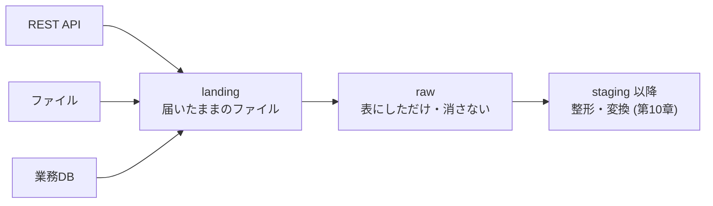

# 第9章 データの取り込み

## この章でできるようになること

- 取り込みの 4 つの型 (全件・差分・追記・CDC) を、データの性質から選べる。
- 同じデータを 2 回入れても壊れない、冪等な取り込みを書ける (キーでの upsert とパーティションの置き換え)。
- REST API から、ページング・認証・レート制限 (429 と `Retry-After`) を扱って全件を取れる。
- ファイルの置き場所と名前を決め、書きかけを読まずに、届いたことを見つけられる。
- データベースから `updated_at` とウォーターマークで差分を取り、その落とし穴 (取りこぼし・削除) を説明できる。
- 遅れて届くデータと、元のスキーマの変化に備え、生データを残す層 (landing / raw) を設計できる。
- クエリベースとログベースの CDC の違いを説明できる。

第3章でシェルと Git を、第4章で Python による ETL (再試行とログ) を、第7章でトランザクションを学びました。この章はそれらを使って、パイプラインの入口を作ります。入口が壊れると、あとの変換もテストも、間違った数字の上に立つことになります。

## 取り込みとは何か

取り込み (インジェスチョン、ingestion) は、自分たちの管理の外にあるデータを、自分たちの基盤に移すことです。元は業務システムのデータベース、外部サービスの API、取引先のファイルなどで、移す先はファイルの置き場所 (オブジェクトストレージ) やデータウェアハウス (分析用のデータベース、第11章) です。

取り込みが難しいのは、元が自分たちの都合では動かないからです。API は予告なく回数を制限し、ファイルは書きかけのまま見え、列が増え、同じ行が二重に届き、1 日遅れで届くこともあります。取り込みの設計とは、そうした「ふつうに起きること」の下でも結果を正しく保つ約束事を決めることです。

その約束事の中心が冪等 (べきとう) です。同じ操作を 1 回行っても 2 回行っても、結果が同じになる性質のことです。たとえば「注文 1 番の状態を `cancelled` にする」は何回やっても同じ結果ですが、「売上に 1,000 円を足す」は回数で結果が変わります。取り込みは、失敗しての再実行、過去の分の取り直し (バックフィル)、誤った二重起動で、必ず繰り返されます。そのたびに行が増える作りでは、直すより壊すほうが多くなります。本章は一貫して、取り込みを「やり直しても安全」にすることを目標にします。

取り込みの全体像を、本章で使う層の名前と合わせて描きます。



## 取り込みの 4 つの型

何をどれだけ運ぶかで、取り込みは 4 つの型に分かれます。

{{ table("b09-load-patterns") }}

迷ったときの基準は、**小さい表は全件にする**ことです。全件は、毎回最初から作り直すので、削除も訂正もそのまま反映され、前回の状態に依存せず、壊れにくい方式です。ねぼすけ商店の顧客 (約 500 行) は、毎晩全件で取っても数秒です。注文のように増え続ける表で、所要時間や元への負荷が許容を超えたとき、はじめて差分に切り替えます。差分は前回の状態 (どこまで取ったか) に依存し、削除が見えず、取りこぼしの余地が生まれます。

追記は「一度書いたら変わらない」行動ログ (`events`) などに使います。ただし `events` には同じ `event_id` が二重に届く欠陥があり、追記は届いたものをそのまま足すので、重複をどこで取り除くかを決めておく必要があります。本章の方針は、raw 層では取り除かず (後述)、次章の staging で取り除くことです。

CDC (Change Data Capture、変更データキャプチャ) は、元のデータベースの変更そのものを順に受け取る方式です。本章の最後で考え方だけを扱い、深くは応用編に回します。

元の持ち主 (業務システムの担当者や取引先) に最初に確かめることを挙げておきます。取り込みの設計は、この答えでほぼ決まります。

- 行を一意に決めるキーは何か。キーの値は後から変わらないか。
- 更新日時の列はあるか。直接 SQL で更新したときも更新されるか。
- 行は削除されるか。物理的に消すのか、削除フラグを立てるのか。
- 過去の行が後から訂正されるか。訂正は何日前まで遡るか。
- 1 回に取ってよい量と回数、取ってよい時間帯はどれだけか。
- 列の追加や型の変更は、事前に知らせてもらえるか。

## 冪等な取り込み

冪等にする方法は、基本的に 3 つです。

1 つ目は、**キーでの upsert** です。upsert は update と insert をあわせた言葉で、「同じキーの行があれば更新し、無ければ挿入する」操作です。取り込み先に主キー (行を一意に決める列、第7章) があることが前提です。DuckDB と PostgreSQL には `INSERT ... ON CONFLICT` があります。次は、本章の差分取り込みで使う SQL です。`batch` は取り込む行を入れた一時的な表です。

```sql
INSERT INTO orders
SELECT * FROM batch
ON CONFLICT (order_id) DO UPDATE SET
    customer_id = excluded.customer_id,
    status = excluded.status,
    amount = excluded.amount,
    updated_at = excluded.updated_at
```

`excluded` は「入れようとした行」を指す名前で、`ON CONFLICT` の中でだけ使えます。`order_id` が既にあれば 4 つの列を新しい値で上書きし、無ければ挿入します。同じ `batch` を 2 回流しても、結果は同じです。

もう 1 つの書き方が、標準 SQL の `MERGE` です。PostgreSQL は 15 以降、DuckDB は 1.4 以降で使えます (出典は参考文献)。書き方は製品で少しずつ違い、下は DuckDB の例です (`INSERT *` は同名の列をすべて使う DuckDB の略記で、PostgreSQL では列を書き並べます)。

```sql
MERGE INTO orders AS t
USING batch AS s
ON t.order_id = s.order_id
WHEN MATCHED THEN UPDATE SET
    customer_id = s.customer_id,
    status = s.status,
    amount = s.amount,
    updated_at = s.updated_at
WHEN NOT MATCHED THEN INSERT *;
```

どちらも、**1 回の文の中に同じキーの行が 2 つあると困る**ことに注意してください。PostgreSQL の `ON CONFLICT DO UPDATE` は、1 つの行を 1 回の文で 2 度は変更できないので、同じキーが 2 行あるバッチをそのまま流すとエラーになります (PostgreSQL の INSERT の文書)。バッチの中に同じキーが複数あるときは、先に「最新の 1 行」に絞ってから入れます。第6章の `row_number` を使います。

```sql
SELECT order_id, customer_id, status, amount, updated_at FROM (
    SELECT *, row_number() OVER (PARTITION BY order_id ORDER BY updated_at DESC) AS rn
    FROM batch) AS t
WHERE rn = 1
```

`updated_at` まで同じ行が残るなら、どちらが残るかが決まりません。連番などの列を `ORDER BY` に足して、順序を一意にします。

2 つ目は、**パーティションの置き換え**です。パーティションは、データを日付などの単位で区切った 1 つの塊のことです。「その日の分を消してから入れ直す」と決めれば、何度流しても、その日の分は最後に入れた中身と同じになります。ログのように主キーを持たないデータに向きます。消す処理と入れる処理は、必ず 1 つのトランザクションに入れます。消した直後に失敗すると、その日の分が空になるからです。コードは後のファイルの節にあります。

3 つ目は、**全件の置き換え**です。毎回表ごと作り直す、最も単純な方法です。

```python
def full_load(duck, pg_dsn):
    """全件を読み、表ごと作り直します (小さい表向け)。読んだ件数を返します。"""
    rows = extract(pg_dsn, datetime(1970, 1, 1, tzinfo=timezone.utc), timedelta(0))
    duck.register("batch", to_arrow(rows))
    duck.execute("CREATE OR REPLACE TABLE orders_full AS SELECT * FROM batch")
    duck.unregister("batch")
    return len(rows)
```

行をまとめて入れる点に注意してください。数千件を 1 行ずつ `INSERT` (Python では `executemany` など) すると、DuckDB のような分析向けの DBMS では特に遅くなります。ここでは Arrow の表にして 1 回で渡しています。大きなファイルなら `COPY` (PostgreSQL・DuckDB どちらにもあります) を使います。

冪等でない取り込みの典型は、ただの `INSERT` です。再実行した分が、そのまま二重に入ります。「最後まで成功したら印を付ける」やり方も、印を付ける直前に落ちれば、次の実行で同じものを読み直します。**落ちる場所はどこでもあり得る**と考え、読み直しが起きても結果が変わらないように書きます。

## REST API から取り込む

REST API は、HTTP で `GET /orders` のように要求を送ると、JSON でデータを返す仕組みです。取り込みでは、(1) 全件を何ページにも分けて返される、(2) 呼べる回数に上限がある、(3) 誰が呼んでいるかを認証される、の 3 点を扱います。

実際の API を叩く代わりに、テストの中で `http.server` (Python の標準ライブラリ) を別スレッドで動かして、同じ挙動の偽 API を作ります。ページング・認証・429 を再現するので、手元で何度でも再現できます。

```python
def do_GET(self):
    api.requests += 1
    if self.headers.get("Authorization") != f"Bearer {TOKEN}":
        return self._send(401, {"error": "unauthorized"})
    if api.requests <= api.reject_first:
        return self._send(429, {"error": "too many requests"}, {"Retry-After": "1"})
    query = parse_qs(urlparse(self.path).query)
    limit = int(query.get("limit", ["100"])[0])
    after = int(query.get("after_id", ["0"])[0])
    rest = [r for r in api.items if r["order_id"] > after]
    page = rest[:limit]
    has_next = len(rest) > limit
    self._send(200, {"items": page, "next_after_id": page[-1]["order_id"] if has_next else None})
```

認証は、`Authorization: Bearer <トークン>` というヘッダーで行う方式が一般的です。トークンは、パスワードの代わりに発行される長い文字列です。コードやリポジトリに書かず、環境変数などで渡します (第3章)。URL の末尾 (`?api_key=...`) に付ける API もありますが、URL はログに残りやすいので、ヘッダーで渡せるならヘッダーにします。偽 API は、トークンが違うと 401 を返します。

ページングには 2 つの方式があります。**オフセット方式** (`?offset=1000&limit=500`) は「先頭から 1,000 件目以降」と指定します。読んでいる間に、読み終えた範囲へ行が挿入されると同じ行を 2 回受け取り、削除されると 1 行飛ばされます。大きな offset は、サーバー側でも遅くなりがちです。**カーソル方式**は「この ID より後」(`?after_id=500`) や、サーバーが渡す不透明な印を使うので、読んでいる最中に行が増えてもずれません。偽 API は、前者の欠点を避けるカーソル方式にしています。応答の `next_after_id` が空 (`None`) になったら最後のページです。

429 (Too Many Requests) は、呼びすぎたときの応答で、RFC 6585 の 4 節で定義されています。同じ節に、応答に `Retry-After` を含めてよい (必須ではない) と書かれています。`Retry-After` は「何秒後にもう一度どうぞ」を知らせるヘッダーで、書式は RFC 9110 の 10.2.3 節にあり、秒数か日時の 2 通りが認められています。次のクライアントは、秒数の形だけを扱います。日時の形を返す API を相手にするときは、そのぶんの解析を足す必要があります。

```python
def get_json(url, token, params=None, sleep=time.sleep, max_attempts=5):
    """GET して JSON を返します。429 は Retry-After の秒数だけ待って再試行します。"""
    for attempt in range(1, max_attempts + 1):
        response = requests.get(url, params=params, headers={"Authorization": f"Bearer {token}"}, timeout=10)
        if response.status_code == 429:
            # Retry-After が無い API もあるので、無ければ 1, 2, 4 ... 秒の指数バックオフにする
            if attempt == max_attempts:
                break  # 最後の 429 のあとは待たずに諦める
            wait = float(response.headers.get("Retry-After", 2 ** (attempt - 1)))
            sleep(wait)
            continue
        response.raise_for_status()  # 401 や 500 はここで例外にする (待っても直らないものは再試行しない)
        return response.json()
    raise RuntimeError(f"{max_attempts} 回続けて 429 でした: {url}")


def fetch_all(base_url, token, limit=500, sleep=time.sleep):
    """after_id を進めながら全ページを集めます (カーソル方式)。"""
    rows, after_id = [], 0
    while after_id is not None:
        body = get_json(f"{base_url}/orders", token, {"limit": limit, "after_id": after_id}, sleep)
        rows.extend(body["items"])
        after_id = body["next_after_id"]
    return rows
```

第4章の再試行を API 向けにしたものです。待ち時間を `sleep` という引数で外から渡せるようにしてあるので、テストでは本当に待たずに、待った秒数を記録できます。401 (認証の失敗) や 400 (要求の誤り) は、待っても直らないので再試行しません。500 番台 (サーバーの故障) は再試行する価値がありますが、この例では省いています。実運用では第4章の仕組みを重ねてください。

動かした結果です (`python examples/b09/demo.py` の一部)。

```text
--- REST API
取得 3000 件, リクエスト 8 回, 待った秒数 [1.0, 1.0]
```

3,000 件を 500 件ずつ取るので 6 ページ、最初の 2 回を 429 で断られたので合計 8 回です。待った秒数は、`Retry-After` の 1 秒が 2 回です。

## ファイルから取り込む

取引先からの CSV や、他システムが書き出す JSON Lines (1 行に 1 件の JSON) は、オブジェクトストレージに置いてもらうのが現場の定番です。本章では MinIO (S3 互換の、手元で動くオブジェクトストレージ) を使います。コードは AWS の S3 と同じ `boto3` で書けます。

**置き場所と名前**を先に決めます。この章の決まりはこうです。

```text
landing/<ソース>/dt=<受信日>/part-0000.jsonl.gz
```

`dt` は「データが届いた日」で、データ中の時刻ではありません。遅れて届いたデータも、届いた日のパーティションに入ります。理由は次の節で説明します。日付は日本時間 (JST) で切ります。第2章の「保存は UTC でタイムゾーン付き」という決まりは、時刻の列の話で、置き場所の日付はチームが読みやすい日付に決めます。どちらを使うか、パイプラインの全員が同じにそろえていることが大事です。

キー名は日付と番号だけで決まります。**1 回の置き込みは、その日の全体を `part-0000` に書き**、同じ番号で書き直すと上書きされます。そのため、同じ日の分を 2 回に分けて同じ `part-0000` に置くと、前の分が消えます。同じ日に後から届いた分は `part-0001` のように番号を足して置き、前の分を消しません。読む側は、パーティション内の `part-` をすべて読みます。時刻や乱数を名前に入れると、再実行のたびにファイルが増えて、冪等になりません。

**書きかけを読まない**ことが、ファイル取り込みで最も大事な約束です。オブジェクトストレージには、ファイルの名前を後から変える操作がありません (コピーして消す操作になります)。そこで、全部置き終えたあとに `_SUCCESS` という空のファイルを置く約束にし、読む側は、それがあるパーティションだけを読みます。

{{ table("b09-arrival-detection") }}

置き直すときの順番にも決まりがあります。前回の `_SUCCESS` を残したまま新しいファイルを置き始めると、置いている途中で止まったとき、古い印が残っているので、書きかけのパーティションが「置き終わっている」ように見えてしまいます。そこで、**先に前回の印を消し、ファイルを置き、最後に新しい印を置きます**。印が無い間、そのパーティションは読まれません。

次のコードが、置く側と見つける側です。

```python
def land_events(s3, bucket, events, part=0):
    """events を受信日ごとにまとめて、gzip 圧縮の JSON Lines (part 番号つき) で置きます。置いた日付の一覧を返します。"""
    by_day = {}
    for event in events:
        by_day.setdefault(event["received_at"][:10], []).append(event)
    for dt, rows in by_day.items():
        body = "".join(json.dumps(r, ensure_ascii=False) + "\n" for r in rows).encode("utf-8")
        marker = f"landing/events/dt={dt}/_SUCCESS"
        # 置き直す前に、前回の印を消す (残っていると、途中で止まったとき書きかけが「置き終わり」に見える)
        s3.delete_object(Bucket=bucket, Key=marker)
        s3.put_object(Bucket=bucket, Key=partition_key("events", dt, part), Body=gzip.compress(body))
        # 全部置き終えた印。読む側は、この印があるパーティションだけを読む
        s3.put_object(Bucket=bucket, Key=marker, Body=b"")
    return sorted(by_day)


def list_ready_partitions(s3, bucket, source, after_dt=""):
    """_SUCCESS のあるパーティションの日付を、after_dt より後のものだけ、古い順に返します。"""
    found = set()
    paginator = s3.get_paginator("list_objects_v2")  # 1 回の list は最大 1,000 件なので、ページ送りが要る
    for page in paginator.paginate(Bucket=bucket, Prefix=f"landing/{source}/"):
        for obj in page.get("Contents", []):
            if obj["Key"].endswith("/_SUCCESS"):
                found.add(obj["Key"].split("dt=")[1].split("/")[0])
    return sorted(dt for dt in found if dt > after_dt)
```

S3 の一覧 API (`ListObjectsV2`) は、1 回に最大 1,000 件のキーしか返しません。パーティションが 1,000 を超える日が来ると、ページ送りをしていない一覧は、黙って途中で切れます。`get_paginator` は、そのページ送りを自動で行います。`after_dt` は「どこまで取り込んだか」の印で、前回より新しい日だけを取り込むために使います。読み取りと取り込みのつなぎは、次の関数です。`_SUCCESS` が無い (置いている途中の) パーティションは、`list_ready_partitions` の結果に出ないので、読まれません (`test_partition_without_success_marker_is_not_read`)。

```python
def load_new_partitions(duck, s3, bucket, after_dt=""):
    """置き終わった (_SUCCESS のある) 新しいパーティションを順に取り込み、取り込んだ日付を返します。"""
    days = list_ready_partitions(s3, bucket, "events", after_dt)
    for dt in days:
        load_partition(duck, s3, bucket, dt)
    return days
```

印をどこに持つかは、DB の節のウォーターマークと同じ考え方で、取り込み先と同じ場所に置きます。

**圧縮と形式**にも判断があります。JSON Lines や CSV は gzip で圧縮すると小さく済みますが、gzip は途中から読めず、大きなファイルを多数の計算機で分けて読む場面では不利です。分析用には、列ごとに圧縮される Parquet (第2章) が向きます。landing は「元の形のまま、圧縮だけ」にして、Parquet への変換はその先の層の仕事にします。取引先の CSV が Shift_JIS や BOM 付き UTF-8 なら、文字コードを読むときに明示します (第2章)。

## データベースから取り込む

業務システムのデータベース (この本では PostgreSQL) から、前回より後に変わった行だけを取る方式が、差分取り込みです。必要なのは、行が最後に変更された時刻を持つ列 (ここでは `updated_at`) と、**ウォーターマーク**です。ウォーターマークは「ここまでは取り込んだ」という印で、普通は取り込んだ行の `updated_at` の最大値です。

```python
def extract(pg_dsn, watermark, lookback):
    """ウォーターマークより (lookback 分だけ手前から) 新しい行を取り出します。"""
    with psycopg.connect(pg_dsn) as con:
        return con.execute(
            "SELECT order_id, customer_id, status, amount, updated_at FROM b09.orders "
            "WHERE updated_at > %s ORDER BY updated_at, order_id",
            (watermark - lookback,)).fetchall()
```

`lookback` は、ウォーターマークより少し手前から読み直す幅です。なぜ必要かは、すぐ後で説明します。書き込みは、upsert とウォーターマークの更新を 1 つのトランザクションにします。

```python
def load(duck, pg_dsn, lookback=timedelta(0)):
    """差分を取り出して upsert し、ウォーターマークを進めます。取り込んだ件数を返します。"""
    rows = extract(pg_dsn, read_watermark(duck), lookback)
    if not rows:
        return 0
    batch = to_arrow(rows)
    duck.execute("BEGIN")
    try:
        duck.register("batch", batch)
        duck.execute(UPSERT)
        duck.unregister("batch")
        # 取り込んだ行の updated_at の最大値を新しい印にする (印は後戻りさせない)
        duck.execute("""
            INSERT INTO watermark VALUES ('orders', ?)
            ON CONFLICT (name) DO UPDATE SET value = greatest(watermark.value, excluded.value)""",
                     [max(r[4] for r in rows)])
        duck.execute("COMMIT")
    except Exception:
        duck.execute("ROLLBACK")
        raise
    return len(rows)
```

ウォーターマークは、データと同じ場所 (ここでは同じ DuckDB) に置きます。別の場所 (設定ファイルやオーケストレーターの変数) に置くと、「データは入ったが印が進まなかった」「印だけ進んだ」という中途半端な状態が生じます。同じトランザクションなら、両方が進むか、両方進まないかのどちらかです。印を進める式に `greatest` を使っているのは、読み直しで古い行だけが来たとき、印が後戻りしないようにするためです。

実行します。取り込み先は空のところから始めて、元で 2 件を更新し 1 件を追加してから、もう一度取り込みます。

```text
--- 差分の取り込み
1 回目: 3000 件
2 回目: 0 件
変更後: 3 件
全件を読み直した後の行数: 3001 件読んで 3001 行
```

1 回目は全件、2 回目は変化が無いので 0 件です。変更後は更新 2 件と追加 1 件の計 3 件だけを取り込みます。最後の行は、ウォーターマークの行を消して (値が 1970 年に戻り、全件が対象になります) 読み直した結果で、3,001 件を読んでも行数は 3,001 のままです。upsert が冪等なので、読み直しても増えません。この性質があるから、次の落とし穴に「少し戻って読み直す」対策が打てます。

差分取り込みの落とし穴を表にまとめます。どれも、実際に起きて、取りこぼしに気づくのが遅れるものです。

{{ table("b09-updated-at-pitfalls") }}

表の「コミットの順番」は、直感に反するので具体例で説明します。トランザクション A が `updated_at = 10:00` の行を更新して、まだコミットしていないとします。その間に別の更新が 10:05 でコミットされ、取り込みがウォーターマークを 10:05 に進めます。その後 A がコミットすると、`updated_at = 10:00` の行が見えるようになりますが、`updated_at > 10:05` の条件には当たりません。この行は、次の取り込みでも永久に拾われません。テストは、ウォーターマークより 5 分古い行を後から入れて、これを再現します。`lookback` を 0 のまま取り込むと 0 件で見落とし、1 時間戻すと拾えます (`test_late_committed_row_needs_lookback`)。戻す幅は、元で 1 回のトランザクションが最大どれだけ続くかを目安に決めます。広すぎても、冪等なので壊れず、読む量が増えるだけです。

**削除**は、差分取り込みの苦手なところです。消えた行は `updated_at` を持たないので、差分に現れません。対策は 3 つあります。元に論理削除 (行を消さず `deleted_at` などの列に印を付ける) に変えてもらう。キーの一覧を取って、取り込み先との差を調べる。CDC に切り替える。キーの突き合わせは、次のコードです。

```python
def sync_deletes(duck, pg_dsn):
    """元で消えた行を、キーの突き合わせで見つけて取り込み先からも消します。消した件数を返します。"""
    with psycopg.connect(pg_dsn) as con:
        source_ids = {r[0] for r in con.execute("SELECT order_id FROM b09.orders")}
    target_ids = {r[0] for r in duck.execute("SELECT order_id FROM orders").fetchall()}
    gone = sorted(target_ids - source_ids)
    if gone:
        duck.execute("BEGIN")
        duck.execute("DELETE FROM orders WHERE order_id = ANY(?)", [gone])
        duck.execute("COMMIT")
    return len(gone)
```

キーだけを読むので軽いものの、件数が増えれば重くなります。また、消えた行を取り込み先からも消すかどうかは業務の判断です。売上を集計する表から注文が消えると、過去の数字が変わります。履歴を残すなら、消さずに「削除済み」の印を付ける (第8章の SCD2 と同じ考え方) のが無難です。元への負荷にも気を配り、`updated_at` にインデックス (第6章) を付けてもらう、読み取り専用のレプリカから読む、混まない時間帯に走らせる、といった相談をします。


## ウォーターマークと遅れて届くデータ

行動ログのようなデータには、2 つの時刻があります。出来事が起きた時刻 (`event_time`) と、自分たちが受け取った時刻 (`received_at`) です。ねぼすけ商店の `events` には、`received_at` が翌日以降にずれる行が意図して混ぜてあります。スマートフォンが電波の無い場所でためた記録を、後でまとめて送るような状況です。

landing に置いたこのデータを raw 層に取り込んで確かめます。

```text
--- landing (MinIO)
置いたパーティション: 182 日分 2026-01-01 〜 2026-07-01
raw の行数と event_id の種類: (4040, 4000)
event_time の日付と dt が違う行: 122
同じ日を入れ直した後の行数: 4040
```

4,040 行のうち、発生した日と届いた日が違う行が 122 行 (約 3%) あります。もし `event_time` の日付で切ると、「3 月 1 日の分」は、3 月 4 日まで書き換わる可能性があります。取り込み済みとして閉じたあとに届いた分は、取り込みの印の外に落ちるか、取り込み済みのパーティションを書き換えるかのどちらかです。`received_at` (届いた日) で切れば、パーティションは届いた時点で確定し、あとから変わりません。

遅れの扱いは、2 段で考えます。取り込みは、**届いた日で切って、取りこぼさず、重複しても壊れない**ことを守ります。集計は、**発生した日で行い、直近の数日は毎回計算し直す**ことで、遅れた分を拾います。第10章の incremental モデルで、この「直近の数日を作り直す」を実際に書きます。

どこまで遅れを受け付けるかには、期限が要ります。無期限に待つと、過去の数字がいつまでも変わります。*Fundamentals of Data Engineering* の取り込みの章も、遅れたデータを処理しなくなる締め切り (cutoff) を決めるよう述べています。ねぼすけ商店の合成データでは、最大の遅れは 4 日 (1〜3 日に 1 時間以内の端数が足されて日付が繰り上がる) です。次の SQL で確かめられます。

```sql
SELECT count(*) FROM events_raw WHERE substr(event_time, 1, 10) <> dt;
SELECT max(date_diff('day', CAST(event_time AS DATE), CAST(dt AS DATE))) FROM events_raw;
```

2 つ目の `date_diff` は DuckDB の関数です (PostgreSQL では日付の引き算で同じ値が得られます)。バックフィルも、冪等なら怖くありません。範囲のパーティションを置き換えるだけで、オーケストレーター (第12章) が日付を渡して過去の日にも走らせます。

## スキーマの変化に備える

スキーマは、データの列の名前・型・意味の決まりです。元のスキーマは、取り込む側に知らされないまま変わります。変化には、重さの違う種類があります。

- **列の追加**: 気づきにくい。何もしないと、新しい列は捨てられる。
- **列の削除・名前の変更**: 下流の SQL が、存在しない列を読んで落ちる。
- **型の変更**: 数値の列に文字列が入り、取り込みか集計で落ちる。
- **意味の変更**: 列名も型も同じで、中身の意味だけが変わる (たとえば金額が税込みに変わる)。エラーが出ないので、最も危ない。

すべてを防ぐ方法はありません。段階を分けて、被害を小さくします。第一に、landing には元の形のまま置きます。列が増えても減っても、ファイルは壊れません。第二に、raw に表として取り込むとき (時刻の列は、元の文字列のまま `VARCHAR` で持ち、型の解釈は staging に任せます)、**想定した列**と**想定外の列**に分けます。想定外の列は捨てずに、JSON の文字列として 1 つの列 (`extra`) に残します。

```python
def split_known(record, known=KNOWN_COLUMNS):
    """想定の列と、想定外の列 (extra) に分けます。想定外の列があっても止まらず、失いもしません。"""
    missing = [c for c in known if c not in record]
    if missing:  # 想定した列が消えたら、NULL で埋めずに止めて知らせる
        raise ValueError(f"想定した列がありません: {missing}")
    return ({c: record[c] for c in known},
            {k: v for k, v in record.items() if k not in known})
```

たとえば `coupon_code` という列が突然増えても、取り込みは止まらず、値は `extra` に `{"coupon_code": "SPRING"}` として残ります (`test_new_column_does_not_break_ingestion`)。第三に、**変化に気づく仕組み**を持ちます。`extra` が空でない行の数を毎日数えて、増えたら通知する、といったものです。想定した列が消えた場合は、黙って `NULL` に埋めずに、止めて知らせるほうが安全です。`split_known` は、想定した列が 1 つでも無ければ `ValueError` を出し、取り込みを止めます (`test_missing_known_column_stops_ingestion`)。止まる損失より、間違った数字が使われ続ける損失のほうが、大きいことが多いからです。

元の表に対して `SELECT *` で読むと、元の列の増減が下流にそのまま漏れます。取り込み先の列は、明示的に決めておきます。スキーマの約束を元と書面で取り交わす考え方 (データ契約) は、応用編の第7章で扱います。

## 生データを残す: landing と raw

取り込んだものを、すぐに加工して上書きするのではなく、**届いたままの形で残す**ことを勧めます。層を 2 つに分けます。

- **landing**: 届いたファイルそのまま。圧縮以外は何も変えず、書き換えもしません。
- **raw**: landing を表にしただけのもの。列の型を付け、どのファイルから来たか (`source_file`) と、いつ取り込んだか (`ingested_at`) の列を足しますが、行は消さず、直しません。

次の関数が、1 つのパーティションを raw に入れます。消してから入れる (パーティションの置き換え) を、1 つのトランザクションで行います。

```python
def load_partition(duck, s3, bucket, dt):
    """1 つのパーティションを置き換えます (消してから入れる。1 トランザクション)。件数を返します。"""
    keys = part_keys(s3, bucket, dt)
    texts = [(key, gzip.decompress(s3.get_object(Bucket=bucket, Key=key)["Body"].read()).decode("utf-8"))
             for key in keys]
    now = datetime.now(timezone.utc)
    rows = []
    for key, text in texts:
        for line in text.splitlines():
            known, extra = split_known(json.loads(line))
            rows.append({**known, "extra": json.dumps(extra, ensure_ascii=False) if extra else None,
                         "dt": dt, "source_file": key, "ingested_at": now})
    batch = pa.Table.from_pylist(rows)
    duck.execute("BEGIN")
    try:
        duck.execute("DELETE FROM events_raw WHERE dt = ?", [dt])
        duck.register("batch", batch)
        duck.execute("INSERT INTO events_raw SELECT * FROM batch")
        duck.unregister("batch")
        duck.execute("COMMIT")
    except Exception:
        duck.execute("ROLLBACK")
        raise
    return len(rows)
```

先ほどの出力で、同じ日を何度入れ直しても行数が 4,040 のままなのは、この置き換えのおかげです。また raw の行数 4,040 に対して `event_id` の種類は 4,000 で、二重に届いた 40 件がそのまま残っています。raw で取り除かないのは、**取り除く規則が間違っていたとき、やり直せなくなるから**です。「重複とみなして捨てた行が、実は別の注文だった」と後から気づいても、捨てていたら戻せません。raw が届いたままなら、staging の SQL を直して流し直すだけで済みます。

残すには保存の費用が掛かり、個人情報を含むなら、いつまで持つかの決まりも要ります (応用編の第9章)。層の呼び名は組織で違い、ブロンズ・シルバー・ゴールドと呼ぶ流儀もあります。名前より、どの層が「書き換えない事実」で、どの層が「作り直せる結果」かを、全員が同じに理解していることが大事です。

## CDC の考え方

クエリベースの CDC は、ここまでの「`updated_at` で問い合わせる」方式です。これに対して、**ログベースの CDC** は、データベースが障害に備えて書いている変更の記録 (PostgreSQL では WAL、MySQL では binlog) を読みます。PostgreSQL には、そこから変更を取り出す論理デコーディングがあります。

{{ table("b09-cdc-compare") }}

ログベースが強いのは、削除と、1 回ごとの更新が見えることです。注文の状態が `placed` → `shipped` → `delivered` と変わった履歴を、順に受け取れます。クエリベースは、取り込みの間隔の中での途中の状態を見落とします。

代わりに運用が重くなります。PostgreSQL のレプリケーションスロットは、受け取り側が読み終えるまで、記録 (WAL) を消さずに取っておきます。受け取り側が止まったままだと、記録がたまり続けてディスクを圧迫します。設定 `max_slot_wal_keep_size` の既定は -1 で、スロットが保持する WAL の量に上限がありません。上限を決めると今度は、遅れた受け取り側が続きを読めなくなるので、容量の監視と上限のどちらを取るか、運用で決めます。専用の権限と設定も要り、最初は全件の取り込みも別に必要です。

ログベースの CDC を担う道具の代表が Debezium で、取り出した変更を Kafka (第15章) に流します。この本では名前の紹介までにして、仕組みと運用は応用編の第5章に譲ります。**削除の取りこぼしが業務に響き、元の負荷も無視できない**ときに検討する、と覚えておけば十分です。

## よくある失敗

- **ただの `INSERT` で取り込む。** 再実行のたびに行が二重になります。キーでの upsert か、パーティションの置き換えにします。
- **ウォーターマークを、データとは別の場所に持つ。** 片方だけ進んだ状態から回復できません。同じトランザクションで進めるか、読み直しを許す設計にします。
- **更新日時を信じ切る。** 一括更新で更新日時が動かない、古い時刻が後から見えるという穴があります。`lookback` と、定期的な全件の突き合わせを入れます。
- **オフセット方式のページングで行がずれる。** カーソル方式があれば使い、無ければ順序を一意なキーで固定します。
- **429 にすぐ再試行を繰り返す。** `Retry-After` に従い、無ければ待ち時間を指数的に延ばします。
- **取り込みで重複や表記ゆれを直してしまう。** 規則が間違っていたら戻せません。raw では直さず、staging で直します。

## まとめ

- 取り込みの型は、全件・差分・追記・CDC。小さい表は全件にし、必要になってから差分へ進みます。
- 取り込みは冪等にします。upsert、パーティションの置き換え、全件の置き換えのどれかで、再実行しても結果を変えません。
- REST API は、カーソル方式のページング、ヘッダーのトークン、429 と `Retry-After` を扱います。
- ファイルは、置き場所と名前を決め、完了マーカーで書きかけを避けます。
- DB の差分は `updated_at` とウォーターマークで取り、コミット順と削除の穴を `lookback` と突き合わせで補います。
- 遅れて届くデータは、届いた日で切って取りこぼさず、集計側で直近の日を計算し直します。
- 元のスキーマは変わります。landing は元の形のまま、raw は想定外の列を捨てず、変化に気づく仕組みを持ちます。
- 生データ (landing と raw) は消さず直さず、規則の誤りをやり直せるようにします。CDC の深い話は応用編です。

## 練習問題

問 1. 差分取り込みで、条件を `updated_at > ウォーターマーク` にしています。ある行の `updated_at` がウォーターマークとちょうど同じ時刻で、その行が 1 回目の取り込みのあとにコミットされたとします。この行は、次の取り込みで拾われますか。拾うには、どう変えますか。

??? note "解答例"
    拾われません。`>` は「ウォーターマークより後」なので、同じ時刻の行は条件に当たらず、永久に見落とします。条件を `>=` に変える方法もありますが、すると毎回、ウォーターマークと同じ時刻の行を読み直します。テスト `test_row_with_same_timestamp_as_watermark` が、`lookback` なしでは 0 件、`lookback` ありでは拾えることを確かめています。より一般的なのは、本文のとおり `lookback` で少し手前から読み直し、upsert の冪等性で重複を受け止める方法です。この方法は、同時刻の行だけでなく、コミット順で遅れて見える行もまとめて拾えます。

問 2. 行動ログ (`events`) を、`received_at` ではなく `event_time` の日付でパーティションに切ると、どんな不都合がありますか。本章のデータで、影響を受ける行数を SQL で求めてください (`events_raw` に全日付を取り込んだあとで流します)。

??? note "解答例"
    日付ごとのパーティションが、あとから届く遅れた行で書き換わります。閉じたはずの日の中身が数日後に変わるので、下流が「その日は確定済み」と扱えません。影響を受ける行数は、本文の最初の SQL (`dt` と `event_time` の日付が違う行を数える) で求められ、122 行 (約 3%) です。`received_at` で切れば届いた時点で確定します。ただし、集計を発生日で行うときは、最大 4 日前までの集計を作り直す必要があります。

問 3. 顧客 (`customers`、約 500 行) を取り込みます。更新日時の列は無く、退会した顧客は物理的に削除されます。全件・差分・追記・CDC のどれを選びますか。理由も述べてください。

??? note "解答例"
    全件です。更新日時が無いので差分の条件が立たず、物理削除があるので差分や追記では削除を反映できません。約 500 行なら全件を読んでも数秒で、元への負荷も小さく、全件の置き換えは削除も訂正も自然に反映します。退会者の履歴を残したいなら、置き換えずに前回との差を取り、「削除済み」の印を付ける設計 (第8章の SCD2) にします。

問 4. 元のイベントに、新しい列 `coupon_code` が追加されました。(a) 列の一覧を決め打ちして `SELECT` する取り込み、(b) 本章の `split_known` を使った取り込み、(c) 列を指定せずに `SELECT *` で表を作り直す取り込み、のそれぞれで何が起きますか。

??? note "解答例"
    (a) 新しい列は無視され、取り込みは成功しますが、列が増えたことにだれも気づきません。(b) 取り込みは成功し、値は `extra` に `{"coupon_code": "SPRING"}` として残ります。`extra` が空でない行を数えれば気づけます (`test_new_column_does_not_break_ingestion`)。(c) 取り込み先の列が自動で増え、`SELECT *` や列の順番に頼る下流の処理が、予期せぬ形で変わります。気づけて失わない (b) が最も安全です。

## 参考文献

- Joe Reis, Matt Housley, *Fundamentals of Data Engineering*, O'Reilly, 2022, Chapter 7 “Ingestion”
- RFC 6585, “Additional HTTP Status Codes”, 4 節（429 Too Many Requests）, <https://www.rfc-editor.org/rfc/rfc6585>
- RFC 9110, “HTTP Semantics”, 10.2.3 Retry-After, <https://www.rfc-editor.org/rfc/rfc9110>
- PostgreSQL Documentation, “INSERT”, <https://www.postgresql.org/docs/current/sql-insert.html>
- PostgreSQL Documentation, “MERGE”（15 で追加）, <https://www.postgresql.org/docs/current/sql-merge.html>
- dbt Documentation, “DuckDB configurations”（`merge` 戦略は DuckDB 1.4 以降）, <https://docs.getdbt.com/reference/resource-configs/duckdb-configs>
- PostgreSQL Documentation, “Replication”（`max_slot_wal_keep_size`）, <https://www.postgresql.org/docs/current/runtime-config-replication.html>
- PostgreSQL Documentation, “Logical Decoding”, <https://www.postgresql.org/docs/current/logicaldecoding.html>
- DuckDB Documentation, “MERGE INTO Statement”, <https://duckdb.org/docs/current/sql/statements/merge_into>
- Amazon S3 API Reference, “ListObjectsV2”, <https://docs.aws.amazon.com/AmazonS3/latest/API/API_ListObjectsV2.html>
- Debezium Documentation, <https://debezium.io/documentation/>（2026年11月時点）

!!! tip "さらに深く"
    ログベースの CDC とイベント駆動の設計は、応用編 第5章「CDC とイベント駆動」で扱います。
