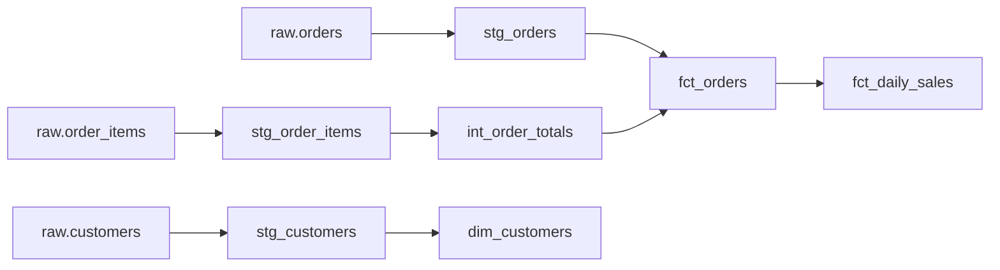

# 第10章 ETL / ELT と dbt

## この章でできるようになること

- ETL と ELT の違いを説明し、場面に応じて選べる。
- 変換を staging → intermediate → marts の層に分けて設計できる。
- dbt のプロジェクトの構成を読み、model・source・ref・seed・macro の役割を説明できる。
- view・table・incremental の materialization を使い分けられる。
- dbt のテスト (標準の 4 種類・独自のテスト・severity) を書き、失敗の出力を読める。
- incremental モデルと `is_incremental()` を書き、その落とし穴 (消えた行が残る) を説明できる。
- `dbt build` の流れと、ドキュメント・リネージ、CI での回し方を説明できる。

第9章で、生データを raw に残しました。この章は、その生データから、使える表を作る変換の話です。第5・6章の SQL と、第8章のファクト表・ディメンション表がそのまま道具になります。

## ETL と ELT

どちらも、データを元から基盤へ運ぶ流れの名前です。違いは変換の位置にあります。

- **ETL** (Extract, Transform, Load): 取り出し (Extract)、変換 (Transform)、書き込み (Load) の順。基盤に入る前に、専用のプログラムなどで加工します。
- **ELT** (Extract, Load, Transform): 取り出し、書き込み、変換の順。生のまま基盤に入れてから、基盤の中で SQL によって加工します。

{{ table("b10-etl-vs-elt") }}

ETL が先に使われてきたのは、データウェアハウスの計算力と容量に限りがあり、入れる前に絞り込んで整えるのが自然だったからだ、と説明されることが多くあります (本書の出典では確かめていない、一般的な説明です)。クラウドのデータウェアハウス (第11章) は容量と計算を必要なだけ増やせるので、先に生のまま入れて、加工を SQL で何度でも直して流し直す ELT が現実的な選択になりました。第9章の landing と raw は、ELT の「E と L」にあたります。*Fundamentals of Data Engineering* の取り込みの章にも、ETL と ELT を扱う節があります。

ELT が常に勝つわけではありません。次の場合は、入れる前に変換する ETL が理にかなっています。

- **入れる前に個人情報を伏せたい。** ELT は生データを基盤に入れるので、メールアドレスのような列が、そのまま基盤に載ります。法令や社内の規則で、基盤に置いてはいけないなら、入れる前に伏せるか落とします (応用編の第9章)。
- **件数を大きく減らしたい。** 秒間数万件のセンサーデータを、1 分ごとの平均にして入れる、といった前処理です。
- **形式が SQL で扱いにくい。** 画像や独自のバイナリは、先にプログラムで表の形にします。

現場では混ざります。取り込みでは個人情報の除去だけを行い (ETL 寄り)、その後の変換は基盤の SQL で行う (ELT) という組み合わせがあります。大事なのは、**生データを残すか、変換の規則をどこに置くか**を意識して決めることです。規則が SQL としてリポジトリにあれば、レビューもテストもできます。

## 変換の層

ELT の「T」を、1 つの巨大な SQL に書くと、読めず、直せず、テストもできません。そこで、層に分けます。dbt の公式ガイドが勧める分け方が、staging → intermediate → marts です。



{{ table("b10-layers") }}

**staging** は、ソースの表を 1 つずつ、使いやすい形に直す層です。列名をそろえ、型を直し、表記ゆれを整え、重複を取り除きます。結合や集計はしません。1 つのソース表に 1 つの staging モデルを対応させると、「この列はどこから来たか」が、いつも 1 つの場所に決まります。第9章で raw に残した 40 件の二重イベントは、ここで取り除きます。

```sql
with ranked as (
    select
        *,
        row_number() over (
            partition by event_id
            order by received_at, event_time, customer_id, event_type
        ) as rn
    from {{ source('raw', 'events') }}
)

select
    event_id,
    customer_id,
    event_type,
    cast(event_time as timestamp) as event_time,
    cast(received_at as timestamp) as received_at
from ranked
where rn = 1
```

`row_number` の `order by` は、一意になるまで列を足します (第6章)。二重に届いた行は中身が同じなので、どれが残っても結果は同じですが、決まりとして順序を固定します。

**intermediate** は、複数の staging をまとめる途中の部品です。複数の marts が使う結合や集計を、ここに 1 度だけ書きます。利用者には見せません。

**marts** は、利用者 (BI ツールや分析者) が使う最終の表で、第8章のファクト表 (数えるもの) とディメンション表 (切り口) にあたります。

名前には接頭辞を付けます。`stg_` / `int_` / `fct_` (ファクト) / `dim_` (ディメンション) です。名前から層がわかり、staging が marts を読むような逆向きの依存に気づけます。

## dbt とは何か

dbt (data build tool) は、SQL の `SELECT` を書いたファイルを、データウェアハウスの表やビューにするツールです。やることは次の 4 つです。

1. `SELECT` 文を、表やビューを作る文に包んで実行する。
2. 文の間の依存を読み取り、正しい順に実行する。
3. データのテストを実行する。
4. 説明文と依存関係から、ドキュメントを作る。

dbt は**データを運びません**。E と L には関わらず、基盤の中にあるデータを変換する T だけを担います。計算は基盤が行い、dbt は SQL を順序立てて指示します。

オープンソースの dbt Core と、公式の有料サービスがあります。本書は dbt Core を使い、データベースの種類ごとに用意されたアダプターで接続します。この本のイメージには dbt-core 1.12.7 と dbt-duckdb 1.11.1 が入っています (2026年11月時点)。版で設定の書き方や警告が変わるので、手元の版は `dbt --version` で確かめます。

手元で動かす手順は `examples/b10/usage.sh` にあります。Docker の開発用イメージで動かす場合、リポジトリの直下で次を実行します。生データ (ねぼすけ商店) を、プロジェクトのフォルダに DuckDB のファイルとして書き出します。

```bash
alias DEV='docker run --rm --user "$(id -u):$(id -g)" -e HOME=/tmp -v "$PWD":/w -w /w/examples/b10 de-book-dev'
DEV python -c "import sys; sys.path.insert(0, '../common'); from neboske_shop import write_duckdb; write_duckdb('neboske.duckdb')"
```

`-w /w/examples/b10` で、作業フォルダがプロジェクトの中になります。以降の `dbt` は、すべてこのフォルダで動かします。最初に、接続の確認 (`dbt debug`) と、全 model の実行 (`dbt run`) をしておきます。

```bash
DEV dbt debug --profiles-dir .
DEV dbt run --profiles-dir .
```

`dbt debug` は、設定ファイルと接続が読めているかを調べます。`dbt run` は model だけを作り、テストは回しません。ここで失敗するなら、テストの前に設定の問題です。DuckDB のファイルのパスは環境変数 `DBT_DUCKDB_PATH` で変えられ、指定しなければ、プロジェクトのフォルダの `neboske.duckdb` を使います。dbt は実行するたびに、`target/` (展開後の SQL と結果) と `logs/` を作ります。これらと DuckDB のファイルはリポジトリに入れないので、`.gitignore` に `target/` `logs/` `dbt_packages/` と `*.duckdb` を書きます (この例の `examples/b10/.gitignore` と同じです)。

## プロジェクトの構成

dbt のプロジェクトは、フォルダの構成と設定ファイルの決まりで動きます。本章の `examples/b10/` は次の形です。

```text
examples/b10/
├── dbt_project.yml        プロジェクトの設定
├── profiles.yml           接続先の設定 (ふつうはリポジトリの外の ~/.dbt/ に置く)
├── models/
│   ├── staging/           stg_*.sql と _sources.yml / _staging.yml
│   ├── intermediate/      int_*.sql
│   └── marts/             dim_*.sql / fct_*.sql と _marts.yml
├── seeds/                 prefecture_region.csv
├── macros/                clean_text.sql
└── tests/                 独自のテスト (generic/ と、単独の .sql)
```

`dbt_project.yml` が、プロジェクトの名前、各フォルダの場所、層ごとの既定の作り方を決めます。

```yaml
name: neboske
version: "1.0.0"
config-version: 2
profile: neboske

model-paths: ["models"]
seed-paths: ["seeds"]
test-paths: ["tests"]
macro-paths: ["macros"]

models:
  neboske:
    staging:
      +materialized: view
    intermediate:
      +materialized: view
    marts:
      +materialized: table
```

`profile: neboske` は、`profiles.yml` の中の接続先の名前です。本物のデータウェアハウスの接続情報にはパスワードが含まれるため、リポジトリに入れません (第3章)。本書の例は秘密を含まないので、プロジェクトの隣に置いています。

```yaml
neboske:
  target: dev
  outputs:
    dev:
      type: duckdb
      path: "{{ env_var('DBT_DUCKDB_PATH', 'neboske.duckdb') }}"
      schema: analytics
      threads: 1
```

`{{ ... }}` の中は Jinja というテンプレートの式で、`env_var` は環境変数を読みます。`schema: analytics` が、dbt の作る表の置き場所です。`threads: 1` は、同時に実行する model の数です。依存のない model が複数あれば、増やすと並列に作られます。DuckDB のファイルは同時に書けるのが 1 つの接続に限られるので、この例は 1 にしています。`target` を `dev`・`prod` のように書き分けると、同じプロジェクトを別の環境に向けられます。

## model・source・ref

**model** は、`models/` の下に置く、1 つの `SELECT` 文を書いた `.sql` ファイルです。ファイル名が表の名前になります。`CREATE TABLE` は書きません。

**source** は、dbt の外で作られた生データの表を、名前を付けて宣言するものです。

```yaml
version: 2

sources:
  - name: raw
    description: ねぼすけ商店の生データ (取り込み直後。加工していない)
    schema: main
    tables:
      - name: customers
        columns:
          - name: email
            data_tests:
              - unique:
                  config:
                    tags: [known_issue]
      - name: orders
      - name: order_items
      - name: events
        columns:
          - name: event_id
            data_tests:
              - unique:
                  config:
                    severity: warn
```

SQL からは `{{ source('raw', 'orders') }}` と書いて参照します。生データの場所 (スキーマ名や表名) が変わっても、宣言を直せば済みます。宣言には、テストも付けられます (後述)。

**ref** は、ほかの model を参照する関数です。staging の 1 つ目を見てください。

```sql
select
    order_id,
    customer_id,
    cast(ordered_at as timestamp) as ordered_at,
    {{ clean_text('status') }} as status
from {{ source('raw', 'orders') }}
```

なお、ねぼすけ商店の時刻は、タイムゾーンのない文字列 (日本時間として扱うもの) です。`cast(... as timestamp)` はタイムゾーンなしの時刻になり、`cast(... as date)` の日付も日本時間の日付です。本物のデータでは、第2章の決まり (UTC でタイムゾーン付き) に合わせて、staging で変換します。

そして marts の `fct_orders` は、`ref` で staging と intermediate を読みます。

```sql
select
    o.order_id,
    o.customer_id,
    o.ordered_at,
    cast(o.ordered_at as date) as order_date,
    o.status,
    t.item_count,
    t.order_amount
from {{ ref('stg_orders') }} as o
inner join {{ ref('int_order_totals') }} as t
    on o.order_id = t.order_id
```

`ref('stg_orders')` と書くと、dbt は 2 つのことをします。実際の表名 (`analytics.stg_orders` のような、環境ごとに違う名前) に置き換えることと、「`fct_orders` は `stg_orders` に依存する」と記録することです。この依存から DAG (向きのある、輪にならないグラフ) を作り、`stg_orders` を先に作ってから `fct_orders` を作ります。表名を直接書くと、この依存が dbt に伝わりません。**ほかの model を読むときは、必ず `ref` を使います。**

## Jinja とマクロを最小限

`{{ ... }}` と `` の部分は、Jinja というテンプレート言語です。dbt は SQL をデータベースに送る前に、Jinja を展開します。展開後の SQL は `dbt compile` で見られます。

```console
$ dbt compile --select stg_orders --profiles-dir .
```

```text
Compiled node 'stg_orders' is:
select
    order_id,
    customer_id,
    cast(ordered_at as timestamp) as ordered_at,
    
    nullif(lower(trim(status)), '')
 as status
from "n"."main"."orders"
```

`{{ clean_text('status') }}` が `nullif(lower(trim(status)), '')` に、`{{ source(...) }}` が表名に置き換わりました (出力の `"n"` はこの確認に使った DuckDB ファイルの名前です)。`clean_text` は、`macros/` に書いた**マクロ**で、Jinja で書く関数です。

```sql

    nullif(lower(trim({{ column_name }})), '')

```

第5章で見たとおり、ねぼすけ商店の `orders.status` には `shipped` と `SHIPPED` の表記ゆれがあります。この整形を `lower` で毎回書くかわりに、マクロにまとめました。メールアドレスの空文字を `NULL` にそろえる処理にも使っています。

Jinja は書きすぎると SQL が読めなくなります。目安は、`ref` `source` `config`、`is_incremental()`、同じ処理を数行のマクロにまとめる、までです。

**seed** は、小さな CSV を表にして取り込む仕組みです。`seeds/prefecture_region.csv` は、都道府県から地方への対応表です。`dbt seed` (または `dbt build`) で表になり、model からは `ref('prefecture_region')` で読みます。Git で管理でき、変更の履歴が残ります。向いているのは、数十〜数百行の変わりにくい対応表だけです。大きなデータや頻繁に変わるデータの取り込みには使いません。

## materialization

materialization は、model の `SELECT` を、データベースの中の何として作るかの選択です。

{{ table("b10-materialization") }}

表の最後の materialized view は、データベースが結果を保存して更新まで管理する機能で、対応する製品でだけ使えます。本章では扱いません。

**view** は更新のコストがありませんが、読むたびに計算されるので、重い model を重ねると遅くなります。**table** は読みが速い代わりに、実行のたびに全件を作り直します。目安は、軽い整形なら view、読む回数が多く計算が重いなら table、全件の作り直しが重すぎるなら incremental です。`dbt_project.yml` の層ごとの既定はこれに沿っています。特定の model だけ変えるときは、その `.sql` の先頭に `{{ config(...) }}` を書きます (後述)。

## テスト

dbt のテストは、**失敗した行を返す `SELECT`** です。返る行が 0 なら成功、1 行でもあれば失敗です。テストには 2 種類あります。

**generic テスト**は、YAML に宣言するだけの、使い回せるテストです。標準で次の 4 つがあります。

- `unique`: 列に重複が無い。
- `not_null`: 列に `NULL` が無い。
- `relationships`: 列の値が、別の model の列に存在する (外部キーの整合性)。
- `accepted_values`: 列の値が、決めた一覧のどれか。

```yaml
version: 2

models:
  - name: stg_orders
    description: 注文 1 件 1 行。状態の表記ゆれを小文字にそろえてある。
    columns:
      - name: order_id
        data_tests: [unique, not_null]
      - name: status
        data_tests:
          - accepted_values:
              arguments:
                values: [placed, shipped, delivered, cancelled]
  - name: stg_order_items
    columns:
      - name: unit_price
        data_tests: [is_positive]
```

marts では、`fct_orders` の `customer_id` が `dim_customers` に存在することを `relationships` で確かめます。

```yaml
      - name: customer_id
        data_tests:
          - relationships:
              arguments:
                to: ref('dim_customers')
                field: customer_id
```

この YAML の書き方は版で変わります。テストのキーは、古い版では `tests`、新しい版では `data_tests` です。引数も、新しい版では `arguments:` の下に書き、挟まない古い書き方は警告 (`MissingArgumentsPropertyInGenericTestDeprecation`) になります。古い記事を写して警告が出たら、版の違いを疑ってください。

**独自のテスト**には 2 通りあります。1 つ目は **singular テスト**で、`tests/` の下に、失敗した行を返す SQL を 1 本書きます。本章の例は、注文の合計と明細の合計が合うかの確認です。

```sql
with totals as (
    select
        (select sum(order_amount) from {{ ref('fct_orders') }}) as orders_total,
        (select sum(line_amount) from {{ ref('stg_order_items') }}) as items_total
)

select orders_total, items_total
from totals
where orders_total <> items_total
```

`select` の中でつけた別名 (`orders_total`) を同じ `select` の `where` で参照する書き方は、DuckDB では通りますが、PostgreSQL や標準 SQL では通りません (第5章の評価順)。そこで、いったん `with` (CTE) で別名を確定させてから絞っています。

2 つ目は、**自作の generic テスト**です。`` で、列に付けられるテストを定義します。

```sql

select {{ column_name }}
from {{ model }}
where {{ column_name }} <= 0

```

`model` と `column_name` は dbt が渡します。YAML に `is_positive` と書くだけで、どの列にも付けられます。1 回きりの確認は singular、何度も使う確認は generic にします。

**テストの失敗**を見ます。ねぼすけ商店の顧客には、同じメールアドレスで customer_id だけが違う重複登録があります (第5章)。source の `customers.email` に付けた `unique` テストは、これを検出します。

```console
$ dbt test --select tag:known_issue --profiles-dir .
```

```text
1 of 1 START test source_unique_raw_customers_email ............................ [RUN]
1 of 1 FAIL 5 source_unique_raw_customers_email ................................ [FAIL 5 in 0.03s]

Completed with 1 error, 0 partial successes, and 0 warnings:

[ERROR]: in test source_unique_raw_customers_email (models/staging/_sources.yml)
  Got 5 results, configured to fail if != 0
```

`FAIL 5` は、テストが返した行の数です。`unique` は、重複した「値」ごとに 1 行を返すので、5 は、重複したメールアドレスが 5 種類あるという意味です (行数ではありません)。メールの欠損 (`NULL`) は重複と数えません。

もう 1 つ、生データの `events.event_id` にも `unique` を付けました。こちらは `severity: warn` です。

`dbt build --exclude tag:known_issue --profiles-dir .` の出力の一部です。

```text
5 of 25 WARN 40 source_unique_raw_events_event_id .............................. [WARN 40 in 0.02s]
```

二重に届いたイベントは 40 件あり、`WARN 40` と出ます。`severity: warn` は、失敗してもビルドを止めずに警告にとどめる設定です。「元の問題は知っているが、止めるほどではない」ときに使います。staging の `stg_events` で重複を取り除いたあとの `unique` は、止めるテスト (error) のままです。**元のデータの欠陥は警告にして記録し、自分たちが作った表の欠陥は止める**、という使い分けです。

テストは、source には元に期待する約束 (キーの一意性、必須の列)、staging には整形が効いているか (表記ゆれが消えたか)、marts には業務の意味 (外部キーの整合、金額が正) を置きます。全体像は第13章です。

## ドキュメントとリネージ

YAML の `description` に書いた説明は、`dbt docs generate` で集められて、ドキュメントのサイトになります。`dbt docs serve` で、手元のブラウザから見られます。

```bash
DEV dbt docs generate --profiles-dir .
```

サイトを見るには `dbt docs serve` を使いますが、Docker の中で動かすと、既定では外から見えません。待ち受けを `0.0.0.0` にして、ポートを公開します。

```bash
docker run --rm -p 8080:8080 --user "$(id -u):$(id -g)" -e HOME=/tmp -v "$PWD":/w -w /w/examples/b10 de-book-dev dbt docs serve --host 0.0.0.0 --port 8080 --profiles-dir .
```

ブラウザで `http://localhost:8080` を開きます。

サイトには、説明、列の一覧、テスト、SQL、そして**リネージ**が載ります。リネージはデータの来歴を示す系統図で、上の層の図のような依存関係を自動で描き、「この列を変えると、どの表に影響するか」「この数字はどの生データから来たか」に答えます。`ref` と `source` から作られるので、手描きの図のようにずれません。依存は `target/manifest.json` にも書かれ、`test_docs_generate_lists_lineage` は、`fct_orders` の親が `stg_orders` と `int_order_totals` であることをここから確かめます。

## dbt build の流れ

`dbt build` は、seed・model・snapshot・テストを、依存の順に 1 つの流れで実行します (snapshot は、元の表の変化を履歴として記録する仕組みで、第8章の SCD2 を dbt で作る手段です。本章では使いません)。`dbt run` と `dbt test` を別々に回すと、テストが落ちた表を下流が使ってしまいます。`build` は、model を作った直後にその model のテストを行い、**テストが失敗したら、その model に依存する下流を実行せずに飛ばします**。

`customers.email` の重複は、すぐには直せません。そこでこのテストに `known_issue` というタグを付け、通常のビルドでは `--exclude` で除いています。

```console
$ dbt build --exclude tag:known_issue --profiles-dir .
```

そのまま `dbt build` を実行すると、どうなるでしょうか。

```console
$ dbt build --profiles-dir .
```

```text
4 of 26 FAIL 5 source_unique_raw_customers_email ............................... [FAIL 5 in 0.02s]
10 of 26 SKIP relation analytics.stg_customers ................................. [SKIP]
13 of 26 SKIP relation analytics.dim_customers ................................. [SKIP]
22 of 26 SKIP test relationships_fct_orders_customer_id__customer_id__ref_dim_customers_  [SKIP]
Done. PASS=19 WARN=1 ERROR=1 SKIP=5 NO-OP=0 REUSED=0 TOTAL=26
```

(出力の一部です。)source のテストが落ちたので、依存する `stg_customers`、その先の `dim_customers`、それを前提にするテストが飛ばされました。壊れた入力から壊れた表を作らない仕組みです。`fct_orders` は顧客の表に依存しないので、作られています。止まる範囲は依存の線で決まります。

対象を絞る**選択**の書き方も覚えておきます。`--select stg_orders` はその model だけ、`stg_orders+` はそれと、**それに依存する下流**、`+fct_orders` は上流、`tag:known_issue` はタグ、`--exclude` は除外です。`dbt ls` は、実行せずに対象を一覧します。

```console
$ dbt ls --select stg_orders+ --resource-type model --profiles-dir .
```

```text
neboske.marts.fct_daily_sales
neboske.marts.fct_orders
neboske.staging.stg_orders
```

下流は `fct_orders` と `fct_daily_sales`ですが、`int_order_totals` は選ばれていません。`int_order_totals` は `fct_orders` の上流であって、`stg_orders` の下流ではないからです。`+` が付く側にしか広がらない、という点が、選択の事故の元です。

## incremental モデル

毎回全件を作り直す table は、データが増えると遅くなります。incremental は、2 回目以降は**新しく来た分だけ**を処理する materialization です。本章では、日別の売上 `fct_daily_sales` を incremental にしました。

```sql
{{
    config(
        materialized='incremental',
        unique_key='order_date',
        incremental_strategy='delete+insert'
    )
}}

select
    order_date,
    count(*) as orders,
    sum(order_amount) as sales
from {{ ref('fct_orders') }}
where status <> 'cancelled'

  and order_date >= (
      select {{ dbt.dateadd('day', -7, 'max(order_date)') }} from {{ this }}
  )

group by order_date
```

動きを順に説明します。`is_incremental()` は、(1) その表がすでにあり、(2) `--full-refresh` が付いておらず、(3) model が incremental であるときだけ真になります。つまり最初の 1 回目は偽で、`where` の追加部分が付かず、全件を計算します。2 回目以降は真になり、`{{ this }}` (自分自身の表) の最大の日付から 7 日前以降だけを計算します。`dbt.dateadd` は、日付の足し引きを製品ごとの書き方に合わせて生成する dbt のマクロです。

なぜ「最大の日付ちょうど」ではなく、7 日前から計算するのでしょうか。注文の状態は、あとから変わります (キャンセルなど)。この例では「キャンセルは注文から 7 日以内に起きる」と**仮定**して、直近 7 日を毎回計算し直しています。第9章の「最大 4 日の遅れ」は行動ログ (`events`) の話で、注文のキャンセルには、ねぼすけ商店の合成データに上限がありません。実際の値は、業務の決まりや、過去の変更の分布を調べて決めます。**窓より古い日の変更は、`--full-refresh` をするまで反映されません。**

`unique_key='order_date'` と `incremental_strategy='delete+insert'` は、取り込み先に書き込む方法を決めます。新しく計算した結果に含まれる日付の行を、いったん消してから挿入し直します。これは、第9章のパーティションの置き換えと同じ考え方で、同じ日を何度計算し直しても、結果は変わりません (冪等)。dbt-duckdb が扱う戦略は、`append`・`delete+insert`・`merge` (DuckDB 1.4 以降)・`microbatch` (dbt-core 1.9 以降) です。既定が何かは文書に明記されていないので、この例のように `incremental_strategy` を明示して指定します。

テストで、次の 3 つを別々に確かめています。

1. 新しい日の注文を足すと、日別売上が 1 行増える (`test_incremental_new_day_is_added`)。
2. 窓の中の日の 2 件のうち 1 件をキャンセルにすると、その日の売上が新しい値に変わる。窓より古い日の同じ変更は、incremental では反映されず、`--full-refresh` で初めて反映される (`test_incremental_recomputes_days_inside_the_window_only`)。
3. 日付が重複せず、`unique` テストを通る。

もう 1 つ落とし穴があります。**後の日の注文を足さずに**、最後の日の注文を**すべて**キャンセルにして incremental で回すと、その日の行は消えず、古い売上のまま残ります。`delete+insert` は、**新しい結果に含まれる日付だけ**を消すからです。その日の結果が 0 行 (すべてキャンセル) だと、消す対象にもなりません。`--full-refresh` を付けると、表を作り直して、この行は消えます (`test_incremental_keeps_a_stale_row_when_the_day_becomes_empty`)。

```console
$ dbt build --select fct_daily_sales --full-refresh --profiles-dir .
```

incremental は速い代わりに、「過去の結果を信じる」仕組みです。元データの訂正や集計の定義の変更があったときのために、`--full-refresh` で作り直す手順を決めておきます。

## dbt を CI で回す

CI (継続的インテグレーション) は、変更を出すたびに自動でテストを回す仕組みです (GitHub Actions など)。dbt では、プルリクエストのたびに `dbt build` を**本番とは別の場所**で回し、SQL の変更が下流のテストを落とさないかを、本番を壊す前に知ります。

```yaml
# GitHub Actions の例 (本書のリポジトリでは examples の下に置いて動かしません)
# 各 action のバージョンは 2026年11月時点
name: dbt
on:
  pull_request:
jobs:
  build:
    runs-on: ubuntu-latest
    env:
      # 本物のデータウェアハウスでは、秘密は secrets から環境変数で渡し、profiles.yml の env_var で読む
      WAREHOUSE_PASSWORD: ${{ secrets.WAREHOUSE_PASSWORD }}
      DBT_CI_PATH: ci.duckdb
    steps:
      - uses: actions/checkout@v4
      - uses: actions/setup-python@v5
        with:
          python-version: "3.12"
      - run: pip install -r requirements.txt
      - run: dbt deps --project-dir examples/b10 --profiles-dir examples/b10
      - run: dbt build --target ci --project-dir examples/b10 --profiles-dir examples/b10
```

ポイントは 3 つです。(1) `profiles.yml` に CI 専用の接続先 (`ci`) を用意し、スキーマも別 (`ci_pr`) にして、本番や開発の表に触れないようにします。(2) `dbt deps` は、`packages.yml` に書いた外部のパッケージを取得します (この例のプロジェクトは使いませんが、使う場合は CI の最初に要ります)。(3) パスワードなどの秘密は、リポジトリの secrets から環境変数に渡し、`profiles.yml` では `env_var` で読みます。DuckDB の例にはパスワードがないので、`WAREHOUSE_PASSWORD` は形だけです。

本書のリポジトリでは、`pytest` が `dbt build` を呼びます。`test_b10_dbt.py` は、プロジェクトを一時フォルダにコピーし、ねぼすけ商店のデータを入れた一時の DuckDB に対して実行し、結果を検査します。`dbt` の終了コードが 0 でなければ pytest が失敗し、CI が止まります。本物のデータウェアハウスでは、CI 専用のスキーマで回すのが一般的です。変更した model とその下流だけを回す方法もあります。dbt Core では `state:modified+` の選択と `--defer` を使い、ひとつ前の実行結果 (manifest) と比べます (参考文献の “Node selection methods”)。公式の “Continuous integration” は dbt のサービス側の機能の説明なので、dbt Core の CI は上の例のように自分で組みます。毎日自動で回す仕組みは、第12章の話です。

## よくある失敗

- **staging で結合や集計をする。** 層の役目が崩れ、どこで何を計算したかがわからなくなります。staging は 1 つのソース表の整形だけにします。
- **`ref` を使わず表名を直接書く。** 依存が dbt に伝わらず、実行の順が狂い、リネージも切れます。
- **意味を考えずにテストを足す。** 全列に `not_null` を付けるとノイズで本当の失敗が埋もれます。キー・外部キー・業務の約束に絞ります。
- **元の欠陥を error にして、いつもビルドが止まる。** 知っている欠陥は `severity: warn` やタグで分け、止めるべきものと区別します。
- **incremental で「消えた行」を考えない。** 結果が 0 行になった日が残ります。`--full-refresh` の手順を決めておきます。
- **ビルドを手元でしか回さない。** CI がないと、他人の変更で下流が壊れても、本番で初めて気づきます。

## まとめ

- ETL は入れる前に変換し、ELT は生で入れてから基盤の SQL で変換します。個人情報の除去や件数の削減では ETL が要ります。
- 変換は staging → intermediate → marts の層に分けます。staging は 1 つのソースの整形、marts が利用者向けのファクトとディメンションです。
- dbt は SQL の `SELECT` を表やビューにするツールで、データの移動は担当しません。`ref` と `source` で依存を作り、順序と系統図が自動で決まります。
- materialization は view・table・incremental。読みの回数と計算の重さ、全件の作り直しの重さで選びます。
- テストは「失敗した行を返す SELECT」です。標準の 4 つに、singular と自作の generic を足し、severity とタグで、止めるものと知らせるものを分けます。
- `dbt build` は依存の順に作りながらテストし、失敗した上流の下流を飛ばします。
- incremental は、`is_incremental()` と `unique_key` で、新しい分だけを冪等に更新します。結果が 0 行になる日が残る点に注意します。
- CI で `dbt build` を回し、変更が下流を壊さないかを確かめます。

## 練習問題

問 1. 先に `dbt build` を一度通してあるとします。そこで `dbt build --select stg_orders+` を実行すると、どの model が作られますか。`int_order_totals` は含まれますか。`dbt ls` で確かめてから、理由を説明してください。

??? note "解答例"
    `dbt ls --select stg_orders+ --resource-type model` は、`stg_orders`・`fct_orders`・`fct_daily_sales` の 3 つを返し、`int_order_totals` は含まれません (本文の出力と、`test_selection_with_plus_selects_descendants_only`)。`+` が後ろに付く `stg_orders+` は、`stg_orders` と、それに依存する下流を選ぶからです。`int_order_totals` は `fct_orders` の上流にあたり、`stg_orders` の下流ではありません。実行すると、`fct_orders` は、すでにある `int_order_totals` の view を使って作られます。上流も一緒に回したいなら `+fct_orders` のように、先頭に `+` を付けます。

問 2. `stg_orders` の `{{ clean_text('status') }}` を、ただの `status` に戻してビルドすると、どのテストがどう失敗しますか。失敗の数字の意味も説明してください。

??? note "解答例"
    `accepted_values_stg_orders_status__...` が `FAIL 1` で失敗します (`test_removing_clean_text_makes_accepted_values_fail`)。`accepted_values` は、許す一覧に無い「値」ごとに 1 行を返すので、1 は、違反した行が 1 行という意味ではなく、違反した値が `SHIPPED` の 1 種類だけという意味です。整形を staging に集めたのは、この種のゆれを下流のどこでも意識しなくて済むようにするためです。

問 3. `fct_daily_sales` は、キャンセルは注文から 7 日以内と仮定した incremental モデルです。8 日以上前の注文をキャンセルにして `dbt build` すると、その日の売上は変わりますか。変えるには、どうしますか。

??? note "解答例"
    変わりません。窓 (最大の日付の 7 日前以降) の外の日は、incremental の実行では計算し直されないからです。`dbt build --select fct_daily_sales --full-refresh` で表を作り直すと、反映されます (`test_incremental_recomputes_days_inside_the_window_only`)。窓の中の日は、通常の実行で新しい売上に変わります。窓の日数は、業務の仮定です。仮定が崩れたとき (たとえば 30 日後のキャンセルが現れたとき) は、窓を広げるか、定期的に full-refresh をします。

問 4. 次のテストを `tests/` に置いて `dbt build --select stg_events assert_no_late_events` を実行してください。失敗します。出力を読んで、(a) 失敗の数字の意味、(b) これは本当にデータの異常か、(c) テストをどう直すかを答えてください。

```sql
select event_id, event_time, received_at
from {{ ref('stg_events') }}
where cast(received_at as date) > cast(event_time as date)
```

??? note "解答例"
    (a) `FAIL 121` は、条件に当たった行 (日付をまたいで届いた行) が 121 行という意味です (singular テストは、返った行数がそのまま数字になります)。(b) 異常ではありません。第9章で見たとおり、遅れて届くデータは意図して入れてあり、遅れは最大でも 4 日未満です。「遅れてはいけない」という前提のほうが誤りでした。(c) 遅れを許す上限を決め、それを超えた行だけを返します。

    ```sql
    select event_id, event_time, received_at
    from {{ ref('stg_events') }}
    where received_at > event_time + interval '4 days'
    ```
    直した版は、`examples/b10/exercises/assert_no_late_events_fixed.sql` にあり、成功します (`test_exercise_failing_singular_test_then_fixed`)。`interval '4 days'` の書き方は PostgreSQL と DuckDB のどちらでも通ります。

問 5. 次の 2 つの場面で、ETL と ELT のどちらを選びますか。理由も述べてください。(a) 会員のメールアドレスと氏名を含む CSV が毎日届き、分析基盤には匿名化した ID だけ置く規則がある。(b) 注文のデータが、すでに基盤に取り込まれていて、売上の集計ロジックを毎週のように直している。

??? note "解答例"
    (a) は、入れる前の前処理を ETL にします (その先は ELT でかまいません)。生のまま入れると置いてはいけない個人情報が基盤に載るので、入れる前に氏名とメールアドレスを ID に置き換えます。(b) は ELT です。生データが基盤にあるので、model の SQL を直して流し直すだけで済み、取り込みをやり直す必要がありません。ロジックをリポジトリの SQL で管理すれば、レビューとテストもできます。

## 参考文献

- dbt Documentation, “About dbt projects”, <https://docs.getdbt.com/docs/build/projects>（2026年11月時点）
- dbt Documentation, “How we structure our dbt projects”（staging / intermediate / marts）, <https://docs.getdbt.com/best-practices/how-we-structure/1-guide-overview>
- dbt Documentation, “Add sources to your DAG”, <https://docs.getdbt.com/docs/build/sources>
- dbt Documentation, “Materializations”, <https://docs.getdbt.com/docs/build/materializations>
- dbt Documentation, “Add data tests to your DAG”, <https://docs.getdbt.com/docs/build/data-tests>
- dbt Documentation, “severity”, <https://docs.getdbt.com/reference/resource-configs/severity>
- dbt Documentation, “About incremental models”, <https://docs.getdbt.com/docs/build/incremental-models>
- dbt Documentation, “About incremental strategy”, <https://docs.getdbt.com/docs/build/incremental-strategy>
- dbt Documentation, “build”, <https://docs.getdbt.com/reference/commands/build>
- dbt Documentation, “Add seeds to your DAG”, <https://docs.getdbt.com/docs/build/seeds>
- dbt Documentation, “Jinja and macros”, <https://docs.getdbt.com/docs/build/jinja-macros>
- dbt Documentation, “Documentation”, <https://docs.getdbt.com/docs/build/documentation>
- dbt Documentation, “Continuous integration in dbt”（サービス側の CI）, <https://docs.getdbt.com/docs/deploy/continuous-integration>
- dbt Documentation, “DuckDB configurations”（incremental の戦略）, <https://docs.getdbt.com/reference/resource-configs/duckdb-configs>
- dbt Documentation, “Node selection methods”（`state`）, <https://docs.getdbt.com/reference/node-selection/methods#state>
- Joe Reis, Matt Housley, *Fundamentals of Data Engineering*, O'Reilly, 2022, Chapter 7 “Ingestion”（ETL と ELT の節）

!!! tip "さらに深く"
    変換の結果を運用で見守る方法は応用編 第8章「観測性・SLO・リネージ」で、source や marts の列の約束をデータ契約として扱う方法は応用編 第7章「データ契約とスキーマ進化」で扱います。
