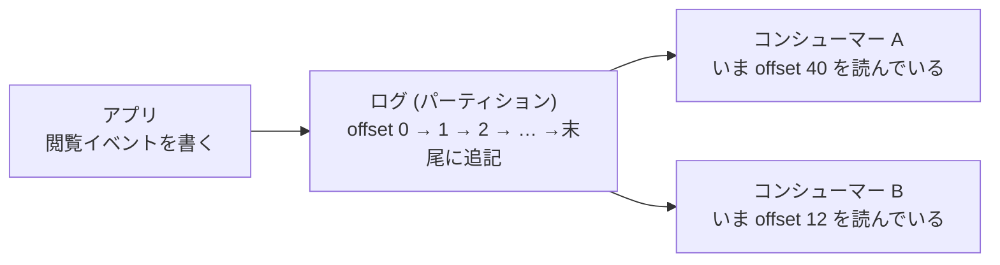

# 第15章 ストリーミング入門

## この章でできるようになること

- バッチとストリームの違いを言い、「ストリームが本当に要る場面」と「バッチで足りる場面」を、要件の聞き方で見分けられる。
- ログ (追記だけの列) という考え方と、Kafka の用語 (ブローカー・トピック・パーティション・オフセット・レプリケーション・保持期間) を、ねぼすけ商店の例で説明できる。
- キーを付けてイベントを送り、同じキーが同じパーティションに入ること、順序が保証されるのはパーティションの中だけであることを、実行して確かめられる。
- コンシューマーグループで読み、処理してからコミットする形で書ける。コミットしないとどうなるかを説明できる。
- 同じメッセージが何度届いても結果が変わらない (冪等な) 書き込み先を作り、ストリームから分ごとの集計表を作れる。

## バッチとストリームの違い

第9章から第14章までで作ってきたのは、基本的にバッチ処理でした。「昨日の分」のように範囲が決まったデータを、決まった時刻にまとめて処理します。範囲が決まっているので、入力には終わりがあり、失敗したら同じ範囲をもう一度やり直せます。

ストリーム処理は、データが届くたびに少しずつ処理を続ける方式です。入力には終わりがなく、プログラムは動き続けます。ねぼすけ商店で言えば、「昨日の閲覧数を朝に集計する」のがバッチ、「いま見られている商品の数を数秒おきに更新し続ける」のがストリームです。

{{ table("b15-batch-vs-stream") }}

この表で、ストリームの利点は遅延の短さだけです。ほかの行は、ストリームのほうが難しい面を表しています。止まらないので、止まったときに遅れがたまります。どこまで処理したかを覚えておく必要があります。同じ出来事が二度届くことも考えなければなりません。この章の後半は、ほとんどがその難しさへの対処です。

なお、バッチとストリームは二択ではありません。バッチでも、実行の間隔を 5 分や 1 分に縮めれば、ストリームに近い遅延になります。データを小さな塊に区切って処理するこの形は、マイクロバッチと呼ばれます。両者の境目は連続的で、どこからをストリームと呼ぶかは製品や人によって違います。

## ストリームが本当に要る場面

「リアルタイムにしたい」という依頼は、よくあります。ただ、依頼者が言う「リアルタイム」は、たいてい厳密な意味ではありません。まず、数字で聞き直します。「結果が出るまで、何分まで待てますか」「それより遅れると、誰が何に困りますか」です。

{{ table("b15-need-stream") }}

判断の軸は、遅延の要件、遅れて困る相手、元のデータの流れ方、運用の体制の 4 つです。要件が「数十秒以内」で、困る相手が機械 (たとえば不正を止める仕組み) なら、ストリームの出番です。人が朝に見るダッシュボードなら、バッチで足ります。

ストリームは、運用の負担が増えます。ブローカーという別のサーバー群を動かし、コンシューマーを常時動かし、遅れ (ラグ) を見張ります。バッチなら、失敗しても翌朝までに直せば間に合うことが多いのに、ストリームでは止まった瞬間から遅れが積もります。要件が緩いのにストリームを選ぶと、このコストを払うだけで得るものがありません。逆に、要件が厳しいのにバッチを 1 日 1 回のまま引き延ばすと、現場は別の苦労をします。大切なのは、要件を聞いたうえで選んだ理由を書き残すことです。

迷ったときの順序は、次のとおりです。まずバッチで作る。バッチの間隔を短くしてみる。それでも足りない要件が確かにあるときに、そこだけをストリームにする。『Fundamentals of Data Engineering』の取り込みの章 (参考文献 3) も、取り込みの頻度を batch・micro-batch・real-time の中から要件に合わせて決める設計判断として扱っています。

## ログという考え方

ストリーム処理の道具の多くは、ログ (log) という単純な構造の上に作られています。ここでのログは、エラーログのように文章を書き出すものではなく、追記だけができる並びのことです。

- 新しいものは、末尾にだけ足される。
- いったん書いたものは、書き換えない。
- 各項目に、先頭から数えた位置の番号が付く。この番号が、後で出てくるオフセットです。

データベースの内部にも、この構造があります。第7章のトランザクションの背後では、PostgreSQL が変更を先に先行書き込みログ (WAL) に追記しています。表の今の中身は、ログに書かれた変更を順に適用した結果、と見ることもできます。

ログの何が嬉しいのでしょうか。ひとつは、読む側が自分のペースで読めることです。ログは消さずに残るので、読み手ごとに別々の位置を覚えておけばよく、読み手が増えても書き手は何も変わりません。もうひとつは、やり直しが効くことです。ある時点から読み直せば、同じ結果をもう一度作れます。Kafka の解説書も、Kafka を「分散コミットログ」と説明しています (参考文献 4、第1章)。



図のように、同じログを 2 つの読み手が別々の位置で読めます。片方が遅くても、もう片方は影響を受けません。

## Kafka と Redpanda

Apache Kafka は、ログを大量に、複数台で分担して持てるようにした仕組みです。ストリーム処理の土台として広く使われています。

この章の手を動かす部分では、Redpanda を使います。Redpanda は Kafka API 互換のブローカーで、Kafka 用に書かれたクライアントのプログラムが、接続先を変えるだけで動くように作られています (参考文献 2)。1 台の Docker コンテナで軽く動くので、学習に向いています。

どこまでが Kafka 共通で、どこからが Redpanda 固有かを、混ぜずに書きます。

- Kafka 共通 (Apache Kafka でも同じ): トピック・パーティション・オフセット・プロデューサー・コンシューマー・コンシューマーグループ・コミットといった考え方と、Python の `confluent-kafka` で書いたコード。この章の本文のほとんどです。
- Redpanda 固有: `rpk` というコマンドラインの道具、`compose.yaml` の起動オプション、既定の設定値の一部。該当する箇所には、その旨を書きます。

細かな互換性は完全に同じとは限りません。本番で使うときは、使う製品と版のドキュメントで確かめてください。

## 用語を一度に整理する

用語を先に並べます。身近な例えは、「トピックは 1 冊の連絡帳、パーティションはその中の何本かの列、オフセットは列の何番目か」です。

{{ table("b15-kafka-terms") }}

もう少し足します。

**ブローカーとレプリケーション。** ブローカーは、ログを実際に預かるサーバーです。1 つのパーティションには、リーダーと呼ぶ 1 つのブローカーが読み書きを受け持ち、ほかのブローカーにフォロワーとして複製が置かれます。この複製の数がレプリカ数 (レプリケーションファクター) です。ブローカーが 1 台壊れても、複製のあるブローカーが引き継ぎます。本番では、レプリカ数を 3 にするのがよくある設定です (組織の方針や製品によって違います)。この章の手元の環境はブローカー 1 台なので、レプリカ数は 1 にしています。壊れたらデータが失われる構成なので、学習専用と考えてください。

**パーティション数。** パーティションは、並列に処理するための単位です。後で見るように、同じグループで同時に読める人数の上限が、パーティションの数です。Kafka ではパーティションを後から増やせますが、減らせません。また、増やすと「同じキーが同じパーティションに入る」という対応が変わります。最初に余裕を持って決めるのが定石です。

**保持期間。** Kafka のブローカーは、読まれたメッセージを消しません。設定した期間 (または量) が過ぎると、古いほうから消します。ブローカーの既定は 7 日です (参考文献 4 の第1章に「たとえば 7 日」とあり、この環境の Redpanda でも 7 日でした。製品や版で変わる値なので、2026年11月時点の手元の確認です)。確かめるコマンドは次のとおりです。

```bash
docker compose exec redpanda rpk topic describe "$TOPIC" --print-configs
```

```text
retention.ms                          604800000   DEFAULT_CONFIG
```

(出力の一部です。604800000 ミリ秒は 7 日です。)ここで覚えておきたいのは、保持期間より長く止まったコンシューマーは、読み残したメッセージを失うことです。期間は、復旧にかかる時間より十分長くします。

## 手を動かす準備

この章のコードは `examples/b15/` にあります。Redpanda が要るので、リポジトリの直下で `docker compose up -d --wait` を実行してから動かします (WSL や Linux のシェルを前提にした例です)。`demo.py` は、トピックを作り、イベントを送り、4 通りの読み方をして、結果を表示します。トピック名は実行ごとにランダムな名前を付けるので、前に動かした結果と混ざりません。

```bash
docker run --rm --network host --user "$(id -u):$(id -g)" -e HOME=/tmp -e KAFKA_BOOTSTRAP=localhost:19092 -v "$PWD":/w -w /w de-book-dev python examples/b15/demo.py
```

環境によっては、`localhost` を IPv6 で試して失敗した旨の警告 (`Connect to ipv6#[::1]:19092 failed`) が rdkafka から表示されます。IPv4 でつながって結果が出ていれば、無視して構いません。

題材は、ねぼすけ商店の行動ログ (events) のうち、閲覧 (`view`) のものです。元のデータの `event_time` は半年に散らばっていて、「分ごとの集計」には向かないので、デモ用に 2026年7月1日 9 時から 1.5 秒おきに振り直し、200 件にしました (`make_stream_events`)。さらに、先頭の 5 件をもう一度末尾に足しています。送る側が再送して同じイベントが二重に入ってしまう事故を、わざと起こしておくためです。

## 送る: プロデューサー、トピック、キー

最初に、トピックを作ります。パーティション数を指定します。

```python title="view_stream.py"
def create_topic(bootstrap, name, partitions=3):
    """トピックを作ります。この手元の 1 台構成ではレプリカ数は 1 しか選べません。"""
    admin = AdminClient({"bootstrap.servers": bootstrap})
    futures = admin.create_topics([NewTopic(name, num_partitions=partitions, replication_factor=1)])
    futures[name].result(timeout=30)
```

次に、イベントを送ります。ここで大事なのは、`key` に顧客の番号を渡していることです。

少し読みにくい部分があるので、先に説明します。`produce` は、メッセージを送信待ちの列に入れて、すぐ戻ります。実際にブローカーに届いたあとで、`on_delivery` に渡した関数が呼ばれます (こういう「あとで呼んでもらう関数」をコールバックと呼びます)。コードの `lambda err, msg, eid=event["event_id"]: ...` は名前のない小さな関数で、`eid=` の部分は、その時点の `event_id` を関数に覚えさせる書き方です。こうしておかないと、あとで呼ばれるときには、ループが進んで別のイベントの番号になってしまいます。`producer.flush` は、送信待ちの列が空になる (全部届く) まで待つ呼び出しです。

```python title="view_stream.py"
def produce_events(bootstrap, topic, events):
    """customer_id をキーにして送ります。届いた先の (event_id, パーティション, オフセット) を返します。
    返る順は、送った順とは限りません (確認が返ってくる順です)。"""
    producer = Producer({"bootstrap.servers": bootstrap, "enable.idempotence": True})
    placed = []

    def on_delivery(err, msg, event_id):
        if err is not None:
            raise KafkaException(err)
        placed.append((event_id, msg.partition(), msg.offset()))

    for event in events:
        producer.produce(topic, key=str(event["customer_id"]), value=json.dumps(event).encode("utf-8"),
                         on_delivery=lambda err, msg, eid=event["event_id"]: on_delivery(err, msg, eid))
        producer.poll(0)
    producer.flush(30)
    return placed
```

キーは、どのパーティションに入れるかを決める材料です。クライアントは、キーの値から計算した数をパーティションの数で割った余りで、行き先を決めます。同じキーなら同じ行き先になります。キーを付けないと、パーティションをばらして振るので、同じ顧客のイベントが別々のパーティションに散らばります。

ここで製品差に注意します。計算方法は、ブローカーではなくクライアントの実装が決めます。Java の Kafka クライアントの既定は murmur2 というハッシュを使いますが、この章で使う `confluent-kafka` (内部は librdkafka) の既定の `partitioner` は、キーの CRC32 を使う `consistent_random` です (参考文献 5)。実際に、本章のテストでは、顧客番号の文字列の CRC32 をパーティション数 3 で割った余りが、送った先と一致することを確かめています。言語やクライアントが違うと、同じキーでも別のパーティションに入ることがあります。複数の言語で同じトピックに書くなら、そろえる必要があります。

もう 1 つ、`enable.idempotence` は混同しやすい設定です。これは、プロデューサーが送信を内部で自動的にやり直したときに、ブローカーに二重に書かれないようにするものです。プログラムが同じイベントを 2 回 `produce` する場合 (今回の再送 5 件) は防げません。層が違います。

実行結果です。

```text
トピック: neboske-views-778fd76b
送った件数: 205 パーティションごと: {0: 62, 1: 78, 2: 65}
```

205 件が 3 本のパーティションに、62・78・65 件と分かれて入りました。

## 順序が保証される範囲

分けると、順序の話が出てきます。Kafka が約束する順序は、1 つのパーティションの中だけです。トピック全体での時刻順は、保証されません (参考文献 4、第1章にも同じ記述があります)。

`read_partition` で、各パーティションを先頭から読んでみます。

```text
--- パーティションの中の並び (先頭 3 件) ---
partition 0: [(0, '91', '00:00'), (1, '166', '00:09'), (2, '443', '00:13')]
partition 1: [(0, '200', '00:01'), (1, '228', '00:07'), (2, '93', '00:18')]
partition 2: [(0, '250', '00:03'), (1, '465', '00:04'), (2, '213', '00:06')]
```

各行の 3 つの値は、(オフセット, キー, 秒の位置の event_time) です。それぞれのパーティションの中は、オフセットが 0・1・2 と進むにつれて時刻も進んでいます。一方、パーティションをまたぐと、9 時 0 分 00 秒 (partition 0) の次の 01 秒は partition 1、03 秒は partition 2 と、別々の列に散らばります。

だから、順序が大切な処理には、キーを選びます。「同じ顧客のイベントは順番に処理したい」なら、顧客番号をキーにします。同じ顧客は同じパーティションに入り、その中の順序は守られます。逆に、顧客をまたいだ全体の順序に頼るプログラムを書いてはいけません。必要なら、後で述べるイベント時刻で並べ直す設計にします。

もう 1 つの注意は、キーの偏りです。特定の顧客 (たとえばテスト用のアカウント) のイベントが極端に多いと、その顧客の入るパーティションだけが重くなります。キーは、順序を守りたい単位のうち、なるべく均等に散らばるものを選びます。

## 読む: コンシューマーとコンシューマーグループ

読む側のプログラムがコンシューマーです。コンシューマーは、`group.id` という名前でグループに入ります。グループのルールは、次の 2 つです。

1. 1 つのパーティションは、同じグループの中の 1 つのコンシューマーだけが読む。
2. 読んだ位置 (オフセット) は、グループごとに、ブローカーに記録される。

1 つ目により、グループに人を足すと、パーティションが分担されて処理が速くなります。ただし上限は、パーティションの数です。パーティションが 3 本なら、4 つ目のコンシューマーは仕事が割り当たらず待機します。2 つ目により、異なるグループは互いに邪魔をせず、同じトピックを別々に読めます。ねぼすけ商店の閲覧イベントを、集計用のグループと、不正検知用のグループが別々に読む、というような使い方です。

誰がどのパーティションを担当するかを決め直す動作が、リバランスです。コンシューマーが加わったとき、抜けたとき、落ちたとき (一定時間応答が無いとき)、購読するトピックが変わったときに起きます。`group_assignments` で、1 つ目のコンシューマーが参加し、次に 2 つ目が参加する様子を見ます。

```text
--- 同じグループに 2 つ目が入ったとき ---
コンシューマー 1 つ: 担当 [[0, 1, 2]]
コンシューマー 2 つ: 担当 [[2], [0, 1]]
```

1 つの間は、3 本すべてを担当しました。2 つ目が入ると、3 本が重ならずに分けられました (どちらが 2 本になるかは実行ごとに変わります)。リバランスの最中は、既定の割り当て方式では、読み取りがいったん止まります。割り当て方式の違い (段階的に移す方式など) は、使う製品とクライアントの版で変わります。コンシューマーを頻繁に起動・停止する運用だと、そのたびに読み取りが止まることは、知っておいてください。

## 配信の保証とコミットのタイミング

コンシューマーは、「どこまで読んで処理したか」をブローカーに伝えます。これがコミットです。コミットされた位置は、次にそのグループが読み始める位置になります。コンシューマーが落ちて再起動すると、最後にコミットした位置から再開します。

つまり、コミットを処理の前にするか後にするかで、落ちたときの結果が変わります。

{{ table("b15-commit-timing") }}

この違いが、配信の保証と呼ばれるものです。

{{ table("b15-delivery") }}

at-most-once は、コミットを先にする形で、落ちるとメッセージを失う代わりに、重複しません。at-least-once は、処理を先にする形で、重複する代わりに、失いません。データ基盤では、失うほうが重大な場面が多いため、at-least-once を選んで重複を受け止める設計がよく採られます (どちらを選ぶかは、失うことと重複することのどちらが困るかで決めます)。

exactly-once (ちょうど 1 回) は、望ましく見えますが、条件付きです。Kafka には、読む・処理する・Kafka に書くを 1 つのトランザクションにまとめる仕組みがあります。ただし、結果の書き先がデータベースやファイルなど Kafka の外にあるときは、その外側まで自動では守ってくれません。したがって、実務では「at-least-once で届けて、受け取る側を冪等にして、結果として 1 回に見せる」やり方がよく使われます。exactly-once の詳しい仕組みと限界は、応用編で扱います。

では、コミットのコードを見ます。`consume` は、メッセージを 1 件ずつ処理し、50 件ごと、そして最後にコミットします。

```python title="view_stream.py"
def consume(bootstrap, topic, group_id, con, commit=True, expected=None, idle_seconds=6.0):
    """トピックを読んで con に入れ、処理した件数を返します。
    commit=True なら、処理が終わってからオフセットを確定します (処理 → コミットの順)。
    expected 件を処理したか、idle_seconds の間 1 件も来なければ終わります。"""
    consumer = Consumer({
        "bootstrap.servers": bootstrap, "group.id": group_id,
        "auto.offset.reset": "earliest",  # このグループの確定済みオフセットが無いときは、先頭から読む
        "enable.auto.commit": False,  # 自動コミットはしない。処理が済んでから自分でコミットする
    })
    consumer.subscribe([topic])
    processed, last_message = 0, time.monotonic()
    try:
        while time.monotonic() - last_message < idle_seconds:
            if expected is not None and processed >= expected:
                break
            msg = consumer.poll(1.0)
            if msg is None:
                continue
            if msg.error():
                raise KafkaException(msg.error())
            handle(con, msg)
            processed += 1
            last_message = time.monotonic()
            if commit and processed % 50 == 0:
                consumer.commit(asynchronous=False)
        if commit and processed:  # 何も読んでいないときは確定するオフセットが無い
            consumer.commit(asynchronous=False)
    finally:
        consumer.close()
    return processed
```

ポイントは 3 つです。`enable.auto.commit` を `False` にして、自動コミットを止めていること。自動コミットは、一定時間ごとにバックグラウンドで位置を確定するので、処理の完了と無関係にコミットされ、取りこぼしの原因になります。次に、`handle` (処理) の後にコミットしていること。最後に、`commit=False` で、あえてコミットしない動作もできるようにしていることです。

`commit=False` で、同じグループ名のまま 2 回続けて読むと、何が起きるでしょうか。コミットの前に落ちて再起動した状態と同じです。`demo.py` の結果です。

```text
--- コミットしない読み方 (コミットの前に落ちたのと同じ) ---
1 回目: 処理 205 件 / events_sink 200 行 / 足し込み方式の合計 205
2 回目: 処理 205 件 / events_sink 200 行 / 足し込み方式の合計 410
```

2 回目も 205 件が全部、もう一度届きました。これが再配信です。`events_sink` は 200 行のままですが、「足し込み方式の合計」は 205 から 410 に増えました。この違いは、次の節で説明します。

`commit=True` にした場合です。

```text
--- 処理してからコミットする読み方 ---
グループ: with-commit-721306
1 回目: 処理 205 件 / events_sink 200 行 / コミット済みの位置の合計 205 (送った件数 205)
2 回目: 処理 0 件 / events_sink 200 行 / コミット済みの位置の合計 205 (送った件数 205)
```

2 回目は 0 件です。ただし「0 件」だけでは、グループへの参加が間に合わずに何も読めなかっただけ、という可能性も残ります。そこで `committed_total` で、ブローカーに記録されたコミット済みの位置を、3 つのパーティションぶん足して見ています。205 は送った件数と同じなので、全部読み終えた記録がブローカーにあります。コミット済みの位置から読み始めたので、新しいメッセージが無く、何も届かなかったのです。ブローカー側から見ると、読み残し (ラグ) が 0 になっています。`rpk group describe` の出力 (一部) です。`rpk` は Redpanda の道具ですが、同じ内容は Kafka の `kafka-consumer-groups.sh` でも見られます。

```text
TOPIC                   PARTITION  CURRENT-OFFSET  LOG-START-OFFSET  LOG-END-OFFSET  LAG
neboske-views-778fd76b  0          62              0                 62              0
neboske-views-778fd76b  1          78              0                 78              0
neboske-views-778fd76b  2          65              0                 65              0
```

取得に使ったコマンドは次のとおりです (`$TOPIC` と `$GROUP` には `demo.py` が表示した名前を入れます)。

```bash
docker compose exec redpanda rpk topic describe "$TOPIC" --print-partitions
docker compose exec redpanda rpk group describe "$GROUP"
```

`CURRENT-OFFSET` がコミット済みの位置、`LOG-END-OFFSET` がログの末尾で、差の `LAG` が読み残しです。ストリームの運用で最初に見張る指標は、このラグです。

## 冪等なコンシューマー: 重複を前提にする

at-least-once を選ぶということは、重複を前提に受け止めるということです。重複は、コミット前に落ちたとき以外にも起きます。上で見たように、送る側の再送も重複を生みます。リバランスの直前に処理した分が、別のコンシューマーにもう一度届くこともあります。

冪等 (べきとう) とは、同じ操作を何回行っても結果が 1 回と同じになる性質です。第9章の取り込みで、同じ範囲を何度流しても結果が変わらないようにしたのと、同じ考え方です。コンシューマーでは、書き込み先をそういう形にします。

```python title="view_stream.py"
def handle(con, msg):
    """1 件を処理します。event_id が同じなら同じ行を上書きするだけなので、何度届いても結果が変わりません。"""
    event = json.loads(msg.value())
    con.execute("""
        INSERT INTO events_sink VALUES (?, ?, ?, ?, ?, ?)
        ON CONFLICT (event_id) DO UPDATE SET customer_id = excluded.customer_id,
            event_type = excluded.event_type, event_time = excluded.event_time,
            src_partition = excluded.src_partition, src_offset = excluded.src_offset
    """, [event["event_id"], event["customer_id"], event["event_type"], event["event_time"],
          msg.partition(), msg.offset()])
    con.execute("""
        INSERT INTO naive_counts VALUES (date_trunc('minute', CAST(? AS TIMESTAMP)), 1)
        ON CONFLICT (minute) DO UPDATE SET views = views + 1
    """, [event["event_time"]])
```

`events_sink` は `event_id` を主キーにして、`ON CONFLICT ... DO UPDATE` で上書きします (行が無ければ追加、あれば更新する書き方をアップサートと呼びます)。同じ `event_id` が何度来ても、行は 1 行です。`ON CONFLICT` の書き方は PostgreSQL と DuckDB にあります。MySQL では `ON DUPLICATE KEY UPDATE`、標準 SQL には `MERGE` があり (第9章)、製品によって書き方が違います。

もう 1 つの `naive_counts` は、比べるための悪い例です。届くたびに閲覧数を 1 足します。重複が来るたびに数字が膨らみ、前の節の出力のように 205、410 と増えました。1 件ずつ足し込む集計は、一見自然ですが、at-least-once とは相性が悪いのです。

冪等にするための、基本の型は次の 3 つです。

1. **一意な ID で上書きする。** イベントに `event_id` のような一意の ID を持たせ、それを主キーにして上書きする。
2. **集計は足し込まず、材料から作り直す。** 結果の表は、材料の表 (ここでは `events_sink`) から SQL で作る。数え間違いが起きても、作り直せば直る。
3. **処理した位置を結果と同じトランザクションで保存する。** コミットの代わりに、書き込み先のデータベースにオフセットも一緒に書く方法。上級の話になるので、名前だけ挙げます。

ID が元から無いイベントもあります。その場合は、元のデータの項目 (顧客番号・イベントの種類・イベント時刻など) から ID を決めて付ける、プロデューサー側で一意な ID を振る、といった対処が要ります。何で同一とみなすかは、業務の側と決めることです。

## スキーマ: 何を送るかを決めておく

メッセージの中身は、ブローカーから見るとただのバイト列です。この章では JSON にしました。人が読めて、書くのも簡単です。一方、JSON には欠点があります。項目名が毎回入るので大きくなりがちです。型の決まりがなく、送る側が項目を変えても、読む側が気づかず壊れることがあります。

そこで、スキーマを決めて、小さなバイナリ形式で送る方法が使われます。代表的な形式が Apache Avro と Protocol Buffers (Protobuf) です。スキーマ (項目と型の定義) を、メッセージの外の「スキーマレジストリ」という仕組みに登録しておき、送る側と読む側が同じ定義を参照します。定義を変えるときに、互換性がなければ登録を断る、といった使い方ができます。ここでは名前だけ紹介し、中身は応用編 第7章のデータ契約・スキーマ進化に譲ります。

最初の一歩としては、JSON のままでも、送る側と読む側が必ず持つ項目 (`event_id`・`event_time` など) を文書にして、読む側が想定外の形を見つけたら止まる (または捨てたものを数える) ようにするだけでも、事故は減らせます。

## イベント時刻と処理時刻の入口

ストリームのデータには、時刻が 2 種類あります。

- イベント時刻 (event time): その出来事が実際に起きた時刻。ねぼすけ商店の `event_time`。
- 処理時刻 (processing time): システムがそれを受け取って処理した時刻。`received_at` や、コンシューマーが読んだ時刻。

この 2 つはずれます。ねぼすけ商店の行動ログは、約 3% を、発生の 1 日以上あとに届くように作ってあります (`neboske_shop.py` の遅延到着の欠陥)。電波の悪い場所で操作されたスマートフォンのイベントが、あとからまとめて届くような状況です。

「分ごとの閲覧数」を、どちらの時刻で数えるかで、意味が変わります。処理時刻で数えると、遅れて届いたものは「届いた分」に入り、実際に見られた分から数がずれます。イベント時刻で数えると、見られた分に正しく入りますが、遅れて届いたイベントのために、過去の分の数字をあとから直すことになります。この章の `minute_counts` は `event_time` で数えます。材料の `events_sink` から作る表なので、遅れたものが届けば、集計し直すだけで直ります。

ストリーム処理の専門の道具には、「どこまで待てば、その分の集計を確定してよいか」を決める仕組み (ウォーターマークと呼びます) があります。ここでは、2 つの時刻を区別する習慣を持つことが目標です。仕組みは応用編 第4章「ストリーミング設計」で扱います。

## ストリームからテーブルを作る

最後に、ストリームからテーブルを作ります。ここまでで、`events_sink` には、重複のない閲覧イベントが入りました。分ごとの集計は、そこから SQL で作ります。

```python title="view_stream.py"
def minute_counts(con):
    """events_sink から分ごとの閲覧数を作ります (集計はいつでも作り直せる)。"""
    return con.execute("""
        SELECT date_trunc('minute', event_time) AS minute, count(*) AS views
        FROM events_sink GROUP BY minute ORDER BY minute
    """).fetchall()
```

実行結果です。

```text
--- 分ごとの閲覧数 (events_sink から作る) ---
09:00 40
09:01 40
09:02 40
09:03 40
09:04 40
```

200 件が 1.5 秒おきなので、1 分に 40 件ずつ 5 分です。5 件の再送が入っていても、数字は 40 のままです。ここまでが、ストリーム処理の最小の形になります。ブローカーから読み、冪等に書き、集計は材料から作る。実務の道具が複雑になっても、この骨格は変わりません。

この結果を、ダッシュボードの表にするときは、次の点を決めます。分ごとの集計は、毎回全部作り直すのか、新しい分だけ更新するのか。遅れて届いたものは、いつまで受け入れるのか。ここで更新を「足し込み」にせず、「対象の分を作り直して置き換える」形にしておけば、冪等さを保てます。第9章の「パーティション単位で置き換える」と同じ型です。

## よくある失敗

- **ストリームでなくてよい要件に使う。** 「リアルタイムで」と言われ、確かめずに作る。まず数字で要件を聞き、バッチの間隔の短縮で足りないかを試します。
- **自動コミットのまま、処理が終わる前にコミットされる。** 落ちたときに失われます。`enable.auto.commit` を切って、処理の後に自分でコミットします。
- **重複を考えず、足し込みで集計する。** 再配信で数字が膨らみます。ID で上書きし、集計は材料から作ります。
- **順序をトピック全体で期待する。** 保証されるのはパーティションの中だけです。順序が要る単位をキーにします。
- **キーを付けずに、順序が要る処理を書く。** 同じ顧客のイベントが別々のパーティションに散って、順序が崩れます。
- **パーティション数を少なく始めて、あとで増やして困る。** 増やすとキーの行き先が変わり、順序が途中で変わります。並列度の見込みから、余裕を持って決めます。
- **保持期間より長く止める。** 読み残したメッセージが消えます。ラグを見張り、復旧の見込みより長く保持します。
- **スキーマを決めずに項目を変える。** 読む側が壊れます。項目の追加・削除は、読む側と相談して順に進めます。
- **送信の成否を確かめない。** `produce` はメッセージを送信待ちの列に入れるだけで、ブローカーに届いたとは限りません。`flush` を呼ばずにプログラムが終わると、列に残ったものが失われます。届いたかどうかは、`on_delivery` (配信結果を受け取る関数) の `err` で確かめます。また、`acks` は「何台のブローカーが書き込めたら成功とみなすか」の設定で、`confluent-kafka` の既定は `all` (-1、同期しているレプリカ全部) です (参考文献 5)。`acks=0` のような弱い設定に変えると、速くなる代わりに、書き込めたかを確かめられなくなります。
- **処理が遅くてリバランスを繰り返す。** コンシューマーは、`poll` を呼ぶ間隔が `max.poll.interval.ms` (librdkafka の既定は 300000 ミリ秒 = 5 分、参考文献 5) を超えると、落ちたとみなされてグループから外され、リバランスが起きます。1 件の処理が長いと、外される → 戻る → また外される、を繰り返します。1 回に処理する量を減らすか、時間のかかる処理を `poll` の外に出します。
- **本番と同じつもりで、手元の 1 台構成を使う。** レプリカ数 1 では、ブローカーが壊れるとデータが失われます。

## まとめ

- バッチは範囲を区切ってまとめて、ストリームは届くたびに続けて処理します。ストリームは遅延が短い代わりに、運用が重くなります。「リアルタイム」は数字で聞き直し、バッチで足りるなら足します。
- ログは追記だけの並びで、位置 (オフセット) で読めます。Kafka のパーティションは、そのログ 1 本です。
- 順序が保証されるのは、パーティションの中だけです。順序を守りたい単位をキーにします。
- コンシューマーグループは、パーティションを分担して読みます。並列度の上限はパーティション数で、メンバーが変わるとリバランスが起きます。
- 処理してからコミットすれば取りこぼさず、代わりに重複が届きます。重複を前提に、一意な ID で上書きして、集計は材料から作ります。
- イベント時刻と処理時刻は別物です。数える時刻を決めて、遅れて届いたものの扱いを決めておきます。

!!! tip "さらに深く"
    配信の保証 (exactly-once を含む) と、イベント時刻・ウォーターマークによる集計の確定は、応用編 第4章「ストリーミング設計」で扱います。スキーマの互換性は、応用編 第7章「データ契約とスキーマ進化」にも関係します。

## 練習問題

問1. 次の 3 つの依頼のうち、バッチで足りそうなものと、ストリームを検討すべきものを分け、理由を 1 行ずつ書いてください。(a) 営業担当が毎朝見る、前日の商品別の売上。(b) 同じクレジットカードで 1 分間に 10 回の注文が入ったら、自動で止めたい。(c) 商品ページに「いま 5 人が見ています」と表示したい。

??? note "解答例"
    (a) バッチで足ります。見るのは人で、朝までに揃っていれば困りません。(b) ストリームを検討します。止める相手は機械で、数十秒以内の判断が要ります。ただし、その前に「1 分」の根拠を聞き、入力の流れ方も確かめます。(c) 要件次第です。「いま」が 1 分遅れでよければ、1 分間隔のバッチや、閲覧イベントの短い間隔の集計で足ります。数秒の更新が必須ならストリームですが、表示の正確さを求める必要があるかも確かめます (多少ずれてよいなら、運用の軽い方法を選べます)。

問2. `examples/b15/view_stream.py` の `consume` で `commit=False` を `True` に変えて、`demo.py` と同じ流れ (同じグループ名で 2 回続けて実行) で動かしたとき、2 回目の `処理 N 件` の N は何件になりますか。そのあと、グループ名だけを変えて 3 回目を実行したときの N と、`events_sink` の行数も答えてください。理由もつけてください。

??? note "解答例"
    2 回目は 0 件です。1 回目の最後に、全メッセージの位置をコミットしてあるからです。グループ名を変えた 3 回目は、そのグループにはコミットがないため、`auto.offset.reset` が `earliest` なので先頭から全部 (205 件) を読み直します。ただし、`events_sink` は `event_id` で上書きするので、行数は 200 のままです。実際の動作は、`test_commit_after_processing_means_rerun_adds_nothing` が確かめています (グループ名を変えるケースを含みます)。

問3. `handle` の `ON CONFLICT (event_id) DO UPDATE` を、`DO NOTHING` に変えると、どちらが良い場面ですか。2 つの場面を挙げて、結果の違いを説明してください。

??? note "解答例"
    `DO NOTHING` は、同じ `event_id` なら中身も同じとみなせる場合に向きます (最初の 1 件を正とする)。この章の再送は、中身が同じなので、どちらでも結果は同じです。`DO UPDATE` は、同じ ID で中身が更新されて届く場合に向きます (たとえば注文の状態が変わったイベントで、最新を正としたい場合)。ただし、`DO UPDATE` で単純に上書きすると、古いイベントが後から届いたときに、新しい値を古い値で戻してしまいます。更新時刻などを見て、新しいほうだけを採用する条件が要ります。

問4. 閲覧イベントを `customer_id` ではなく `event_type` をキーにして送ると、順序と並列度はどう変わりますか。

??? note "解答例"
    `view` だけを送る場合は、キーが全部同じ値になり、全部のイベントが 1 つのパーティションに入ります。順序はそのパーティションの中で完全に保たれますが、並列度が 1 になり、ほかの 2 本は使われません。`event_type` が 4〜5 種類しかない場合も、使えるパーティションは最大でその種類の数までで、偏りも大きくなります。順序を守りたい単位 (顧客) ごとに、数が多くて偏りの少ない値をキーにする理由です。

## 参考文献

1. Apache Kafka Documentation. <https://kafka.apache.org/documentation/>（トピック・パーティション・レプリケーション・コンシューマーグループ・メッセージ配信の保証・保持期間の設定。2026年11月時点）
2. Redpanda Documentation. <https://docs.redpanda.com/>（Kafka API 互換、`rpk`、トピックの既定設定。この章の動作確認は Redpanda v24.3.1）
3. Joe Reis, Matt Housley. *Fundamentals of Data Engineering*. O'Reilly Media, 2022. 第 7 章 (Ingestion)。
4. Gwen Shapira, Todd Palino, Rajini Sivaram, Krit Petty. *Kafka: The Definitive Guide*, 2nd Edition (Early Release, 2020). O'Reilly Media. 第 1 章 (Meet Kafka)。コミットログ、トピックとパーティション、順序、コンシューマーグループ、保持期間の説明。
5. librdkafka. "Configuration properties". <https://github.com/confluentinc/librdkafka/blob/master/CONFIGURATION.md>（`partitioner`、`enable.idempotence`、`enable.auto.commit`）
6. Confluent. "confluent-kafka-python" Documentation. <https://docs.confluent.io/platform/current/clients/confluent-kafka-python/html/index.html>
