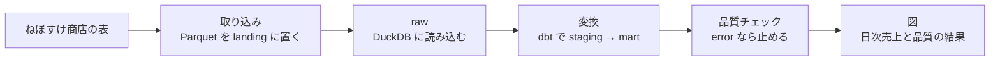

# 第16章 実践プロジェクトとキャリア

## この章でできるようになること

- 取り込みから図までの流れ (取り込み → raw → 変換 → 品質チェック → 図) を、1 本のスクリプトで通して動かし、各工程が止まる条件を説明できる。
- 同じ日付で何度実行しても同じ結果になること、品質チェックの error で後ろの工程が止まることを、テストで確かめられる。
- 設計メモ (README) を、「何を決めたか・なぜか・何をやらなかったか」の順で書ける。
- ポートフォリオに何を見せ、何を入れてはいけないかを判断できる。
- 現場に入ってからの最初の 90 日の過ごし方、学び続ける方法、面接で聞かれることと答え方の型を持てる。
- 応用編 12 章の内容を、自分の次の学習計画に結びつけられる。

## 基礎編の総仕上げ: 日次売上と品質のダッシュボード

第1章で、店長から「売上ダッシュボードを作ってほしい」と頼まれる場面を取り上げました。あのとき作ったのは、SQL 1 本でした。この章では、同じ依頼を、仕事として通用する形で作り直します。これまでの章の部品を全部つないで、「日次売上」と「その数字を信じてよいか」を 1 枚の図にします。

流れは次のとおりです。



{{ table("b16-steps") }}

この表で大事なのは、右端の列です。パイプラインは、動いているときより、壊れたときの振る舞いで価値が決まります。書きかけのファイルを読まない。変換のテストが落ちたら先へ進まない。売上の数字が合わなければ、図を作らない。間違った図が店長の目に触れるより、図が出ないほうがましだからです。

### 使う部品について

この演習は、新しく書くコードを少なくして、前の章のものを使い直します。

- 取り込み: events は、第9章の `landing_files.py` (`land_events` で置き、`load_new_partitions` で読み込む) をそのまま呼びます。第9章のコードに無い customers・orders・order_items の置き込みだけを、同じ決まり (`_SUCCESS` を最後に置く、日付のパーティション) で `examples/b16/ingest.py` に書きました。
- 変換: 第10章の dbt プロジェクト (`examples/b10/`) を、作業フォルダにコピーして `dbt build` します。第10章のテストと同じく、既知の問題を表すテスト (`tag:known_issue`) は除きます。そのため、この章の売上の定義は、第10章の `fct_daily_sales` (キャンセル以外の注文の金額を、日ごとに足したもの) と同じです。この章では新しい dbt のモデルは作りません。
- 品質チェック: 第13章の考え方 (「悪い行の数 / 見た行の数」で表す確認、error と warn の区別、結果の記録) を、この演習に要る分だけ小さくした `examples/b16/quality.py` を使います。第13章のコード例は、執筆の時点でこの本のリポジトリの main に入っていなかったので、そのまま呼ばず、自前の小さな版にしています。

第9章のコードは、boto3 の S3 クライアントを受け取って動きます。サービスが無い環境 (図のビルドなど) でも動かせるように、`examples/b16/store.py` に、手元のフォルダで S3 の呼び出しを受け止める小さな代用品 (`LocalS3`) を置きました。MinIO に置くときは、本物の boto3 のクライアントを渡します。パイプラインの側は、どちらが来たかを知りません。

### 動かす

WSL や Linux のシェルで、リポジトリの直下から動かします。Docker で動かす `de-book-dev` は、この本の開発用イメージです (第14章)。まず MinIO に置く版です。`docker compose up -d --wait` で MinIO を起動してから実行します。

```bash
# リポジトリの直下で動かします。先に docker compose up -d --wait で MinIO を起動しておきます。
# minioadmin は、この本の compose.yaml の MinIO の初期のユーザー名とパスワードです (手元の学習用)。本番では環境変数や .env から渡し、コードに書きません。
# --network host は、コンテナの中から localhost の MinIO に届かせるためです。結果は work/b16/ にできます。
docker run --rm --network host --user "$(id -u):$(id -g)" -e HOME=/tmp -e S3_ENDPOINT=http://localhost:9000 -e S3_ACCESS_KEY=minioadmin -e S3_SECRET_KEY=minioadmin -v "$PWD":/w -w /w de-book-dev python examples/b16/pipeline.py --dt 2026-07-01 --workdir work/b16
```

`minioadmin` は、この本の `compose.yaml` が作る手元の MinIO の初期のユーザー名とパスワードで、学習用です。本番のキーは、コードに書かず、環境変数や `.env` (リポジトリに入れない) から渡します (第3章)。次は、サービスなしで手元のフォルダに置く版です。MinIO が無くても動きます。

```bash
# サービスなしで、手元のフォルダ (work/b16/landing/) に置いて動かす場合です。S3_ENDPOINT を渡さないので MinIO は使いません。
docker run --rm --user "$(id -u):$(id -g)" -e HOME=/tmp -v "$PWD":/w -w /w de-book-dev python examples/b16/pipeline.py --dt 2026-07-01 --workdir work/b16
```

どちらも、結果は `work/b16/` にできます (`.gitignore` に入れてあります。確認が済んだら消して構いません)。
実行すると、次のように表示されました (MinIO に置いた場合です。`work/b16/` に、DuckDB のファイル `warehouse.duckdb` と図の SVG ができます)。

```text
raw に読み込み: {'customers': 505, 'orders': 3000, 'order_items': 7469, 'events': 4040}
  OK    orders が空でない
  OK    日別売上の日付が NULL でも重複でもない
  OK    日別売上の合計が raw の明細と一致する
  WARN  events の event_id が重複していない
  OK    events の遅延到着 (翌日以降) が 5% 以下
図: work/b16/dashboard_2026-07-01.svg
```

`WARN` が 1 件出ています。ねぼすけ商店の行動ログには、重複して届く行を意図的に入れてあるためです (第13章)。重複は 4,040 行中の 40 行で、このチェックは「知らせて進む」(warn) の扱いです。売上の計算には events を使わないので、止める理由がありません。できあがる図は、次のようなものです。


上の図は、日別売上の棒と 7 日の移動平均線、下に品質チェックの結果の一覧です。図は `examples/figures/b16_dashboard.py` が、サービスなしのモード (手元のフォルダに置く形) で同じパイプラインを動かして作ります。数字を手で写していないので、データや定義を変えれば図も変わります。

## 中を読む

### 取り込みと raw

`land` は、表を Parquet (列ごとにまとめて保存するファイル形式。第2章) にして置き、**最後に** `_SUCCESS` を置きます。第9章で見たとおり、全部置き終えた印です。再実行のとき、最初に前回の印を消します。消さずに置き直すと、置き直しの途中で止まったとき、前回の印が残ったまま中身が半分だけ新しくなり、読む側が「置き終わっている」と思って読んでしまうからです。

```python title="ingest.py"
def land(s3, bucket, dt):
    """TABLES を Parquet にして置き、events は第9章の land_events で置きます。印は最後です。"""
    data = generate()
    s3.delete_object(Bucket=bucket, Key=success_key(dt))  # 置き直す前に、前回の印を消す
    for name in TABLES:
        buf = io.BytesIO()
        pq.write_table(pa.Table.from_pylist(data[name]), buf)
        s3.put_object(Bucket=bucket, Key=f"raw/dt={dt}/{name}.parquet", Body=buf.getvalue())
    landing_files.land_events(s3, bucket, data["events"])  # 日ごとの _SUCCESS も、置き終えたあとに置かれる
    s3.put_object(Bucket=bucket, Key=success_key(dt), Body=b"")
```

events は、第9章の `land_events` が、受信日ごとに `landing/events/dt=<日付>/` へ置き、日ごとに印も置きます。読む側の `load_raw` は、`raw/dt=<取り込み日>/_SUCCESS` が無ければ読みません。

```python title="ingest.py"
def load_raw(con, s3, bucket, dt):
    """印のある dt だけを、DuckDB の raw 表 (main スキーマ) に読み込みます。件数の辞書を返します。"""
    keys = [o["Key"] for page in s3.get_paginator("list_objects_v2").paginate(Bucket=bucket, Prefix=success_key(dt))
            for o in page.get("Contents", [])]
    if success_key(dt) not in keys:
        raise RuntimeError(f"dt={dt} は _SUCCESS が無いので読みません (書きかけかもしれません)")
    counts = {}
    for name in TABLES:
        body = s3.get_object(Bucket=bucket, Key=f"raw/dt={dt}/{name}.parquet")["Body"].read()
        con.register("_t", pq.read_table(io.BytesIO(body)))
        con.execute(f"CREATE OR REPLACE TABLE main.{name} AS SELECT * FROM _t")
        con.unregister("_t")
        counts[name] = con.execute(f"SELECT count(*) FROM main.{name}").fetchall()[0][0]
    # events: 第9章の load_partition で events_raw に入れ、dbt が読む main.events (元の 5 列) を作る
    landing_files.setup_raw(con)
    landing_files.load_new_partitions(con, s3, bucket)
    con.execute("""CREATE OR REPLACE TABLE main.events AS
                   SELECT event_id, customer_id, event_type, event_time, received_at FROM events_raw""")
    counts["events"] = con.execute("SELECT count(*) FROM main.events").fetchall()[0][0]
    return counts
```

決まりが4つコードに入っています。置く場所は `raw/dt=<取り込み日>/` で、同じ日付なら同じキーを上書きするので、何度実行しても結果は同じです (冪等)。印は、前回のものを消してから、最後に置きます。読む側は印が無ければ読みません。そして、raw 表は元の値のまま入れます。表記ゆれも重複も直しません。直す場所を変換に限ると、「元はどうだったか」がいつでも raw に残ります。events の 4,040 行に重複の 40 行が含まれているのは、そのためです。

`dt` は本来「取り込んだ日」です。この演習の元データは固定のデータセットなので、`--dt` は取り込みの区分けの名前として渡しています。

### 変換

変換は dbt です。第10章のプロジェクトをそのまま使うので、この章でモデルのコードは増えません。第10章で作った staging が、状態の表記ゆれ (`shipped` と `SHIPPED`) を小文字にそろえ、events の重複を取り除きます。mart の `fct_daily_sales` が、キャンセル以外の注文の件数と売上を日ごとに数えます。粒度は「1 行 = 1 日」です (第8章)。dbt のテストも第10章のものがそのまま動きます。実行結果は、25 件中 `PASS=24 WARN=1 ERROR=0` でした。WARN の 1 件は、events の `event_id` の重複 (40 件) を知らせる、第10章で severity を warn にしたテストです。

dbt を呼ぶ部分は、プロジェクトを作業フォルダにコピーしてから実行します。dbt は実行すると `target/` と `logs/` を作るので、リポジトリの中を汚さないためです。`subprocess.run` は、プログラムの中から別のコマンド (ここでは `dbt`) を動かす呼び出しで、終了コードが 0 以外なら失敗です。失敗したときは、dbt の出力 (標準出力と標準エラー) の末尾を例外に付けて、原因を追えるようにしています。

```python title="pipeline.py"
def dbt_build(workdir, db_path):
    """第10章の dbt プロジェクトを workdir にコピーして build します (target と logs をリポジトリに残さないため)。
    既知の問題 (tag:known_issue のテスト) は、第10章のテストと同じく除きます。"""
    project = Path(workdir) / "dbt"
    shutil.rmtree(project, ignore_errors=True)
    shutil.copytree(DBT_PROJECT, project, ignore=shutil.ignore_patterns(
        "test_*.py", "__pycache__", "exercises", "ci-example.yml", "usage*.sh", "target", "logs", "*.duckdb"))
    env = {**os.environ, "DBT_DUCKDB_PATH": str(db_path), "DBT_SEND_ANONYMOUS_USAGE_STATS": "False"}
    try:
        result = subprocess.run(
            ["dbt", "build", "--exclude", "tag:known_issue", "--project-dir", str(project),
             "--profiles-dir", str(project), "--no-use-colors"], capture_output=True, text=True, env=env)
    except FileNotFoundError:
        raise RuntimeError("dbt コマンドが見つかりません (pip install dbt-duckdb か、開発用イメージで動かしてください)")
    if result.returncode != 0:
        raise RuntimeError("dbt build が失敗しました:\n" + result.stdout[-2000:] + result.stderr[-1000:])
```

### 品質チェック

確認は、「悪い行の数」と「見た行の数」を返す SQL 1 本で表します (第13章)。一覧は `quality.py` の `CHECKS` にあります。その中の 1 つ、売上の突合 (とつごう: 2 つの出どころの数字が合うかの確認) は、変換の結果を、raw から別の書き方で数え直した値と比べます。

実行して結果を残すのは `run_checks` です。

```python title="quality.py"
def run_checks(con, run_dt, checks=CHECKS):
    """全部の確認を実行して dq_results に残します。error が 1 つでも不合格なら、残したあとで止めます。"""
    con.execute("""CREATE TABLE IF NOT EXISTS dq_results (
        run_dt VARCHAR, check_name VARCHAR, severity VARCHAR, bad BIGINT, total BIGINT,
        passed BOOLEAN, checked_at TIMESTAMPTZ)""")
    con.execute("DELETE FROM dq_results WHERE run_dt = ?", [run_dt])  # 同じ日を再実行しても結果は 1 組だけ
    failed = []
    for check in checks:
        bad, total = con.execute(check.sql).fetchone()
        passed = total == 0 or bad / total <= check.max_ratio
        con.execute("INSERT INTO dq_results VALUES (?, ?, ?, ?, ?, ?, ?)",
                    [run_dt, check.name, check.severity, bad, total, passed, datetime.now(timezone.utc)])
        if not passed and check.severity == "error":
            failed.append(check.name)
    if failed:
        raise QualityError("error の確認が不合格です: " + ", ".join(failed))
```

ここにも、教えた決まりが入っています。error の不合格があっても、**全部の確認を実行して結果を残してから**止めます。最初の不合格で止めると、ほかに何が壊れているかが見えないからです。また、同じ日を再実行したときに結果が二重に残らないよう、その日の結果を消してから入れます。

### 1 本につなぐ

全体をつなぐのは、`pipeline.py` の `run` です。

```python title="pipeline.py"
def run(s3, bucket, dt, workdir):
    """全工程を実行して、図のパスを返します。"""
    workdir = Path(workdir)
    workdir.mkdir(parents=True, exist_ok=True)
    db_path = workdir / "warehouse.duckdb"
    ingest.land(s3, bucket, dt)
    con = duckdb.connect(str(db_path))
    try:
        print("raw に読み込み:", ingest.load_raw(con, s3, bucket, dt))
    finally:
        con.close()  # dbt が同じファイルを開くので、いったん閉じる (DuckDB は同時に 1 つのプロセスしか書けない)
    dbt_build(workdir, db_path)
    con = duckdb.connect(str(db_path))
    try:
        try:
            quality.run_checks(con, dt)
        finally:
            for name, severity, passed in con.execute(
                    "SELECT check_name, severity, passed FROM dq_results WHERE run_dt = ? ORDER BY rowid", [dt]).fetchall():
                print(f"  {'OK  ' if passed else severity.upper():5} {name}")
        figure = workdir / f"dashboard_{dt}.svg"
        dashboard.draw(con, dt, figure)
    finally:
        con.close()
    return figure
```

プログラムは、上から順に動きます。途中で例外 (エラーを知らせる仕組み) が出ると、その行でプログラムは止まり、後ろの行は実行されません。これが「失敗したら後ろの工程が動かない」の正体です。`try ... finally` は、例外が出ても出なくても、`finally` の中を必ず実行する書き方です。`finally` の中で結果を表示しているので、`QualityError` で止まったときにも、どの確認が不合格だったかが表示に残ります。DuckDB は 1 つのファイルを同時に 1 つのプロセスしか書き込めないので、dbt を呼ぶ前に、こちらの接続をいったん閉じています。

## 止まり方と冪等さを確かめる

動かして「できた」で終わらせず、テストで確かめます。`examples/b16/test_b16_project.py` に、次の内容が入っています。

- 手元のフォルダ版と MinIO 版の両方で、最後まで通る。落ちた確認は、warn の 1 件だけ。売上の合計は、第10章の `fct_orders` から数えた値と一致する。
- 同じ日付で 2 回実行しても、売上の合計も `dq_results` も変わらない。
- `land` が前回の `_SUCCESS` を最初に消し、新しい `_SUCCESS` を最後に 1 回だけ置く (`put` と `delete` の呼び出し順を記録して確かめる)。
- 置き直しの途中で落ちると、古い印が残らず、`load_raw` が `RuntimeError` で拒否する。
- 売上の合計をわざと合わなくすると、`QualityError` で止まる。止まる前に、5 件すべての結果が記録されている。
- 日付の NULL は 1 回だけ数える (確認の SQL の数え方)。

パイプラインを書いたあと、「壊したときにどうなるか」を 1 回は確かめてください。確かめていない止まり方は、本番で初めて動くことになります。

## 設計メモ (README) を書く

作ったものを、他の人が (半年後の自分も) 引き継げるようにするのが、設計メモです。コードの説明ではなく、**決めたことと、その理由**を書きます。コードを読めば何をしているかは分かりますが、なぜそうしたか、何をやらなかったかは分からないからです。

書く項目の目安は、次の 7 つです。

1. 何のためか (誰が、何に使うか)
2. 決めたこと (数字の定義。「売上」にキャンセルを含めるか、など)
3. 全体の流れ (図か短い文)
4. 動かし方 (コピーして動く形で)
5. 品質チェックと、止める基準
6. 既知の限界
7. 次にやること

このプロジェクトの設計メモを、`examples/b16/DESIGN_MEMO.md` に置きました。

```text
# ねぼすけ商店 日次売上ダッシュボード 設計メモ

## 何のためか
店長が毎朝、前日までの日別売上と、その数字を信じてよいかを 1 枚で見られるようにする。

## 決めたこと (数字の定義)
- 売上 = キャンセル以外の注文の「数量 × 単価」の合計 (第10章の fct_daily_sales と同じ定義)。
- 注文日 = ordered_at の日付。元データの時刻はタイムゾーンを持たないので、変換せずそのまま日付にしている。
  第2章の「タイムゾーン付きの UTC で保存する」決まりは、元データにタイムゾーンが無いため適用できていない (限界に記載)。
- 状態の表記ゆれ (shipped / SHIPPED) は、変換 (staging) で小文字にそろえる。raw は直さない。
- 更新は 1 日 1 回。結果が出るまでの許容は翌朝まで (バッチで足りる。ストリームにはしない)。

## 全体の流れ
取り込み (landing に置く。events は第9章の仕組み) → raw (DuckDB) → dbt (第10章のプロジェクト)
→ 品質チェック (5 件) → 図 (SVG)。どこかで失敗したら後ろの工程は動かない。

## 動かし方
    docker compose up -d --wait
    sh examples/b16/run-minio.sh      (サービスなしなら run-local.sh)
結果は work/b16/ にできる。同じ日付で何度実行しても同じ結果になる (landing のキーは上書き、raw と dbt は作り直し、dq_results は日付ごとに入れ替え)。

## 品質チェックと、止める基準
- error (止める): orders が空 / 日別売上の日付の NULL・重複 / 日別売上の合計が raw の明細と不一致。
- warn (知らせて進む): events の event_id 重複 (元データの既知の欠陥。現状 40 件) / 遅延到着が 5% 超。
- 基準の根拠: 売上の数字が壊れるものは error、集計に直接使わない events の欠陥は warn。

## 既知の限界
- 注文日のタイムゾーンが不明 (上記)。時刻の意味を元データの持ち主に確認するまで、日付の境目の近くの注文は日がずれるかもしれない。
- 取り込みは毎回全件の置き直し (増分ではない)。件数が増えたら watermark 方式に変える。
- 実行はコマンド 1 本。スケジューラ (Airflow など) には載せていない。
- 通知は標準出力だけ。

## 次にやること
1. 増分取り込みにする。 2. Airflow から呼ぶ。 3. warn の件数が増えたら通知する。
```

特に「既知の限界」は、書くのに勇気がいる項目です。しかし、ここを書いていると、読む人は「この人は何ができて何ができないかを分かっている」と受け取ります。書かないと、読む人は自分で限界を探し当てることになり、書いた人への信頼を損ねることがあります。

なお、判断の記録を 1 件ずつ短い文書にして残す書き方があります。Michael Nygard が提案した Architecture Decision Record (ADR) で、「状況・決めたこと・結果」を 1 枚に書きます (参考文献 2)。設計メモの「決めたこと」が増えてきたら、ADR に分けると読みやすくなります。

## ポートフォリオにするときのコツ

ポートフォリオは、「この人に仕事を任せられるか」を判断する材料です。派手さより、**再現できること**と、**判断が見えること**が大事です。

**何を見せるか。**

- 1 つの題材を、取り込みから使える形まで通したもの。この章の演習のように、止まり方と冪等さまで確かめてあるもの。
- 設計メモ。何を決めて何をやらなかったか。
- テスト。動くことを自動で確かめている証拠になります。
- 失敗と直した記録。「最初はこうして壊れ、こう直した」は、完成品より多くを伝えます。

**入れてはいけないもの。**

- 秘密 (API キー・パスワード・接続文字列・`.env`)。公開した瞬間に、悪用されるおそれがあります。一度でも commit した秘密は、履歴に残ります。消したつもりでも、キーは失効させて作り直します。第3章の `.gitignore` と環境変数の使い方を、そのまま使います。
- 勤務先や顧客のデータ・コード・社内の名前。守秘義務に触れます。題材は、公開データか、ねぼすけ商店のような架空のデータにします。
- 個人情報。氏名やメールアドレスが入ったデータは、架空のものであっても、本物と区別がつかない形では載せません。

**再現手順。** README の「動かし方」を、新しい環境で上から順に実行して、動くことを自分で確かめます。自分のマシンにだけある設定やファイルに頼っていないか、見つかるのはたいていここです。`docker compose up` とテストのコマンドを、そのまま貼れる形で書くと、見る人の手間が大きく減ります。

**見る人の時間は短い。** README の最初の数行で、何を作ったか、何が分かるかを書きます。細かい説明はその下です。

## 現場での最初の 90 日

入社(または異動)後の最初の 90 日は、新しいものを作るより、**読んで、聞いて、小さく直す**時間にします。新しいものを早く作りたくなりますが、そこにある仕組みを知らないまま作ると、既にある別の仕組みと食い違います。

{{ table("b16-90days") }}

**聞くこと。** 次の質問は、どの職場でも役に立ちます。

- このデータは、誰が、何のために、どのくらいの頻度で見ていますか。止まると誰が困りますか。
- 過去に大きく壊れたことはありますか。そのとき何が原因でしたか。
- 「売上」「有効な顧客」のような言葉の定義は、どこに書いてありますか。人によって違いませんか。
- 夜中に壊れたとき、誰が気づいて、誰が直しますか。

**読むもの。** 動いているジョブの一覧と、直近の失敗の履歴、既存のドキュメント、レビューで指摘されている内容 (チームが大事にしている基準が見えます)、そして障害の振り返りです。振り返りは、責める文書ではなく、仕組みの弱点を読む文書として書かれているのが理想で、Google の SRE の本が「責めない振り返り」の考え方を説明しています (参考文献 3)。

**小さく直す。** 最初に直すのは、影響が小さく、確認しやすいものにします。たとえば、テストの無い重要な列にテストを足す。失敗しても誰にも通知されないジョブに通知を足す。実行手順の書かれていない作業を、手順書にする。小さく直して、レビューを受け、出す。この往復を、チームの流儀を知るために使います。

直すときの習慣が 3 つあります。1 つ目は、変更を小さな単位に分けて、コミットメッセージに「何を、なぜ」を書くことです (第3章)。`fix(b16): …` のように、種類を頭に付ける書き方もあります。2 つ目は、プルリクエスト (PR: 変更をレビューしてもらう依頼) の説明に、確認した方法 (どのテストを動かしたか) を書くことです。3 つ目は、大きな変更を 1 つの PR に詰めず、レビューする人が 1 回で読める量にすることです。

**手順書 (runbook) と引き継ぎ。** 手順書は、「この警告が出たら、まず何を見て、どう直すか」を書いた文書です。夜中に呼ばれた当番が、背景を知らなくても動けるようにします。書く内容は、症状、確認するコマンド、直す手順、直らないときの連絡先です。当番の引き継ぎでは、直近の障害、まだ直っていない既知の問題、これから実行されるジョブ (大きなデータ移行など) を、短い文で伝えます。

**失敗のログの読み方。** パイプラインが失敗したら、まずログの最後の数十行ではなく、最初のエラーの行を探します。後ろのエラーは、最初のエラーの結果として出ることが多いためです。dbt なら、`dbt build` の出力で `ERROR` が付いたモデルかテストの名前を見て、`target/run/` にある実際に実行された SQL を、DuckDB や psql で動かして確かめます。Airflow なら (第12章)、画面でその実行 (DAG run) の失敗したタスクを選び、そのタスクのログを開きます。失敗したタスクの、さらに上流のタスクが成功しているかも見ます。再実行する前に、同じ日付で何度実行しても結果が同じか (冪等か) を確かめてください。

やってはいけないのは、読む前に「作り直したい」と言い出すことです。作り直したくなる部分には、まだ理由を知らないだけのものが含まれています。理由を聞いてから、それでも直したいなら、根拠を数字で示して提案します。

## 学び続ける

データエンジニアリングの道具は、数年で入れ替わります。そのため、道具の使い方より、**変わらない考え方**を土台にして、道具は必要になったときに調べて覚えるのが、長く続く方法です。

**公式ドキュメントを一次情報にする。** ブログの記事は、書かれた時点の版の話です。仕様は、公式ドキュメントで確かめます。PostgreSQL・DuckDB・dbt・Airflow・Kafka・Docker は、どれもドキュメントが充実しています (参考文献 5 から 10)。使っている版のページを開いているかを確かめる癖をつけてください。

**リリースノートを読む。** 使っている道具の新しい版が出たら、リリースノートの「破壊的な変更」と「非推奨」の項目だけでも読みます。版を上げたときに挙動が変わる点は、ここに書かれています。PostgreSQL・Airflow・dbt・DuckDB は、どれも公開しています (参考文献 5 から 8)。

**手元の本。** 筆者の手元にある本のうち、この本の内容に近い実在の本を挙げます (版は表のとおりです)。

{{ table("b16-books") }}

読み方は、章を最初から全部読むより、いま仕事で困っている段階の章を先に読み、必要なら戻る形が続きます。本に出てくるコードや構成は、自分で動かして初めて身につくので、小さくても手を動かしてください。

**自分の記録を残す。** 分からなかったことと、解決した方法を、短くメモにします。この本の設計メモと同じで、半年後の自分への手紙です。

## 面接でよく聞かれること

面接の質問は会社ごとに違うので、ここに書くのは「よく聞かれる分野」と「答えの型」です。型を持っていると、知らない質問が来たときにも、落ち着いて組み立てられます。

{{ table("b16-interview") }}

**SQL。** 手元で書く問題が出ることがあります。最初に粒度(1 行が何か)を確かめてから書き、書いたあとで件数で検算する、という順にすると、間違いに気づきやすくなります。DuckDB で動かしている SQL なので、PostgreSQL などとの違いも注記します。`examples/b16/interview.sql` に、次の形の問題を置きました。

```sql
-- 面接でよく出る形の SQL。パイプラインを一度動かしたあとの warehouse.duckdb (DuckDB) で動かします。

-- 1. 顧客ごとの最初の注文 (同じ時刻のときは order_id の小さいほう)。標準 SQL の書き方
SELECT customer_id, order_id, ordered_at
FROM (
    SELECT customer_id, order_id, ordered_at,
           row_number() OVER (PARTITION BY customer_id ORDER BY ordered_at, order_id) AS rn
    FROM analytics.stg_orders
) AS t
WHERE rn = 1
ORDER BY customer_id;

-- 2. 日別売上の「直近 7 行」の平均。注文の無い日は行が無いので、7 行は 7 日とは限らない
SELECT order_date, sales,
       avg(sales) OVER (ORDER BY order_date ROWS BETWEEN 6 PRECEDING AND CURRENT ROW) AS avg_last_7_rows
FROM analytics.fct_daily_sales
ORDER BY order_date;

-- 3. 検算: 注文の件数が、明細の無い注文を含めて合っているか (JOIN で行が消えていないか)
SELECT (SELECT count(*) FROM analytics.stg_orders) AS orders,
       (SELECT count(DISTINCT order_id) FROM main.order_items) AS orders_with_items;
```

1 つ目は `row_number` で、顧客ごとの先頭の行を取る定番の形です。DuckDB には `QUALIFY` という、窓関数の結果で絞る構文があり、サブクエリなしで書けます。ただし PostgreSQL や標準 SQL にはない書き方なので、面接で使うなら、どこで動くかを一言添えてください。2 つ目は、「直近 7 日」を `ROWS BETWEEN 6 PRECEDING` で書いたものです。これは直近の **7 行**であって、注文の無い日の行が無ければ、7 日ではありません。7 日にしたいなら、日付の表と結合して欠けた日を 0 で埋めるか、範囲指定 (`RANGE`) を使います(`RANGE` の間隔指定の書き方は製品で違います)。「この数字は本当に 7 日か」と自分から指摘できると、数字を疑う習慣があることが伝わります。

**モデリング。** 第8章の 4 つの手順をそのまま口に出します。「まず業務の質問を確かめ、粒度を決めて、ファクトとディメンションを分け、履歴の持ち方を決めます」。

**パイプラインの設計。** 「毎朝の売上レポートの基盤を設計してください」のような問いでは、いきなり道具の名前を並べないことです。鮮度(翌朝までか)、正しさ(どの定義か)、量(何行か)を、聞き返します。次に、取り込み・保存・変換・品質・運用の順に、選んだ理由と、**選ばなかった案**を言います。この章の設計メモの構成が、そのまま答えの骨組みになります。

**障害対応。** 「朝に数字がおかしいと言われたら」という問いには、順序で答えます。まず間違った数字が使われ続けないように止める(止血)。次に影響範囲(いつから、どのテーブルとレポートか)。原因を調べて直す。最後に、再発を防ぐテストと通知を足す。原因探しの前に止血を言えるかを、確かめる面接官もいます。

答えるときの注意が 2 つあります。分からないことは「分かりません。こう調べます」と言うこと。経験していないことを、したように話さないこと。この本の演習で作ったものは、「自分で作って確かめた」と堂々と言える題材です。

## 応用編への案内

基礎編は、ここまでです。続く応用編は、全 12 章です。現場で出会う順や、興味のある順で読んで構いません。

{{ table("b16-advanced") }}

次に何を読むかは、いま困っていることで決めるのが一番です。たとえば、Spark のジョブが遅いなら第2章、秘密や個人情報の扱いが気になるなら第9章、コストが話題なら第10章です。迷ったら、この章の設計メモの「次にやること」を見てください。そこに書いたことに一番近い章が、次の一歩です。

## よくある失敗

- **全部を 1 つのスクリプトに詰めて、途中の結果を残さない。** 失敗したとき、どの工程が悪いか分からなくなります。この演習のように、工程ごとに置き場(landing・raw・mart)を分けます。
- **動いたところで終わって、壊れたときを試さない。** 止まり方も、再実行も、テストで確かめます。
- **品質チェックが全部 error、または全部 warn。** 全部 error だと、頻繁に止まって見られなくなりがちで、全部 warn だと、何も止まりません。売上の数字が壊れるものだけを error にします。
- **README に動かし方だけがあって、理由が無い。** 引き継ぐ人が最初に知りたいのは、なぜそうなっているかです。
- **ポートフォリオに秘密や実データが入る。** 公開前に、履歴も含めて確かめます。
- **最初の 90 日で作り直そうとする。** 読む・聞く・小さく直すを先にします。
- **学ぶ対象を道具で追い続ける。** 新しい名前が出るたびに追うと終わりがありません。考え方を土台にして、道具は必要になったときに学びます。
- **面接で、経験していないことを経験したように話す。** 深く聞かれると崩れます。作って確かめたことを、そのまま話すほうが強いです。

## まとめ

- 基礎編の総仕上げとして、取り込み → raw → 変換 → 品質チェック → 図を 1 本で通しました。大事なのは、壊れたときに、どこで止まるかです。
- 書きかけを読まない (`_SUCCESS` を最後に置き、置き直す前に前回の印を消す)、同じ日付で再実行しても同じ (冪等)、error の不合格では図を作らない、という決まりを、コードとテストの両方に入れました。
- 設計メモは「決めたこと・理由・限界・次にやること」を書きます。ポートフォリオは再現できることと判断が見えることが大事で、秘密と実データは入れません。
- 最初の 90 日は、読む・聞く・小さく直す。学び続けるには、公式ドキュメントとリリースノートを一次情報にします。
- 面接では、分野ごとの答えの型 (粒度の確認、要件を聞き返す、止血から始める) を持ちます。

おつかれさまでした。基礎編はここまでです。次は、手元で動くものを 1 つ、自分の題材で作ってみてください。

!!! tip "さらに深く"
    パイプラインの健康を数字で見張る方法(SLO・リネージ)は、応用編 第8章「観測性・SLO・リネージ」で扱います。チームでの役割分担や基盤の運営は、応用編 第12章「プラットフォーム設計と組織」です。

## 練習問題

問1. `examples/b16/quality.py` の `CHECKS` に、「`fct_daily_sales` の売上に負の値が無い」という error の確認を 1 件足してください。足したあと、パイプラインが通ることを確かめ、そのうえで、どんな状況でその確認が不合格になるかを 1 つ挙げてください。

??? note "解答例"
    たとえば `Check("日別売上に負の値が無い", "error", "SELECT count(*) FILTER (WHERE sales < 0), count(*) FROM analytics.fct_daily_sales")` を足します。bad が 0 なら合格で、通ります。不合格になるのは、返品の行 (数量が負の明細) が raw に混ざり、日の合計が負になるような場合です。この確認が error なのは、売上の数字そのものが壊れるためです。なお `FILTER (WHERE …)` は標準 SQL の書き方で、PostgreSQL でも動きます (DuckDB 独自ではありません)。なお、足したら `test_b16_project.py` の件数の確認 (`len(quality.CHECKS)`) は自動で追従しますが、「落ちたのは warn の 1 件だけ」の確認は、そのまま通ることを実行して確かめてください。

問2. `examples/b16/ingest.py` の `land` から、最初の `s3.delete_object(...)` の行 (前回の `_SUCCESS` を消す行) を消すと、`test_b16_project.py` のどのテストが落ちますか。理由とあわせて答えてください。実際に消して動かして確かめてください。

??? note "解答例"
    `test_land_removes_old_marker_first_and_puts_new_one_last` (呼び出しの最初が `delete` でなくなる) と、`test_interrupted_reland_leaves_no_marker_and_load_refuses` (1 回目の成功で置かれた印が残ったまま、2 回目が途中で落ちるので、`load_raw` が拒否せずに読んでしまう) の 2 つが落ちます。後者は、書きかけの状態を「置き終わっている」と誤って読んでしまう、実際の事故そのものを再現しています。

問3. 面接で「ダッシュボードの売上が、昨日と比べて半分になっている」と言われました。最初の 3 つの行動を、順序の理由とともに答えてください。

??? note "解答例"
    1 つ目は、間違った数字が使われ続けないようにする止血です(ダッシュボードに注意書きを出す、更新を止めるなど)。理由は、原因探しの間も、見た人が誤った判断をするためです。2 つ目は、影響範囲の確認です。いつから半分か、全体か特定の商品や地域だけか、ほかのレポートにも出ているか。範囲が分かると、原因の見当がつきます。3 つ目は、パイプラインの工程を遡ることです。品質チェックの結果、直近の取り込みの件数、変換のテストを、出口から入口の順に見ます。取り込みの件数が半分なら取り込み、そうでなければ変換や定義の変更です。原因を直したあとに、同じことを検知するテストと通知を足します。

問4. 自分のポートフォリオ用リポジトリを公開する前の点検として、第3章の道具を使い、秘密が入っていないかを確かめる手順を書いてください。

??? note "解答例"
    作業ツリーだけでなく履歴も調べます。たとえば `git log -p` の出力を `grep -i -E "password|secret|api[_-]?key|token"` にかける、`git ls-files` で `.env` やキーのファイルが追跡されていないかを見る、`.gitignore` に `.env` が入っているかを見る、の 3 つです。専用の検出ツールを使うこともできます。見つかったら、履歴から消すだけでなく、そのキーを失効させて作り直します。公開した後で消しても、すでにコピーされているおそれがあるためです。

問5. 自分の題材のデータ (公開データや、自分で作った架空のデータ) で、小さなパイプラインを 1 本作ってください。作ったら、上の 7 項目で設計メモを書いてください。書いたあと、新しい環境 (別のフォルダ、または別のマシン) で、メモの「動かし方」だけを見て動くかを確かめます。

??? note "解答例"
    正解は 1 つではありません。点検の観点は 3 つです。(1) 「決めたこと」に、数字の定義とその理由があるか。(2) 「品質チェックと止める基準」で、error と warn を分けた理由が書いてあるか。(3) 「既知の限界」に、書くのが少し恥ずかしいことも含めて、3 つ以上あるか。動かし方で詰まった箇所は、そのままメモを直す材料になります。

## 参考文献

1. Joe Reis, Matt Housley. *Fundamentals of Data Engineering*. O'Reilly Media, 2022.（全体の設計判断、取り込み、変換、提供）
2. Michael Nygard. "Documenting Architecture Decisions". 2011. <https://cognitect.com/blog/2011/11/15/documenting-architecture-decisions>（ADR）
3. Google. *Site Reliability Engineering*. "Postmortem Culture: Learning from Failure". <https://sre.google/sre-book/postmortem-culture/>（責めない振り返り）
4. Matt Palmer. *Understanding ETL*. O'Reilly Media (Databricks 提供版), 2024.（取り込み、変換、オーケストレーション、障害の対処）
5. PostgreSQL Documentation. "Release Notes". <https://www.postgresql.org/docs/release/>
6. Apache Airflow Documentation. "Release Notes". <https://airflow.apache.org/docs/apache-airflow/stable/release_notes.html>
7. dbt Documentation. "Upgrading to new versions of dbt Core" (各版の変更点)。<https://docs.getdbt.com/docs/dbt-versions/core-upgrade>
8. DuckDB. "News". <https://duckdb.org/news/>
9. Apache Kafka Documentation. <https://kafka.apache.org/documentation/>
10. Docker Documentation. <https://docs.docker.com/>
11. Gwen Shapira ほか. *Kafka: The Definitive Guide*, 2nd Edition (Early Release, 2020). O'Reilly Media. / Jules S. Damji ほか. *Learning Spark*, 2nd Edition. O'Reilly Media, 2020. / Russell Jurney. *Agile Data Science 2.0*. O'Reilly Media, 2017.（学び続けるための本の表）
