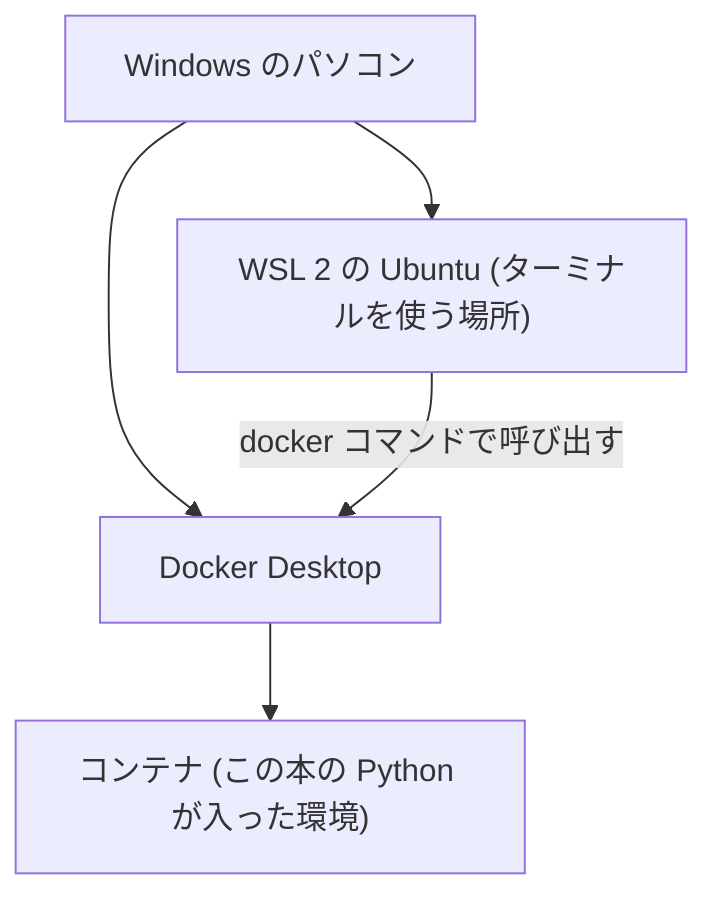

# 第1章 パソコンとターミナルの基本

## この章でできるようになること

- ファイル・フォルダ・拡張子・パスという言葉を、自分の言葉で説明できる。
- ターミナルを開き、`pwd` `ls` `cd` `mkdir` `cat` `cp` `mv` `rm` を使って、フォルダの中を動き回れる。
- エラーメッセージが出たとき、慌てずに最初に見る場所が分かる。
- Windows では WSL 2 の Ubuntu、Mac ではターミナルが使える状態にする。
- VS Code と Docker を入れ、この本のリポジトリ (本のコードとデータの置き場所) を手元に持ってきて、`docker run` で Python のバージョンを表示できる。

この章は、プログラムを書く前の「準備の準備」です。ここで道具がそろえば、第 2 章から先は Python を書くことだけに集中できます。ただし、この章には自分のパソコンの設定を変える手順が多く含まれます。時間がかかるのは普通のことで、一度に終わらせる必要はありません。区切りのよいところ (章の中の見出しごと) で休んでください。

この章の枠は 2 種類あります。bash と書いた枠は、ターミナルに打つコマンドです。text と書いた枠は、画面に出る文字や、マウスで操作する手順です。ソフトの画面は更新されて変わることがあります。名前や場所が合わないときは、章末の参考文献にある公式ページが正です。

## ファイルとフォルダ

パソコンの中の情報は、**ファイル**と**フォルダ**でできています。ファイルは文章や写真など、ひとまとまりの情報です。フォルダは、ファイルをしまっておく入れ物で、フォルダの中にフォルダを入れることもできます。Windows のエクスプローラーや Mac の Finder で見ている景色が、まさにこれです。

この章の最初の大事な考え方は、「フォルダは入れ子になっていて、木のような形をしている」ことです。いちばん上のフォルダから、枝分かれして下へ広がっていきます。たとえばこの章の練習で作るフォルダは、次のような形になります。

```text
home
└── taro
    └── deb-practice
        ├── memo.txt
        └── data
```

`taro` は例のためのユーザー名です。あなたのパソコンでは、あなたのユーザー名が入ります。

### 拡張子

ファイルの名前の最後にある `.txt` や `.py` のような部分を**拡張子**と言います。拡張子は、「このファイルは何の種類か」を人とソフトに伝える目印です。`hello.py` なら、Python のプログラムだと分かります。この本でよく見る拡張子を、次の表にまとめます。

{{ table("s01-extensions") }}

つまずきやすい点があります。Windows のエクスプローラーは、初期設定だと拡張子を隠します。`memo.txt` が `memo` とだけ表示されるので、`memo.txt.txt` のような名前のファイルを作ってしまう人がいます。エクスプローラーの「表示」メニューから「ファイル名拡張子」にチェックを入れると、拡張子が見えるようになります。以降は、拡張子まで含めてファイル名と考えてください。

## パス: ファイルの住所

あるファイルを指すとき、「どのフォルダのどこにあるか」を書いたものを**パス**と言います。住所と同じ考え方で、書き方が 2 通りあります。

1. **絶対パス**: いちばん上のフォルダ (**ルート**と言い、`/` と書きます) から全部書く。住所で言えば「石川県…」と都道府県から書く形。
2. **相対パス**: 今いるフォルダを出発点にして書く。「この家の隣」と言うような形。

ここで「今いるフォルダ」という考え方が必要になります。ターミナルは、いつもどこかのフォルダの中に「いる」ことになっていて、これを**カレントディレクトリ** (現在のフォルダ。ディレクトリはフォルダの別名です) と呼びます。相対パスは、そこから数えます。

もうひとつ、**ホームフォルダ**という特別なフォルダがあります。自分専用の置き場所で、ターミナルを開くとまずここにいます。`~` (チルダ) という 1 文字で表せます。Linux (WSL の Ubuntu) では `/home/ユーザー名`、Mac では `/Users/ユーザー名` です。

パスの書き方をまとめます。`.` は今いるフォルダ、`..` はひとつ上のフォルダを表します。

{{ table("s01-path-kinds") }}

Windows のふだんの画面では `C:\Users\taro\Documents` のように `\` で区切りますが、この本で使う WSL の Ubuntu と Mac では `/` で区切ります。区切りの文字が違うので、同じ場所でも見かけが違います。

## ターミナルとは何か

**ターミナル**は、文字でパソコンに命令を出す画面です。マウスで「ファイルを開く」「フォルダを作る」とする代わりに、`mkdir deb-practice` のように文字で打ちます。打った命令を**コマンド**と言います。

なぜ文字で命令するのでしょうか。同じ命令を何度でも同じように繰り返せるからです。そして、データエンジニアが使う道具 (データベース、Docker、Git など) の多くは、ターミナルから使う前提で作られているからです。

ターミナルの中で、打ったコマンドを受け取って実行するソフトを**シェル**と言います。この本の Ubuntu と、最近の Mac では、シェルの種類が違います (Ubuntu は bash、Mac は zsh)。ただし、この章で使う基本のコマンドは、どちらでも同じ名前で同じように動きます。

### Windows と Mac で、この本が決めたこと

この本では、環境の違いで迷わないように、次のように決めます。

- **Windows**: WSL 2 の上に入れた Ubuntu を使う。
- **Mac**: 最初から入っているターミナルを使う。

WSL (Windows Subsystem for Linux) は、Windows の中で Linux を動かす仕組みです。データエンジニアが仕事で触るサーバーの多くは Linux なので、同じ感覚で練習できます。Ubuntu は Linux の種類のひとつで、WSL ではこれが標準です。

違いを一覧にします。

{{ table("s01-os-differences") }}

仕組みの全体像は、次の図のとおりです。コンテナと Docker は、この章の後半で説明します。今は「この本のコードを動かす箱」と読んでください。Windows の人は、パソコンの中に入れ子で環境が増えます。



## Windows: WSL 2 と Ubuntu を入れる

Mac の人はこの節を飛ばして、次の「Mac: ターミナルを開く」へ進んでください。

ここは Microsoft の公式手順の要点です。出典は章末の参考文献にあります。

**前提**: Windows 10 のバージョン 2004 以降 (ビルド 19041 以降) か Windows 11 であること。公式の手順によると、これより古い場合は「手動のインストール手順」のページを見る必要があります。後で入れる Docker Desktop はさらに新しく、Windows 10 22H2 (ビルド 19045) 以降か Windows 11 23H2 (ビルド 22631) 以降、と WSL 2.1.5 以降が必要です (Docker 公式の Windows 版のインストールのページ)。

手順は次のとおりです。マウスで操作する部分と、キーボードで文字を打つ部分があります。

```text
1. キーボードの Windows キーを押し、「PowerShell」と打つ。
2. 出てきた「Windows PowerShell」を右クリックし、「管理者として実行」を選ぶ。
3.「このアプリがデバイスに変更を加えることを許可しますか?」と聞かれたら「はい」を押す。
4. 青い画面が開く。1 行目の左端が PS C:\Windows\system32> のようになっていれば、管理者の PowerShell。
5. その後ろに、次の文字を打って Enter キーを押す。
     wsl --install
6. 文字が流れ、終わると「再起動が必要です」のような案内が出る。パソコンを再起動する。
```

公式の説明では、この 1 行で WSL を動かすのに必要な機能が有効になり、標準では Ubuntu が入ります。再起動のあと、Ubuntu の画面が自動で開くことがあります。開かなければ、スタートメニューで「Ubuntu」と打って開きます。初回は、ファイルの展開のために時間がかかります。

```text
Installing, this may take a few minutes...
```

この表示が出ている間は、待ちます。機能の有効化のあとに、もう一度再起動を求められることもあります。その場合は、指示どおり再起動して、また Ubuntu を開きます。公式には、2 回目以降の起動は 1 秒もかからないと書かれています。

!!! warning "青い PowerShell の画面と Ubuntu の画面を間違えない"
    `wsl --install` を打つのは、**青い PowerShell の画面**だけです。これ以降のこの本のコマンドは、**Ubuntu の画面** (黒か紺色) に打ちます。見分け方は、行の最後の記号です。Ubuntu は `$`、PowerShell は `>` で終わります。

Ubuntu の初回の起動では、**ユーザー名とパスワード**を決めるよう求められます。

```text
Enter new UNIX username: taro
New password:
Retype new password:
```

ここで一番多いつまずきは、**パスワードを打っても画面に何も出ない**ことです。壊れたわけではありません。Linux では、パスワードの入力中は文字も `*` も表示しないのが普通です。何も出なくても、打った文字は受け取られています。そのまま打って Enter を押してください。ユーザー名は半角の英小文字がおすすめです。パスワードは忘れないようにメモしておきます (あとで `sudo` というコマンドで使います)。

もし `wsl --install` でヘルプが出るだけだったら、`wsl --list --online` で入れられる一覧を見て、`wsl --install -d Ubuntu` で入れます (公式の手順)。

### Ubuntu の画面を開く

スタートメニューで「Ubuntu」と打つと、黒い (または紺色の) 画面が開きます。これがターミナルです。次のような 1 行が表示されていれば成功です。

```text
taro@NEBO-PC:~$
```

この 1 行を**プロンプト**と言い、「コマンドを待っています」という合図です。見方は `ユーザー名@パソコン名:今いるフォルダ$` です。`~` はホームフォルダのことで、最初はホームフォルダにいると分かります。あなたの画面では、`taro` と `NEBO-PC` の部分があなたのユーザー名とパソコン名になります。

これ以降、この本のコマンドは、**このプロンプトの `$` の後ろの、点滅しているカーソル**の位置に打つものです。窓を閉じてしまったときは、スタートメニューで「Ubuntu」と打てば、また開けます。本文には、プロンプトの `taro@NEBO-PC:~$` の部分は書かず、打つ文字だけを書きます。画面に出る内容は、そのあとの text の枠に書きます。

## Mac: ターミナルを開く

Mac には、最初からターミナルが入っています。開き方は 2 通りです。

```text
方法 1: ⌘ (コマンド) キーを押しながらスペースキーを押し、Spotlight に「ターミナル」と入力して Enter。
方法 2: Finder で「アプリケーション」→「ユーティリティ」→「ターミナル」を開く。
```

開くと、プロンプトが表示されます。Mac の標準のシェルは zsh で、プロンプトは `taro@MacBook ~ %` のような形です。Ubuntu の `$` の代わりに `%` になりますが、コマンドを打つ位置は同じです。この本のコマンドは、どちらでも同じように動きます。

## 最初のコマンド: 今いる場所を知る

では、実際に打ってみましょう。ターミナルを開いたら、1 行ずつ打って Enter キーを押します。**打つ → 画面を見る → 何が起きたかを考える**の順で進めます。

まず、フォルダを作って入り、今いる場所を表示します。

```bash
mkdir deb-practice
cd deb-practice
pwd
```

この 3 行は、1 行ずつ Enter を押して打ちます。順に説明します。

- `mkdir deb-practice`: `deb-practice` という名前のフォルダを作ります。`mkdir` は make directory (ディレクトリを作る) の略です。成功したときは、何も表示されません。
- `cd deb-practice`: そのフォルダの中へ移動します。`cd` は change directory の略です。これも成功したときは何も表示されません。
- `pwd`: 今いるフォルダを表示します。print working directory の略です。

`pwd` を打つと、次のように表示されます。

```text
/home/taro/deb-practice
```

これが、今いる場所の絶対パスです。`/home/taro` はホームフォルダ、その中の `deb-practice` に今いる、と読めます。あなたの画面では、`taro` の部分が自分のユーザー名になります (Mac では `/Users/ユーザー名/deb-practice` と出ます)。

ここで、**コマンドは成功すると何も言わない**ことに気づいてください。`mkdir` も `cd` も無言でした。「何も起きなかった」と思いがちですが、エラーが出なかったことが成功の知らせです。

次は、フォルダの中身を一覧する `ls` です。

```bash
ls
```

作ったばかりのフォルダは空なので、**何も表示されません**。これも失敗ではありません。空だから何もない、というだけです。

## ファイルを作る・読む・コピーする・動かす・消す

空のフォルダではつまらないので、ファイルを作ります。

```bash
echo "ねぼすけ商店" > memo.txt
ls
cat memo.txt
```

画面にはこう出ます。

```text
memo.txt
ねぼすけ商店
```

1 行目の `echo "ねぼすけ商店" > memo.txt` は、`echo` (文字を表示するコマンド) の結果を、画面でなく `memo.txt` というファイルに書き込む、という命令です。`>` は「右側のファイルに書き込む」印で、同じ名前のファイルがすでにあれば**中身を上書き**します。`>>` と 2 つ重ねると、上書きでなく**末尾に追加**します。

2 行目の `ls` で `memo.txt` が見えるようになり、3 行目の `cat memo.txt` で中身が表示されました。`cat` は、ファイルの中身を画面に出すコマンドです。

引用符 `"` は半角です。日本語入力のまま打つと全角の `”` になり、うまく動きません。コマンドを打つときは、日本語入力をオフにしておくのが無難です。

### コピーと移動

次に、ファイルをコピーして、名前を変えます。

```bash
cp memo.txt memo-copy.txt
mv memo-copy.txt note.txt
ls
```

```text
memo.txt
note.txt
```

- `cp A B`: ファイル A を B という名前でコピーします (copy)。A は残ります。
- `mv A B`: ファイル A を B に動かします (move)。同じフォルダの中で B という新しい名前を与えると、**名前の変更**になります。別のフォルダを B に指定すれば、移動になります。

### 消す: rm は取り消せない

最後に、ファイルを消します。

```bash
rm note.txt
ls
```

```text
memo.txt
```

`rm` は remove の略です。ここで、**とても大事な注意**があります。`rm` で消したファイルは、**ごみ箱に入りません**。取り消しの方法もありません。Windows や Mac のごみ箱から「元に戻す」ようなことは、ターミナルでは基本的にできません。

なので、`rm` を打つ前には、次の 2 つを必ず確かめてください。

1. `pwd` で、今いるフォルダが正しいか。
2. 消す対象の名前が、打った通りか。

とくに危ないのが、フォルダごと消す `rm -r` (`-r` は「中身ごと」) です。たとえば `rm -r ~` のように、ホームフォルダを指定してしまうと、自分のファイルが全部消えます。**意味が分からないコマンドは、貼り付けて実行しない**ことを習慣にしてください。この本の練習では、`deb-practice` フォルダの中のファイルしか消しません。

ここまでのコマンドを表にまとめます。

{{ table("s01-commands") }}

## 場所を移動する: 絶対パスと相対パス

次は、フォルダの階層を動き回る練習です。さきほどの `deb-practice` の中に `data` というフォルダを作り、そこへ移動します。ホームフォルダから打ちます。すでに `deb-practice` の中にいる場合は、先に `cd ~` でホームフォルダに戻ってください。

```bash
mkdir -p deb-practice/data
cd deb-practice/data
pwd
```

```text
/home/taro/deb-practice/data
```

`mkdir -p` の `-p` は、途中のフォルダがなくてもまとめて作る、という指定です。ここでは `deb-practice` がすでにあるのでエラーにならず、`data` だけが作られます。

`cd deb-practice/data` のように、今いる場所を出発点にして書いたのが**相対パス**です。

ひとつ上のフォルダへ戻るには、`..` を使います。

```bash
cd ..
pwd
```

```text
/home/taro/deb-practice
```

`cd ..` は、ひとつ上のフォルダへ移動する命令です。`..` を重ねた `../..` は、ふたつ上を指します。

### 隠しファイル

名前が `.` で始まるファイルは、**隠しファイル**で、`ls` では普通は表示されません。設定ファイルなどに使われます。`deb-practice` の中には、前に作った `memo.txt` と、いま作った `data` があります。ここに隠しファイルを作って、確かめてみましょう。

```bash
touch .hidden
ls
ls -a
```

```text
data
memo.txt
.
..
.hidden
data
memo.txt
```

`touch` は、空のファイルを作るコマンドです。1 回目の `ls` には `.hidden` が出ず、`data` と `memo.txt` だけですが、`ls -a` (`-a` は all) だと `.hidden` が出ます。ここに出てくる `.` と `..` は、さきほどの「今いるフォルダ」と「ひとつ上のフォルダ」です。上の出力は 1 行に 1 つずつ並べましたが、ふつうのターミナルでは横に並んで出ます。並び順も環境の設定で変わることがあるので、あなたの画面と少し違っても気にしなくて大丈夫です。

### ホームフォルダに戻る

どこにいても、`cd ~` (または `cd` だけ) でホームフォルダに戻れます。迷子になったら、まずこれを打つのが安全です。

```bash
cd data
cd ../..
pwd
```

```text
/home/taro
```

`cd data` で `deb-practice/data` に入り、`cd ../..` でふたつ上、つまりホームフォルダに戻りました。続けて `cd ~` を打っても、同じ結果です。

```bash
cd ~
pwd
```

```text
/home/taro
```

## エラーメッセージの読み方

コマンドが失敗すると、エラーメッセージが出ます。最初は読むのが怖いのですが、**エラーは「どこで・何がうまくいかなかったか」を教えてくれる親切なメモ**です。ないファイルを指定してみましょう。

```bash
cat nothing.txt
ls /no/such/folder
```

```text
cat: nothing.txt: No such file or directory
ls: cannot access '/no/such/folder': No such file or directory
```

どちらも、読み方は同じです。

1. 最初の単語 (`cat:` や `ls:`) が、**エラーを出したコマンド**です。
2. 次に、**問題の対象** (ファイル名やフォルダ名) が出ます。
3. 最後が**原因**です。`No such file or directory` は「そんなファイルもフォルダもありません」という意味です。

最初に見るのは、次の 3 つです。

- 名前の打ち間違いはないか (大文字小文字も区別されます)。
- 今いるフォルダは、そのファイルのあるフォルダか (`pwd` と `ls` で確かめます)。
- 全角の文字やスペースが混ざっていないか。

`No such file or directory` が出たときは、ほとんどの場合、今いる場所が違うか、名前が違うか、です。

## キーボードのコツ

ターミナルは、少しのコツで打つ量が大きく減ります。使うキーを表にまとめます。

{{ table("s01-keys") }}

とくに便利なのが **Tab 補完**です。たとえば `cd deb-p` まで打って Tab キーを押すと、`cd deb-practice` まで自動で補ってくれます。名前の候補がひとつしかないときは補完され、複数あるときは、Tab を 2 回押すと候補が並びます。補完されるということは、その名前が実在するということなので、打ち間違い防止にもなります。

**↑ キー**を押すと、直前に打ったコマンドが現れます。同じコマンドを少し直して打ちたいときに使います。

**Ctrl+C** は、実行中のコマンドを止めます。画面が止まったまま戻ってこないときや、間違えて大きな処理を始めてしまったときの非常口です。Ctrl キーを押しながら C を押します。ターミナルでは、このキーは「コピー」ではありません。コピー&ペーストをするときは、多くの環境で Ctrl+Shift+C と Ctrl+Shift+V (Mac は ⌘+C と ⌘+V) を使います。

## エディタ: VS Code を入れる

コマンドで `echo` を使ってファイルを作る方法は、短い内容にしか向きません。プログラムを書くときは、**エディタ** (文章やプログラムを書くための専用ソフト) を使います。この本では、無料で広く使われている **Visual Studio Code** (以下 VS Code) を使います。

VS Code の入れ方は、OS によって少し違います。

```text
共通: ブラウザで VS Code の公式サイト (https://code.visualstudio.com/) を開き、
      自分の OS 用のインストーラーをダウンロードして、実行する。
Windows の注意: インストール中に「追加タスクの選択」が出たら、
      「PATH への追加」にチェックを入れる。
      これで、ターミナルから code コマンドが使える。
Windows の注意: VS Code は、WSL の中ではなく Windows 側に入れる。
```

公式の WSL の説明によると、Windows の場合は Windows 側に VS Code を入れ、さらに拡張機能「WSL」(Microsoft 製) を入れます。拡張機能は、VS Code に機能を足す部品です。

```text
1. VS Code を開く。
2. 左側の四角が並んだアイコン (拡張機能) を押す。
3. 検索欄に「WSL」と入力し、Microsoft が出している「WSL」を選んで「インストール」を押す。
```

### WSL のフォルダを VS Code で開く

まず、Ubuntu のターミナルで作業用のフォルダ `work` を作ります。そのフォルダに入り、`code .` で VS Code を開きます。

```bash
cd ~
mkdir -p work
cd work
code .
```

`code .` の `.` は、前に出てきた「今いるフォルダ」です。「今いるフォルダを VS Code で開く」という意味になります。初回は、VS Code が WSL の中に必要な部品を取り込むため、少し待たされます。公式の説明では、うまくいくと新しいウィンドウが開き、左下に WSL を表す表示が出ます。Ubuntu のターミナルの窓は、開いたままにしておいてかまいません。

VS Code の中にも、ターミナルがあります。Ctrl+` (バッククォート。Mac は Control+`) で開閉できます。ここで打つコマンドは、開いているフォルダ (`work`) で動くので、以降の章のコマンドは、この VS Code の中のターミナルで打つことにします。Ubuntu の窓で打っても同じです。ただし、`cd` で今いる場所が窓ごとに別なので、迷ったら `pwd` で確かめます。

もし `code` が見つからないと言われたら、公式にもあるとおり、ターミナルの再起動か、VS Code のインストール時の PATH 追加を確かめます。Mac では、VS Code のコマンドパレット (⌘+Shift+P) から「Shell Command: Install 'code' command in PATH」を選ぶと、`code .` が使えるようになります。

### WSL のファイルは、WSL の中に置く

Windows の人は、この本のファイル (リポジトリ) を、**Ubuntu のホームフォルダの中** (`~/work` など) に置いてください。`/mnt/c/...` で見える Windows 側のフォルダに置くと、動作が遅くなったり、ファイルの権限の扱いが変わったりします (参考文献の「WSL の開発環境の設定」)。

## Docker を入れる

この本のコードは、**Docker** という道具の上で動かします。Docker がないと、読者それぞれのパソコンに入っている Python のバージョンやソフトの違いで、本と同じ結果にならないことがあるからです。Docker を使えば、全員が同じ環境で、同じコードを動かせます。

Docker には、次の 2 つの言葉があります。

- **イメージ**: 環境の設計図。Python のバージョンや、入れるソフトの一覧が書かれています。
- **コンテナ**: イメージから起こした、実際に動いている環境。使い終わったら捨てられます。

料理にたとえると、イメージはレシピ、コンテナは実際に作った 1 皿です。レシピ (イメージ) はそのままに、何度でも皿 (コンテナ) を作れます。

### Docker Desktop を入れる

Windows でも Mac でも、**Docker Desktop** を入れます。公式サイト (https://www.docker.com/products/docker-desktop/) からインストーラーをダウンロードして実行します。個人の学習には無料で使えますが、従業員が 250 人を超える会社や、年間の売上が 1,000 万ドルを超える会社が仕事で使う場合は、有料のプランが必要です (公式の利用条件)。勤め先のパソコンで入れる前に、決まりを確かめてください。

```text
Windows の人:
  1. インストーラーを実行する。
  2. 設定の選択で「Use WSL 2 instead of Hyper-V」(WSL 2 を使う) と出たら、選ばれていることを確かめる。出なければ飛ばす。
  3. インストールが終わったら、再起動して Docker Desktop を開く。
  4. Docker Desktop の「Settings」→「Resources」→「WSL integration」を開き、
     「Ubuntu」のスイッチがオンになっているか確かめる。オフならオンにして、「Apply & restart」を押す。

Mac の人:
  1. 自分の Mac の種類 (Apple チップか Intel か) に合ったインストーラーをダウンロードする。
  2. ダウンロードした .dmg を開き、Docker のアイコンを「アプリケーション」へドラッグする。
  3. Docker Desktop を開き、初回に出る利用規約に同意する。
  4. Apple チップの Mac では、Rosetta 2 を入れるよう案内が出ることがある (公式は入れることを推奨)。
```

設定画面の言葉や場所は版によって変わります。合わないときは、章末の公式ページ (Docker Desktop WSL 2 backend on Windows) を見てください。

Docker Desktop は、**起動しておく必要があります**。起動したら、画面のクジラのアイコンの動きが落ち着くまで待ちます。

### 動作確認

Ubuntu (Mac はターミナル) で、次のように打ちます。

```bash
docker --version
docker run --rm hello-world
```

```text
Docker version ... , build ...
...
Hello from Docker!
This message shows that your installation appears to be working correctly.
...
```

1 行目は Docker のバージョン、2 行目は動作確認用のイメージ `hello-world` の実行です。初回は取ってくるので少し時間がかかります。`Hello from Docker!` で始まるメッセージが出れば成功です。`--rm` は「終わったらそのコンテナを消す」という指定です。上の表示は一部を ... で省いてあります。

## Git を入れる

この本のリポジトリ (ファイルとその変更の履歴をまとめた入れ物) を取ってくるために、**Git** を使います。Git の詳しい使い方は基礎編の第 3 章で扱うので、ここでは「手元に持ってくる」ことだけに使います。

Mac では、ターミナルで `git --version` を打つと、入っていなければ「開発者ツールをインストールしますか」と案内が出ます。案内に従ってください。Ubuntu では、次のコマンドで入れます。

```bash
sudo apt update
sudo apt install -y git
git --version
```

`sudo` は、「管理者の権限でこのコマンドを実行する」という意味で、最初に決めたパスワードを聞かれます。`apt` は Ubuntu のソフトを入れる道具です。`apt update` で入れられるソフトの一覧を最新にし、`apt install -y git` で Git を入れます (`-y` は「確認に自動で Yes と答える」)。

## この本のリポジトリを取ってきて、開発用のイメージを作る

いよいよ最後の作業です。この本のリポジトリを `git clone` で手元にコピーし、開発用の Docker イメージを作って、Python を動かします。

```bash
git clone https://github.com/nebourocket/data-engineering-book.git
cd data-engineering-book
```

`git clone URL` は、インターネット上のリポジトリを、手元に丸ごとコピーします。コピー先は、`data-engineering-book` という名前のフォルダです。`cd` でその中に入ります。Windows の人は、必ず Ubuntu のホームフォルダの下 (`~/work` など) で実行してください。

このフォルダには、`Dockerfile` というファイルがあります。**Dockerfile は、イメージの作り方 (設計図) を書いたファイル**です。この本のものを見てみましょう。

```dockerfile
FROM python:3.12-slim
# git と bash と jq は 3 章（Linux・シェル・Git）のコード例を動かすために入れます。
# fonts-noto-cjk は図の日本語ラベルのために入れます（matplotlib は OS のフォントを使います）。
RUN apt-get update \
    && apt-get install -y --no-install-recommends git bash jq fonts-noto-cjk \
    && rm -rf /var/lib/apt/lists/*
WORKDIR /w
COPY requirements.txt .
RUN pip install --no-cache-dir -r requirements.txt
```

今はすべてを理解する必要はありません。`FROM` が土台の Python、`RUN` が追加のソフトと Python の部品の取り込み、`WORKDIR` が作業フォルダ (`/w`) です。

この Dockerfile から、イメージを作ります。

```bash
docker build -t de-book-dev .
```

`docker build` はイメージを作るコマンドで、`-t de-book-dev` は名前、最後の `.` は「今いるフォルダの Dockerfile を使う」という意味です。初回は数分から十数分かかることがあります。画面にたくさんの文字が流れますが、`ERROR` で止まらなければ待ちます。

完成したら、いよいよ Python のバージョンを表示します。

```bash
docker run --rm de-book-dev python --version
```

```text
Python 3.12.16
```

`docker run` は、イメージからコンテナを起こして、コマンドを実行します。`de-book-dev` がイメージの名前、そのあとの `python --version` が、コンテナの中で実行するコマンドです。`Python 3.12.` で始まる表示が出れば成功です。最後の数字は、イメージを作った時期によって変わることがあります。

### 自分で書いたファイルを Docker で動かす

最後に、自分で作った Python のファイルを Docker の中で動かしてみます。

```bash
echo 'print("おはよう、ねぼすけ商店")' > hello.py
docker run --rm -v "$PWD":/w -w /w de-book-dev python hello.py
```

```text
おはよう、ねぼすけ商店
```

1 行目は `hello.py` を作ります。2 行目の `-v "$PWD":/w` は、今いるフォルダ (`$PWD`) をコンテナの中の `/w` に**つなぐ** (マウントする) 指定で、手元のファイルがコンテナから見えるようになります。`-w /w` はコンテナの中の作業フォルダの指定です。

以降の章では、この `docker run` の形を何度も使います。長いので、ターミナルの ↑ キー (履歴) で呼び出して使うと楽です。

### 短縮コマンド DEV を作る

`docker run --rm -v "$PWD":/w -w /w de-book-dev` は、これから何度も打ちます。長いので、`DEV` という短い名前で呼べる**短縮コマンド** (長いコマンドに付ける短い名前) を作ります。次の 1 行を、ターミナルに打ちます。

```bash
alias DEV='docker run --rm --user "$(id -u):$(id -g)" -e HOME=/tmp -v "$PWD":/w -w /w de-book-dev'
```

中身は今は分からなくてよいです。`--user` などの指定は、Docker の中で作ったファイルが自分のものになるようにするためのもので、後の章で必要になったときに説明します。使い方は、`docker run ...` の部分を `DEV` に置き換えるだけです。

```bash
DEV python --version
```

```text
Python 3.12.16
```

大事な約束が 1 つあります。`DEV` は、**今いるフォルダ**を Docker の中の `/w` につなぎます。だから、動かしたいファイルのあるフォルダに `cd` してから使います。別のフォルダにいると、そのファイルは見えません。`input` で入力を受け取るプログラムを動かすときは、`-it` が必要なので、`DEV` ではなく `docker run -it ...` と書きます。

この短縮コマンドは、ターミナルを閉じると消えます。毎回使えるように、設定ファイルに書いておきます。Ubuntu の設定ファイルは、ホームフォルダの `~/.bashrc` です (Mac の標準のシェル zsh では `~/.zshrc`)。VS Code で開き、いちばん下に上の `alias` の 1 行を貼り付けて、保存します。

```bash
code ~/.bashrc
source ~/.bashrc
```

2 行目の `source ~/.bashrc` は、保存した設定を今のターミナルに読み込む命令です (Mac は `source ~/.zshrc`)。新しく開いたターミナルでは、自動で読み込まれます。以降の章では、`DEV` を使います。

## よくある失敗

つまずきやすいところを、あらかじめ並べておきます。

- **パスワードを打っても何も表示されない**: 壊れていません。Linux は、パスワード入力中は何も表示しません。そのまま打って Enter を押します。
- **`No such file or directory`**: 名前が違うか、今いるフォルダが違います。`pwd` と `ls` で確かめます。大文字小文字も区別されます。
- **`command not found`**: コマンド名の打ち間違いか、そのソフトがまだ入っていません。
- **Docker が動かない**: Docker Desktop が起動していないことが、ほとんどの原因です。アイコンが動作中になるまで待ちます。Windows では、「WSL integration」で Ubuntu がオンになっているかも確かめます。
- **Windows のフォルダ (`/mnt/c`) で作業して遅い・動かない**: ホームフォルダ (`~`) の下に移ります。

エラーが出たら、**メッセージの最後の行**を最初に読んでください。多くの場合、原因が書かれています。意味が分からない英語は、そのままコピーして検索すれば、同じ失敗をした人の記録が見つかります。

## まとめ

- ファイルはひとまとまりの情報、フォルダはその入れ物。フォルダは入れ子の木の形になっている。
- パスは住所。`/` から書くのが絶対パス、今いる場所から書くのが相対パス。`~` はホームフォルダ、`.` は今の場所、`..` はひとつ上。
- ターミナルは文字で命令する画面。Windows は WSL 2 の Ubuntu、Mac は標準のターミナルを使う。
- 基本のコマンドは `pwd` (場所) `ls` (一覧) `cd` (移動) `mkdir` (フォルダ作成) `cat` (中身) `cp` (コピー) `mv` (移動・改名) `rm` (削除)。成功すると何も言わないことが多い。
- `rm` は取り消せない。打つ前に `pwd` と名前を確かめる。
- エラーは、コマンド名・対象・原因の順に書かれている。`No such file or directory` は、名前か場所の間違いが多い。
- Tab で補完、↑ で履歴、Ctrl+C で停止。
- VS Code は `code .` で開く。Docker で、全員が同じ環境の Python を動かす。`git clone` と `docker build` と `docker run` が通れば、準備は完了。

## 練習問題

問1. ホームフォルダにいる状態から、`deb-practice/shop/photos` というフォルダを一度に作り、`deb-practice/shop` に移動して、今いるフォルダを表示してください。

??? note "解答例"
    `mkdir -p` を使うと、途中のフォルダもまとめて作れます。

    ```bash
    mkdir -p deb-practice/shop/photos
    cd deb-practice/shop
    pwd
    ```

    ```text
    /home/taro/deb-practice/shop
    ```

問2. 今いるフォルダ (`deb-practice/shop`) に、中身が `アイマスク 1500` のファイル `items.txt` を作ってください。それを `items-backup.txt` という名前でコピーし、そのコピーを `photos` フォルダの中の `backup.txt` に移動してください。最後に、`photos` の中身と `backup.txt` の内容を表示してください。

??? note "解答例"
    `echo` と `>` で作り、`cp` でコピー、`mv` で移動します。移動先に新しい名前を書くと、移動と同時に名前も変わります。

    ```bash
    echo "アイマスク 1500" > items.txt
    cp items.txt items-backup.txt
    mv items-backup.txt photos/backup.txt
    ls photos
    cat photos/backup.txt
    ```

    ```text
    backup.txt
    アイマスク 1500
    ```

問3. 問 2 のあと、`photos` フォルダの中に入り、そこから `deb-practice` に、相対パスだけで (`cd ~` や絶対パスを使わずに) 戻ってください。戻れたことは `pwd` で確かめます。

??? note "解答例"
    `photos` から見て、ひとつ上が `shop`、ふたつ上が `deb-practice` です。`..` を 2 回重ねます。

    ```bash
    cd photos
    cd ../..
    pwd
    ```

    ```text
    /home/taro/deb-practice
    ```

問4. 次のコマンドを打ったら、`cat: memo.txt: No such file or directory` と出ました。原因として考えられることを 2 つ挙げ、それぞれ何を打って確かめればよいか書いてください。

```text
cat memo.txt
```

??? note "解答例"
    1 つ目は、今いるフォルダが違う場合です。`pwd` で今の場所を、`ls` でそのフォルダの中身を確かめます。2 つ目は、名前が違う場合です。`ls` に `memo.txt` がなければ、`Memo.txt` のように大文字が混じっていたり、拡張子が `memo.txt.txt` になっていたりします。ほかに、日本語入力のまま全角のスペースを打っている可能性もあります。いずれも、メッセージの最後の `No such file or directory` が、ファイルが見つからないことを示しています。

問5. この本のリポジトリ (本のコードとデータの置き場所) を手元に持ってきて、Python のバージョンを表示するまでの流れを、コマンドの順に書いてください (Docker Desktop はすでに起動しているものとします)。

??? note "解答例"
    `git clone` で取ってきて、フォルダに入り、`docker build` でイメージを作ってから、`docker run` で Python を動かします。

    ```bash
    git clone https://github.com/nebourocket/data-engineering-book.git
    cd data-engineering-book
    docker build -t de-book-dev .
    docker run --rm de-book-dev python --version
    ```

    成功すると、最後に `Python 3.12.` で始まる表示が出ます。

次に読む章: [第2章 Python 入門 1 (値・変数・計算)](s02-python-1.md)

## 参考文献

- Microsoft Learn「How to install Linux on Windows with WSL」(WSL の入れ方、`wsl --install`、対応する Windows のバージョン) <https://learn.microsoft.com/en-us/windows/wsl/install>
- Microsoft Learn「Set up a WSL development environment」(WSL の開発環境の設定。ファイルの置き場所) <https://learn.microsoft.com/en-us/windows/wsl/setup/environment>
- Visual Studio Code「Developing in WSL」(WSL 拡張の入れ方、`code .` でフォルダを開く方法) <https://code.visualstudio.com/docs/remote/wsl>
- Docker Docs「Docker Desktop WSL 2 backend on Windows」(WSL 2 で Docker Desktop を使う設定) <https://docs.docker.com/desktop/features/wsl/>
- Docker Docs「Install Docker Desktop on Windows」<https://docs.docker.com/desktop/setup/install/windows-install/>
- Docker Docs「Install Docker Desktop on Mac」<https://docs.docker.com/desktop/setup/install/mac-install/>
- Docker Docs「Dockerfile reference」<https://docs.docker.com/reference/dockerfile/>
- Git「git clone」<https://git-scm.com/docs/git-clone>
- GNU Coreutils のマニュアル (`ls` `cp` `mv` `rm` など) <https://www.gnu.org/software/coreutils/manual/>
