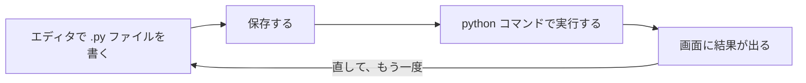

# 第2章 Python 入門 1 (値・変数・計算)

## この章でできるようになること

- プログラムとは何かを、自分の言葉で説明できる。
- Python を「対話モード」と「.py ファイル」の 2 つの方法で動かせる。
- `print` で画面に表示し、数の計算ができる。
- 変数に値を入れ、`=` が「等しい」ではなく「入れる」だと説明できる。
- 文字列を作り、つなげて、`f"..."` で値を埋め込める。
- `type` で型を調べ、`int()` `str()` `float()` で型を変換できる。
- `input` でキーボードからの入力を受け取れる。
- 初めて見るエラーメッセージを、落ち着いて読める。

この章の題材は、架空の通販「ねぼすけ商店」の小さな計算です。商品の値段と個数から合計を出し、税込みの金額と送料まで計算するレシートを、章の最後に作ります。

## プログラムとは

**プログラム**は、コンピューターへの命令を、順番に書いたものです。料理のレシピに似ています。「卵を割る → 混ぜる → 焼く」と書いてあれば、人はその順にやります。プログラムも同じで、書いた順に、上から1行ずつ実行されます。

人とコンピューターの大きな違いは、コンピューターは**書いたとおりにしか動かない**ことです。「だいたいこんな感じで」と伝わりません。1 文字違っても、思ったようには動きません。エラーが出るのは、悪いことではありません。「ここが分からない」とコンピューターが教えてくれているのです。

この本では、**Python** というプログラミング言語を使います。プログラミング言語は、コンピューターに命令を伝えるための決まった書き方です。Python は読みやすく、データを扱う道具がそろっているので、データエンジニアリングで広く使われています。

## Python を動かす 2 つの方法

Python の動かし方は 2 つあります。どちらも使うので、まず違いを知ってください。

1. **対話モード**: 1 行打つたびに、すぐ結果が返ってくる。電卓のように使える。試し打ちに向く。
2. **.py ファイル**: 命令を何行も書いてファイルに保存し、まとめて実行する。保存して何度でも動かせる。

仕組みの流れは次のとおりです。



### 対話モードを使ってみる

第 1 章で作った Docker のイメージを使います。Docker Desktop を起動して、ターミナルで次のように打ちます。

```bash
docker run --rm -it de-book-dev python
```

`-it` は、キーボードからの入力を受け付けて、その場でやり取りするための指定です。対話モードや、後で出てくる `input` を使うときは、必ず付けます。次のような表示が出ます。

```text
Python 3.12.16 (main, ...) [GCC ...] on linux
Type "help", "copyright", "credits" or "license" for more information.
>>>
```

`>>>` が、Python が入力を待っている合図 (**プロンプト**) です。画面の1行目の、細かい数字は環境によって変わります。ここに、式を打ってみます。

```text
>>> x = 5
>>> x
5
>>> print(x * 2)
10
>>> "nebo" + "suke"
'nebosuke'
```

`>>>` の後ろが、自分で打つ部分です。`x = 5` は何も返しませんが、`x` と打つと `5` が返り、`x * 2` を表示すると `10` と出ます。文字列同士を `+` でつなぐと、`'nebosuke'` が返ります (文字列は後で詳しく説明します)。この行き来は、実際に Python を動かして確かめたものです。

終わるときは `exit()` と打つか、Ctrl+D を押します。Ctrl+C は実行を止めるキーで、対話モードを抜けるキーではありません。

### .py ファイルを作って動かす

次に、ファイルで動かします。手順は次のとおりです。

```text
1. ターミナルで、作業用のフォルダを作る。
     mkdir -p ~/work/nebosuke-py
   (Mac では、ホームフォルダ /Users/ユーザー名 の下の work フォルダです。第 1 章で作っていれば、その中に作られます)
2. そのフォルダを VS Code で開く。
     cd ~/work/nebosuke-py
     code .
3. VS Code の左側の「新しいファイル」のアイコンを押し、名前に 01_hello.py と打つ。
4. 開いたファイルに、下の 1 行を書く。
5. Ctrl+S (Mac は ⌘+S) で保存する。
6. VS Code の中のターミナル (Ctrl+`) で、下の docker run を打つ。
```

ファイルに書く 1 行は、これです。

```python
print("おはよう、ねぼすけ商店")
```

そのフォルダ (`nebosuke-py`) の中で、次のように打ちます。

```bash
docker run --rm -v "$PWD":/w -w /w de-book-dev python 01_hello.py
```

```text
おはよう、ねぼすけ商店
```

`python 01_hello.py` が「`01_hello.py` を Python で実行する」という意味です。Docker の部分は、第 1 章で説明したとおり、今いるフォルダをコンテナの中の `/w` につないでいます。

ここで、**保存し忘れ**に注意してください。VS Code では、保存していないファイルは、タブの名前の横に丸い印が付きます。保存せずに実行すると、前の内容のまま動きます。Ctrl+S (Mac は ⌘+S) で保存してから動かす癖を付けてください。

この本のコードは、リポジトリの `examples/s02/` にもあります。

## print で表示する

`print` は、かっこの中の値を画面に表示する命令です。さきほどの 1 行は、次の形をしていました。

`print("おはよう、ねぼすけ商店")`

Python では、`print` のような名前のあとにかっこを付けて、中に値を入れる形がよく出てきます。かっこの中の値を**引数**と呼び、`print` のように名前が付いた命令を**関数**と呼びます。関数は第 4 章で自分でも作ります。今は、「`print(...)` で画面に表示できる」と覚えれば十分です。

**全角と半角**にも注意してください。`print` の後ろのかっこ `(` `)` と引用符 `"` は、必ず半角です。全角の `（` や `”` だと、エラーになります。見た目がよく似ているので、エラーが出たら最初に疑ってください。大文字小文字も区別されるので、`Print` ではなく `print` です。

## 数と計算

Python には、電卓の機能がそのまま入っています。数には、整数 (`1`, `42`) と小数 (`3.14`) があります。まず、基本の計算です。

```python
print(7 + 3)
print(7 - 3)
print(7 * 3)
```

```text
10
4
21
```

`+` が足し算、`-` が引き算、`*` が掛け算です。掛け算は `×` ではなく `*` を使います。次は割り算です。割り算には 3 つの種類があります。

```python
print(7 / 3)
print(7 // 3)
print(7 % 3)
```

```text
2.3333333333333335
2
1
```

- `/`: ふつうの割り算です。答えは必ず小数になります。
- `//`: 割り算の**商** (何回割れたか) だけを整数で返します。7 を 3 で割ると 2 回割れるので `2` です。
- `%`: 割り算の**余り**を返します。7 を 3 で割ると 1 余るので `1` です。

使い道を、ねぼすけ商店の例で考えます。「7 個のクッキーを 3 人で同じ数ずつ分けるとき、1 人 2 個で、1 個余る」は、`7 // 3` と `7 % 3` で出せます。

べき乗 (同じ数を何回も掛ける) は `**` です。

```python
print(2 ** 10)
```

```text
1024
```

小数の計算も同じ書き方です。小数でも、割り算の答えが整数のように見えるときは、`.0` が付きます。

```python
print(1.5 + 2.25)
print(10 / 2)
```

```text
3.75
5.0
```

`10 / 2` は、割り切れても `5.0` と、小数の形で出てきます。`/` は必ず小数を返す、と先ほど書いたとおりです。

演算子 (計算の記号) を表にまとめます。

{{ table("s02-operators") }}

### 小数の計算には、小さな誤差が出る

次の式を見てください。

```python
print(0.1 + 0.2)
```

```text
0.30000000000000004
```

答えは 0.3 のはずなのに、末尾に余計な数字が付きます。バグではありません。コンピューターは数を 2 進数で扱うので、`0.1` のような小数を、ぴったり表せないことがあります。Python の公式チュートリアルにも、同じ仕組みの説明があります。

だから、**お金のように1円の誤差も許されない計算は、小数を避け、整数 (円) で扱います**。この章の商店の計算も、金額は整数で計算します。

### 計算の順番

数学と同じで、掛け算と割り算が先、足し算と引き算があとです。かっこで先に計算したい部分を囲めます。

```python
print(2 + 3 * 4)
print((2 + 3) * 4)
```

```text
14
20
```

1 行目は `3 * 4 = 12` を先に計算して `2 + 12 = 14` です。2 行目は、かっこの中が先で `5 * 4 = 20` です。迷ったら、かっこを付けて意図をはっきりさせるのが安全です。かっこは、全部半角の `(` `)` です。

## 変数: 値に名前を付ける

同じ値を何度も使うとき、毎回書くのは大変です。値に**名前**を付けて、箱のように覚えておく仕組みが**変数**です。ねぼすけ商店の計算で使ってみます。

```python
price = 1200
quantity = 3
subtotal = price * quantity
print(subtotal)
```

```text
3600
```

1 行目の `price = 1200` は、「`price` という名前の箱に、`1200` を入れる」という命令です。これを**代入**と言います。2 行目で `quantity` に `3` を入れ、3 行目で2つの箱の中身を掛けた結果を `subtotal` (小計) に入れ、4 行目で表示しています。

ここが、初めての人が一番つまずく点です。`price = 1200` の `=` は、数学の「等しい」ではありません。「右側の値を、左側の名前に**入れる**」という意味です。数学では `x = x + 1` は成り立ちませんが、プログラムでは普通に書けます。

```python
tax = subtotal * 10 // 100
shipping = 500
total = subtotal + tax + shipping
print(tax)
print(total)
```

```text
360
4460
```

`tax` (消費税) は、小計の 10% です。`subtotal * 10 // 100` と、整数のまま計算しています (`subtotal * 0.1` と書くと小数になり、さきほどの誤差の元になります)。`shipping` (送料) は 500 円、`total` は 3 つを足した合計です。食品などで税率が違う商品もありますが、ここでは全部 10% として計算します。

### 値を入れ直す

変数の中身は、あとから入れ直せます。

```python
quantity = quantity + 1
print(quantity)
print(price * quantity)
```

```text
4
4800
```

`quantity = quantity + 1` を、数学の式として読むと変です。プログラムでは、**右側を先に計算**します。今の `quantity` は 3 なので、右側は `3 + 1 = 4` です。その4を、左側の `quantity` に入れ直します。つまり「個数を 1 つ増やす」命令です。入れ直したあとの `price * quantity` は、`1200 * 4 = 4800` です。入れ直した値は上書きされて、前の値(3)は残りません。

### 変数の名前の付け方

変数の名前は、自分で決められますが、決まりがあります。

- 使える文字は、英数字と `_` (アンダースコア) です。日本語も使えますが、この本では英語で書きます。
- 数字から始められません。
- 大文字と小文字は別の名前です。`price` と `Price` は別物です。
- スペースは使えません。単語はアンダースコアでつなぎます (`tax_rate`)。
- Python がすでに意味を持っている語 (`class` `if` `for` など) は使えません。

Python の公式のスタイルガイド (PEP 8) は、変数の名前を小文字とアンダースコアで書くことを勧めています。名前は、何の値か分かるものにします。

{{ table("s02-naming") }}

## 文字列

文字の並びを**文字列**と言います。引用符 (`"` か `'`) で囲んで書きます。どちらを使っても同じですが、始めと終わりは同じ種類でそろえます。

```python
shop = "ねぼすけ商店"
item = 'アイマスク'
quantity = 3
total = 4460
```

以降の例では、この4つの変数が入っているものとします。

### つなぐ・長さを数える

文字列は `+` でつなげられます。`len` は、文字列の文字数を返す関数です。

```python
print(shop + "の" + item)
print(len(shop))
```

```text
ねぼすけ商店のアイマスク
6
```

`len("ねぼすけ商店")` は、日本語でも1文字を1と数えて 6 です。

### f-string: 文章に値を埋め込む

「アイマスクを 3 個、合計 4460 円です」のような文章を、変数から作りたい場合を考えます。`+` でつなぐと、数を文字列に変換する必要があって面倒です。便利なのが **f-string** です。引用符の前に `f` を付け、中の `{ }` の中に変数や式を書くと、その値が埋め込まれます。

```python
print(f"{item}を{quantity}個、合計{total}円です")
```

```text
アイマスクを3個、合計4460円です
```

`{item}` が `アイマスク`、`{quantity}` が `3`、`{total}` が `4460` に置き換わっています。`{ }` の中には、`{price * quantity}` のように計算式も書けます。`f` を付け忘れると、`{item}` がそのまま画面に出ます。波かっこ `{ }` も半角です。

### 改行と引用符

特別な文字は、`\n` のように、バックスラッシュ `\` で書きます。日本語キーボードでは `¥` キーを押すと `\` が入力されます (Mac は Option キーを押しながら `¥` キー)。`\n` は改行を表します。

```python
print("1行目\n2行目")
print("He said 'good morning'")
```

```text
1行目
2行目
He said 'good morning'
```

2 行目のように、`"` で囲んだ文字列の中には、`'` をそのまま書けます。

### 大文字と小文字

`upper()` は全部大文字、`lower()` は全部小文字にした新しい文字列を返します。

```python
word = "Nebosuke"
print(word.upper())
print(word.lower())
```

```text
NEBOSUKE
nebosuke
```

`word.upper()` のように、`.` で名前につなげて呼ぶ命令を**メソッド**と言います。この章では、使い方だけ覚えれば十分です。

2つの文字列が同じかどうかは `==` で比べます (ここでの `==` は「等しい」という意味です。`=` 1 つは代入でした)。結果は `True` (正しい) か `False` (正しくない) です。

```python
print(word == "nebosuke")
print(word.lower() == "nebosuke")
```

```text
False
True
```

大文字小文字が違うと、別の文字列です。1 つ目は `False` です。比べる前に小文字にそろえると、2 つ目のように `True` になります。ユーザーの入力を比べるときに、よく使う書き方です。

## 型: 値の種類

ここまでに、整数・小数・文字列が出てきました。これらを値の**型**と言います。`type` 関数で調べられます。

```python
print(type(42))
print(type(3.14))
print(type("42"))
```

```text
<class 'int'>
<class 'float'>
<class 'str'>
```

{{ table("s02-types") }}

最後の `"42"` に注目してください。引用符で囲むと、数に見えても**文字列**です。`42` と `"42"` は別物で、計算できるかどうかが違います。

### 型の変換

型を変える関数が、`int()` `float()` `str()` です。

```python
print(int("42") + 1)
print(str(42) + "円")
print(float("1.5") * 2)
print(int(3.9))
```

```text
43
42円
3.0
3
```

- `int("42")`: 文字列 `"42"` を整数 `42` にします。だから `+ 1` ができて `43` です。
- `str(42)`: 整数を文字列にします。`"円"` とつなげられます。
- `float("1.5")`: 文字列を小数にします。
- `int(3.9)`: 小数を整数にします。**四捨五入でなく、小数部分を切り捨てる**ので `3` です。

文字列同士の `+` は、足し算でなく「つなぐ」です。

```python
print("42" + "1")
```

```text
421
```

`"42" + "1"` は、文字を並べて `"421"` になります。`43` の足し算とは違う結果です。

### 変換に失敗すると

`int("abc")` のように、数にできない文字列を渡すと、エラーになります。これは「エラーを読む」の節で、実際に起こして確かめます。

## input: キーボードから受け取る

`input` は、キーボードで打った文字を受け取る関数です。かっこの中に案内の文章を入れると、それが表示されます。

```python
name = input("お名前は? ")
count = int(input("個数は? "))
price = 1200
print(f"{name}さん、{count}個で{price * count}円です")
```

このファイルを `06_input.py` として保存し、次のように動かします。`-it` が必要です。

```bash
docker run --rm -it -v "$PWD":/w -w /w de-book-dev python 06_input.py
```

画面は、次のように進みます。`ねぼ` と `3` が、自分で打つ部分です。

```text
お名前は? ねぼ
個数は? 3
ねぼさん、3個で3600円です
```

プログラムは `input("お名前は? ")` のところで止まり、Enter キーを押すまで待ちます。打った文字は、変数 `name` に入ります。ここで大事なのは、**`input` が返す値は、数を打っても必ず文字列**だということです。`3` と打っても、`"3"` という文字列です。だから、個数は `int(input("個数は? "))` と書いて、整数に変換しています。`int` を忘れて `price * count` を計算すると、`1200 * "3"` となり、`"3"` が 1200 回つながった長い文字列が出てしまいます。

## コメント

プログラムの中に、人のためのメモを書けます。`#` から行末までが**コメント**で、Python は無視します。

```python excerpt
# 商品の値段と個数から、合計を計算します。
```

コメントは、「何をしているか」でなく「なぜそうしているか」を書くと、あとで読み返したときに役立ちます。この本のコードの冒頭にも、こうした説明が付いています。

## エラーを読む

ここまでで、基本の文法はそろいました。プログラムを書けば、必ずエラーに出会います。ここでは、よく出る 6 つのエラーを**わざと起こして**、読み方を覚えます。どれも、本物の Python が出した表示です。

エラーを読むときの基本は、**最後の行から読む**ことです。最後の行に、エラーの種類と理由が書かれています。その前の行には、どのファイルの何行目で起きたかが書かれています。

{{ table("s02-errors") }}

### SyntaxError: 書き方が合わない

文字列の終わりの引用符 `"` を書き忘れた例です。

```python excerpt
print("おはよう、ねぼすけ商店)
```

```text
  File "/home/taro/nebosuke/err_syntax.py", line 1
    print("おはよう、ねぼすけ商店)
          ^
SyntaxError: unterminated string literal (detected at line 1)
```

最後の行の `SyntaxError` は「書き方の誤り」です。`unterminated string literal` は「文字列が終わっていない」という意味です。`File "...", line 1` で 1 行目と分かり、`^` が問題の始まりを指しています。`"` で始めたのに、閉じていません。引用符や括弧は、必ず始めと終わりがそろっているか確かめます。

### NameError: 知らない名前

変数名を打ち間違えた例です。

```python
total = 3600
print(totl)
```

```text
Traceback (most recent call last):
  File "/home/taro/nebosuke/err_name.py", line 2, in <module>
    print(totl)
          ^^^^
NameError: name 'totl' is not defined. Did you mean: 'total'?
```

`Traceback` は、エラーに至るまでの道筋です。`line 2` で2行目、`^^^^` が問題の部分を指しています。最後の行は「`totl` という名前は定義されていません。`total` のことですか?」です。Python が、近い名前を教えてくれています。打ち間違い、または、その名前に値を入れる前に使ったときに出ます。

### TypeError: 型が合わない

文字列と整数を `+` でつなごうとした例です。

```python
total = 3600
print("合計は" + total + "円")
```

```text
Traceback (most recent call last):
  File "/home/taro/nebosuke/err_type.py", line 2, in <module>
    print("合計は" + total + "円")
          ~~~~~~~~~^~~~~~~
TypeError: can only concatenate str (not "int") to str
```

最後の行は「文字列には、文字列しかつなげられません。整数(int)は無理です」です。直し方は2通りあります。`str(total)` で文字列に変えるか、f-string (`f"合計は{total}円"`) を使います。f-string のほうが短く、間違えにくいのでおすすめです。

### ValueError: 型は合うが中身が合わない

```python
count = int("3個")
print(count)
```

```text
Traceback (most recent call last):
  File "/home/taro/nebosuke/err_value.py", line 1, in <module>
    count = int("3個")
            ^^^^^^^^^^
ValueError: invalid literal for int() with base 10: '3個'
```

`int()` に文字列を渡すこと自体は正しい (型は合っている) のですが、`"3個"` は数にできません。最後の行は「10 進数の整数として不正な文字列: '3個'」です。`input` で受け取った文字列に、単位や全角の数字が混じると、このエラーが出ます。出てきた値 (`'3個'`) を見ると、原因が分かります。

### ZeroDivisionError: 0 で割る

```python
people = 0
print(1200 / people)
```

```text
Traceback (most recent call last):
  File "/home/taro/nebosuke/err_zero.py", line 2, in <module>
    print(1200 / people)
          ~~~~~^~~~~~~
ZeroDivisionError: division by zero
```

0 で割ることは、数学でもできません。割る数が 0 になる原因を探します。

### IndentationError: 字下げが合わない

行の先頭に余計なスペースを入れた例です。

```python excerpt
price = 1200
 quantity = 3
print(price * quantity)
```

```text
  File "/home/taro/nebosuke/err_indent.py", line 2
    quantity = 3
IndentationError: unexpected indent
```

`unexpected indent` は「予期しない字下げ」です。Python では、行頭の空白に意味があります (この次の第 3 章の `if` や `for` で、字下げを使い始めます)。今は、行頭のスペースが余計な場所にあるとエラーになる、と知っておけば足ります。全角スペースが混ざっていても、似たエラーが出ます。

### エラーが出たときの手順

1. 慌てず、画面の**最後の行**を読む。
2. その前の `File ..., line N` で、何行目かを確かめる。
3. その行 (SyntaxError のときは、その前の行も) をよく見る。引用符・括弧・スペースの全角、名前の打ち間違いを疑う。
4. 直して、**保存**して、もう一度動かす。

なお、本文のエラーの表示は、この本のテストで使った Python 3.12 のものです。Python のバージョンが違うと、`^` の位置や補足の文が少し違うことがあります。

## ねぼすけ商店のレシートを作る

ここまでのことを、まとめて使います。商品名・値段・個数を `input` で受け取り、小計・消費税・送料・合計を計算して、レシートを表示するプログラムです。`07_receipt.py` として保存します。

```python
# ねぼすけ商店のレシートを作ります。
name = input("商品名: ")
price = int(input("値段(円): "))
quantity = int(input("個数: "))

subtotal = price * quantity
tax = subtotal * 10 // 100
shipping = 500
total = subtotal + tax + shipping

print("--- ねぼすけ商店 レシート ---")
print(f"{name} {price}円 x {quantity}個 = {subtotal}円")
print(f"消費税(10%): {tax}円")
print(f"送料: {shipping}円")
print(f"合計: {total}円")
```

`docker run --rm -it -v "$PWD":/w -w /w de-book-dev python 07_receipt.py` で動かし、`アイマスク`、`1500`、`2` と打つと、次のように表示されます。

```text
商品名: アイマスク
値段(円): 1500
個数: 2
--- ねぼすけ商店 レシート ---
アイマスク 1500円 x 2個 = 3000円
消費税(10%): 300円
送料: 500円
合計: 3800円
```

小計は 1500 円 × 2 個で 3000 円、消費税は 10% で 300 円、送料 500 円を足して、合計 3800 円です。プログラムの流れは、「受け取る → 計算する → 表示する」の 3 段階になっています。これは、データ処理の基本の形です。

値段に `千五百` のような数でない文字を打つと、`ValueError: invalid literal for int() with base 10: '千五百'` と出て止まります。先ほどの ValueError と同じです。入力が正しいかどうかを確かめて、間違いにやさしく対応する書き方は、次の第 3 章で `if` を覚えたあとに扱います。

## よくある失敗

- **保存し忘れ**: 直したのに結果が変わらないときは、保存しているか確かめます。
- **全角の混入**: `（` `）` `”` やスペースが全角だと、`SyntaxError` になります。日本語入力をオフにして打ちます。
- **大文字小文字の違い**: `Print`、`Price`、`price` は別の名前です。
- **`=` と `==` の取り違え**: `=` は入れる、`==` は比べる、です。
- **文字列と数の混同**: `"3"` と `3` は別です。`input` の結果は、いつも文字列です。
- **引用符・括弧の閉じ忘れ**: 始めと終わりをそろえます。エラーが指す行の1つ上も見ます。
- **f-string の `f` の付け忘れ**: `{item}` がそのまま表示されたら、`f` を確かめます。
- **docker run で `-it` を付け忘れる**: `input` を使うプログラムで、入力が受け取れません。
- **小数でお金を計算する**: 誤差が出ます。円は整数で扱います。
- **エラーを最初から読む**: 最後の行から読みます。

## まとめ

- プログラムは、命令を書いた順に実行する。コンピューターは、書いたとおりにしか動かない。
- Python は、対話モード (試し打ち) と .py ファイル (保存して何度でも) の 2 通りで動かす。
- 計算は `+ - * / // % **`。`/` は小数、`//` は商、`%` は余り。小数の計算には誤差が出るので、お金は整数で。
- 変数は値に付ける名前。`=` は「等しい」でなく「入れる」で、右側を先に計算する。
- 文字列は引用符で囲む。`+` でつなぎ、`f"..."` で値を埋め込み、`len` で長さを数える。
- 型は `int` `float` `str`。`type` で調べ、`int()` `str()` `float()` で変換する。`input` は必ず文字列を返す。
- `#` から後ろはコメント。
- エラーは最後の行から読む。`SyntaxError` `NameError` `TypeError` `ValueError` `ZeroDivisionError` `IndentationError` は、ここで見たとおりの形で出る。

## 練習問題

問1. 値段 480 円のマグカップを 4 個買いました。値段を `price`、個数を `quantity` という変数に入れ、小計を表示してください。

??? note "解答例"
    ```python
    price = 480
    quantity = 4
    print(price * quantity)
    ```

    ```text
    1920
    ```

問2. 7 個のクッキーを、3 人で同じ数ずつ分けます。1 人あたりの個数と、余る個数を、それぞれ表示してください。

??? note "解答例"
    1 人あたりは商 (`//`)、余りは `%` で求めます。

    ```python
    cookies = 7
    people = 3
    print(cookies // people)
    print(cookies % people)
    ```

    ```text
    2
    1
    ```

問3. 次のプログラムを実行すると、最後に何と表示されますか。`price = price + 100` は、どういう意味ですか。

```text
price = 1000
price = price + 100
print(price)
```

??? note "解答例"
    `1100` と表示されます。`price = price + 100` は、「右側を先に計算して、その結果を左側の `price` に入れ直す」という命令です。今の `price` は 1000 なので、右側は `1000 + 100 = 1100` です。数学の式としては成り立ちませんが、プログラムの `=` は「等しい」でなく「入れる」です。

    ```python
    price = 1000
    price = price + 100
    print(price)
    ```

    ```text
    1100
    ```

問4. 変数 `item` に `"アイマスク"`、`price` に `1500` を入れ、f-string を使って「アイマスクは1500円です」と表示してください。

??? note "解答例"
    ```python
    item = "アイマスク"
    price = 1500
    print(f"{item}は{price}円です")
    ```

    ```text
    アイマスクは1500円です
    ```

問5. `print("3" + 4)` は `TypeError` になります。数としての計算 (答えが `7`) になるように直したものと、文字列をつなぐ形 (答えが `34`) に直したものを、それぞれ書いてください。

??? note "解答例"
    `"3"` は文字列、`4` は整数なので、そのままでは足せません。足し算にするなら `"3"` を `int` で整数に、つなぐなら `4` を `str` で文字列にします。

    ```python
    print(int("3") + 4)
    print("3" + str(4))
    ```

    ```text
    7
    34
    ```

問6. 税抜きの値段を `input` で受け取り、10% の消費税を足した税込みの金額を表示するプログラムを書いてください。小数は使いません。新しい `.py` ファイル (たとえば `ex6_input.py`) に書き、`docker run` に `-it` を付けて動かします。

??? note "解答例"
    `input` は文字列を返すので `int` で変換します。税は整数のまま `price * 10 // 100` で出します。

    ```python
    price = int(input("税抜きの値段: "))
    print(price + price * 10 // 100)
    ```

    `2000` と打つと `2200` と出ます。

問7. 次のプログラムを動かすとエラーになりました。エラーの名前、起きた行、原因を答え、直す方法を書いてください。

```text
people = 0
print(1200 / people)
```

??? note "解答例"
    エラーの名前は `ZeroDivisionError` (`division by zero`) で、2 行目の `1200 / people` で起きます。`people` が 0 なので、0 で割ろうとしています。`people` に 0 でない値 (たとえば 3) を入れれば動きます。プログラムでは、人数が 0 になる場合を先に確かめる方法もあります。それは次の第 3 章の `if` で学びます。

次に読む章: [第3章 Python 入門 2 (条件・繰り返し・リスト・辞書)](s03-python-2.md)

## 参考文献

- Python 公式チュートリアル「An Informal Introduction to Python」(数・文字列・コメント) <https://docs.python.org/3/tutorial/introduction.html>
- Python 公式チュートリアル「Floating-Point Arithmetic: Issues and Limitations」(小数の誤差の仕組み) <https://docs.python.org/3/tutorial/floatingpoint.html>
- Python 公式チュートリアル「Input and Output」(f-string) <https://docs.python.org/3/tutorial/inputoutput.html>
- Python 公式チュートリアル「Errors and Exceptions」(エラーの種類) <https://docs.python.org/3/tutorial/errors.html>
- Python 標準ライブラリ「Built-in Functions」(`print` `input` `type` `len` `int` `float` `str`) <https://docs.python.org/3/library/functions.html>
- Python 標準ライブラリ「Built-in Types」(数値型・文字列のメソッド) <https://docs.python.org/3/library/stdtypes.html>
- PEP 8「Style Guide for Python Code」(名前の付け方) <https://peps.python.org/pep-0008/>
