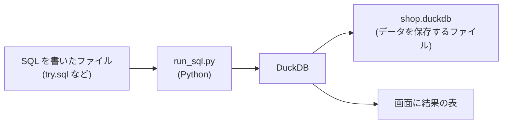

# 第5章 SQL 入門 1 (表と SELECT)

!!! tip "この章の前に"
    第2〜4章で Python を少し書いたので、「文字を打って、画面の結果を確かめる」流れは分かっているはずです。この章でも、その流れを変えません。

## この章でできるようになること

- データベースと表計算ソフトの違いを、自分の言葉で説明できる。
- 表・行・列・型・主キーが何を指すか分かり、`CREATE TABLE` と `INSERT` で小さな表を自分で作れる。
- `SELECT` で、欲しい列だけを取り出し、別名を付けられる。
- `WHERE` で、比較・`AND` / `OR` / `NOT`・`IN`・`BETWEEN`・`LIKE` を使って行を絞れる。
- `ORDER BY` と `LIMIT` で、並べ替えと件数の制限ができる。
- SQL の書き方の決まり (セミコロン・大文字小文字・引用符・コメント) を守って書き、エラーメッセージの読み方が分かる。

この章は、これから先ずっと使う道具の最初の一歩です。表を 1 つ作り、その表に質問する、というところまでを、1 つずつ確かめながら進めます。急がず、打った SQL と画面の結果を見比べてください。

## データベースとは何か

まず、言葉の説明からです。**データベース**は、データを決まった形で整理して、あとから探したり数えたりしやすいように保存したものです。そのデータベースを動かし、データを保存して、頼まれた探し物に答えるソフトウェアを **DBMS** (データベース管理システム) と呼びます。この本では、DBMS として **DuckDB** を使います。ファイル 1 つにデータを保存でき、特別なサーバーを用意せずに動かせるので、練習に向いています。

DBMS に「こういうデータが欲しい」と伝えるための言葉が **SQL** です (エスキューエル、またはシークェルと読みます)。SQL で書いた 1 つの依頼を **クエリ** (問い合わせ) と呼びます。たとえば「飲み物の商品を全部見せて」と頼むのが、1 つのクエリです。

ここで、表計算ソフトとの違いを見ておきます。表計算ソフトに慣れている人は、「表なら、もう扱っている」と思うでしょう。そのとおりで、データベースの表は、表計算の 1 枚のシートによく似ています。違うのは、ルールを決めて守らせる所と、操作の仕方です。

{{ table("s05-spreadsheet-vs-db") }}

表計算ソフトでは、セルに何を入れても怒られません。数字の列に「あとで確認」と書いても動きます。データベースは、その自由さを減らす代わりに、「この列には整数だけ」「この列の値は重複しない」という決まりを守らせてくれます。決まりがあるおかげで、データが増えても崩れにくくなります。これが、データエンジニアがデータベースを使う一番の理由です。

もう 1 つの違いは、操作が **SQL という文字で残る** ことです。表計算ソフトでマウスを使って直した手順は、あとから再現しにくいものです。SQL は、書いたものを保存しておけば、何度でも同じ結果を出せます。データを毎日自動で処理する仕事 (基礎編 第10章以降) では、この性質が欠かせません。

## 表・行・列・型・主キー

データベースの中でデータを入れる入れ物が **表** (テーブル) です。この章では、ねぼすけ商店の商品の表 `products` を使います。次の図は、その表の先頭 4 行です。


図の言葉を 1 つずつ説明します。

- **列** (カラム): 縦に並ぶ、同じ種類の値の並びです。`price` の列には、商品の値段だけが入ります。列には名前があり、名前は表を作るときに決めます。
- **行** (ロウ): 横に並ぶ、1 件分のまとまりです。3 行目は「アイマスク」という 1 つの商品について、番号・名前・分類・値段・在庫をまとめて持っています。
- **セル**: 行と列が交わる 1 つの値です。3 行目の `price` のセルは 900 です。
- **主キー**: その行を 1 つに決めるための列です。図では `product_id` です。商品名は同じものが 2 つあるかもしれませんが、番号は 1 つの番号に 1 つの商品しか当てはまらないようにします。DBMS は、主キーの重複と空 (値が入っていないこと) を許さず、守らせてくれます。

次は **型** です。列には、入れられる値の種類が決まっています。これを型と呼びます。

{{ table("s05-types") }}

`price` が INTEGER なので、`price` に「高い」という文字は入れられません。入れようとするとエラーになります (この章の最後で実際に起こします)。表計算ソフトの自由さとの一番大きな違いが、これです。

!!! note "空の値 (NULL) は、第6章で"
    「値が入っていない」状態を、データベースでは **NULL** と呼びます。空の文字列や 0 とは別の扱いになります。この章の表には NULL を入れず、第6章でゆっくり扱います。

## DuckDB を動かす

準備を整えます。DuckDB には、画面に直接 SQL を打ち込める専用のコマンド (`duckdb` という CLI) もありますが、この本の Docker イメージには入っていません。入っているのは Python から使える DuckDB です。そこで、この本では **Python から DuckDB を呼ぶ小さなスクリプト** `run_sql.py` を用意しました。SQL をファイルに書き、そのファイルを渡すと、DuckDB に流して結果を画面に出します。

流れを図にすると、次のとおりです。



`shop.duckdb` は、データを保存する 1 つのファイルです。最初はありません。`run_sql.py` が最初に実行されるときに、自動で作られます。そこに作った表は、次の実行でも残っています。やり直したいときは、このファイルを消します。

`run_sql.py` の中身で大事なのは、次の関数だけです。第4章までの Python で読めます。

```python
def run(con: duckdb.DuckDBPyConnection, sql: str) -> None:
    """SQL を 1 文ずつ流し、SELECT 系の結果だけを表示します。"""
    for statement in duckdb.extract_statements(sql):
        result = con.sql(statement.query)
        if statement.type == duckdb.StatementType.SELECT:
            result.show()
```

SQL を 1 文ずつに分けて流し、結果を返す種類の文 (`SELECT` など) だけ、表にして画面に出します。表を作る文のように、結果を返さない文は、成功しても何も表示しません。「何も出ない」のが成功です。

コマンドの打ち方も決めておきます。Docker のコマンドは長いので、短い名前 (別名、`alias`) を付けます。第1章で作った `de-book-dev` というイメージを使う前提です。この本のフォルダで、次のように打ってください。Windows は WSL 2 の Ubuntu、Mac はターミナルで、同じ文字を打ちます。

```bash
alias DEV='docker run --rm --user "$(id -u):$(id -g)" -e HOME=/tmp -v "$PWD":/w -w /w de-book-dev'
```

`DEV` は、ターミナルを閉じると忘れられます。新しくターミナルを開いたら、もう一度この 1 行を打ってください。`DEV` の後ろに続けた文字が、道具箱の中で実行されます。

## 表を作る: CREATE TABLE と INSERT

いよいよ、表を自分で作ります。作り方は 2 段階です。1 つ目は、表の形を決める `CREATE TABLE`。2 つ目は、行を入れる `INSERT` です。

エディタで、この本のフォルダの直下に `practice.sql` という名前のファイルを作り、次の SQL を打ってください。打つのが大変なら、`examples/s05/create_products.sql` の中身をコピーしても構いません。

```sql
CREATE TABLE products (
    product_id INTEGER PRIMARY KEY,
    name       VARCHAR,
    category   VARCHAR,
    price      INTEGER,
    stock      INTEGER
);
```

1 行ずつ読みます。

- `CREATE TABLE products` は、「`products` という名前の表を作って」という頼みです。
- 丸括弧の中に、列を 1 つずつ「名前 型」の形で、カンマで区切って並べます。`product_id INTEGER` は、「`product_id` という列を作る。型は整数」という意味です。
- `PRIMARY KEY` を付けた列が、主キーです。重複と空を許しません。
- 最後の `;` (セミコロン) が、「ここで 1 つの文が終わり」の印です。

続けて、同じファイルに行を入れる文を足します。

```sql
INSERT INTO products VALUES
    (1, '枕', '寝具', 3200, 12),
    (2, '毛布', '寝具', 5800, 5),
    (3, 'アイマスク', '寝具', 900, 40),
    (4, '光る目覚まし', '目覚まし', 4500, 8),
    (5, 'コーヒー豆(標準)', '飲み物', 1200, 30),
    (6, 'コーヒー豆(大)', '飲み物', 2800, 15),
    (7, '紅茶', '飲み物', 800, 0),
    (8, 'マグカップ', '雑貨', 1500, 20),
    (9, 'ステッカー', '雑貨', 300, 100);
```

`INSERT INTO products VALUES` の後ろに、行を丸括弧で 1 つずつ書きます。カンマで区切り、最後だけ `;` で終えます。値の並びは、`CREATE TABLE` で決めた列の順です。丸括弧の中の最初の `1` は `product_id`、次の `'枕'` は `name`、というように対応します。文字列は、シングルクォート `'` で囲みます。数字は囲みません。

保存したら、ターミナルで実行します。

```bash
DEV python examples/s05/run_sql.py shop.duckdb practice.sql
```

何も表示されずに、元のプロンプトに戻れば成功です。表を作る文は、結果の表を返さないためです。ほんとうに作れたかは、次の 2 つで確かめます。`SHOW TABLES` は、今ある表の名前の一覧を返します。

```sql
SHOW TABLES;
```

```text
┌──────────┐
│   name   │
│ varchar  │
├──────────┤
│ products │
└──────────┘
```

`DESCRIBE` は、表の列と型を返します。見方は次のとおりです。

```sql
DESCRIBE products;
```

```text
┌─────────────┬─────────────┬─────────┬─────────┬─────────┬─────────┐
│ column_name │ column_type │  null   │   key   │ default │  extra  │
│   varchar   │   varchar   │ varchar │ varchar │ varchar │ varchar │
├─────────────┼─────────────┼─────────┼─────────┼─────────┼─────────┤
│ product_id  │ INTEGER     │ NO      │ PRI     │ NULL    │ NULL    │
│ name        │ VARCHAR     │ YES     │ NULL    │ NULL    │ NULL    │
│ category    │ VARCHAR     │ YES     │ NULL    │ NULL    │ NULL    │
│ price       │ INTEGER     │ YES     │ NULL    │ NULL    │ NULL    │
│ stock       │ INTEGER     │ YES     │ NULL    │ NULL    │ NULL    │
└─────────────┴─────────────┴─────────┴─────────┴─────────┴─────────┘
```

`column_name` が列の名前、`column_type` が型です。`product_id` の `key` の欄が `PRI` (主キー) で、`null` の欄が `NO` (空を許さない) になっています。ほかの列の `YES` は、空を許す、という意味です。

ここから先は、SQL を `try.sql` というファイルに書いて、次の 1 行で実行します。新しい SQL を試すたびに、ファイルの中身を書き換えてください。

```bash
DEV python examples/s05/run_sql.py shop.duckdb try.sql
```

表の中身は、次のとおりです。以降の例は、すべてこの 9 行に対する SQL です。

{{ table("s05-products") }}

## SELECT: 列を選ぶ

表から取り出す文は `SELECT` です。SQL の中で、一番よく使います。いちばん短い書き方は、「表の全部の列を出して」です。`*` (アスタリスク) は「全部の列」を意味します。

```sql
SELECT * FROM products;
```

```text
┌────────────┬──────────────────┬──────────┬───────┬───────┐
│ product_id │       name       │ category │ price │ stock │
│   int32    │     varchar      │ varchar  │ int32 │ int32 │
├────────────┼──────────────────┼──────────┼───────┼───────┤
│          1 │ 枕               │ 寝具     │  3200 │    12 │
│          2 │ 毛布             │ 寝具     │  5800 │     5 │
│          3 │ アイマスク       │ 寝具     │   900 │    40 │
│          4 │ 光る目覚まし     │ 目覚まし │  4500 │     8 │
│          5 │ コーヒー豆(標準) │ 飲み物   │  1200 │    30 │
│          6 │ コーヒー豆(大)   │ 飲み物   │  2800 │    15 │
│          7 │ 紅茶             │ 飲み物   │   800 │     0 │
│          8 │ マグカップ       │ 雑貨     │  1500 │    20 │
│          9 │ ステッカー       │ 雑貨     │   300 │   100 │
└────────────┴──────────────────┴──────────┴───────┴───────┘
```

見方は、`SELECT *` が「全部の列を」、`FROM products` が「`products` という表から」です。2 つを合わせて、「`products` の全部の列を出して」という頼みになります。9 行すべてが出ました。

欲しい列だけを選ぶには、`*` の代わりに列の名前をカンマで並べます。

```sql
SELECT name, price FROM products;
```

```text
┌──────────────────┬───────┐
│       name       │ price │
│     varchar      │ int32 │
├──────────────────┼───────┤
│ 枕               │  3200 │
│ 毛布             │  5800 │
│ アイマスク       │   900 │
│ 光る目覚まし     │  4500 │
│ コーヒー豆(標準) │  1200 │
│ コーヒー豆(大)   │  2800 │
│ 紅茶             │   800 │
│ マグカップ       │  1500 │
│ ステッカー       │   300 │
└──────────────────┴───────┘
```

`name` と `price` だけが出ました。表の中身は変わっていません。取り出して見せる列が変わっただけです。列の並びは、書いた順に出ます。

```sql
SELECT price, name FROM products;
```

```text
┌───────┬──────────────────┐
│ price │       name       │
│ int32 │     varchar      │
├───────┼──────────────────┤
│  3200 │ 枕               │
│  5800 │ 毛布             │
│   900 │ アイマスク       │
│  4500 │ 光る目覚まし     │
│  1200 │ コーヒー豆(標準) │
│  2800 │ コーヒー豆(大)   │
│   800 │ 紅茶             │
│  1500 │ マグカップ       │
│   300 │ ステッカー       │
└───────┴──────────────────┘
```

`SELECT` の後ろには、列の名前だけでなく、**計算した結果** も書けます。値段を 2 倍にした列を作ってみます。計算に使う記号は `+` `-` `*` (掛け算) `/` (割り算) です。

```sql
SELECT name, price, price * 2 AS price_double FROM products;
```

```text
┌──────────────────┬───────┬──────────────┐
│       name       │ price │ price_double │
│     varchar      │ int32 │    int32     │
├──────────────────┼───────┼──────────────┤
│ 枕               │  3200 │         6400 │
│ 毛布             │  5800 │        11600 │
│ アイマスク       │   900 │         1800 │
│ 光る目覚まし     │  4500 │         9000 │
│ コーヒー豆(標準) │  1200 │         2400 │
│ コーヒー豆(大)   │  2800 │         5600 │
│ 紅茶             │   800 │         1600 │
│ マグカップ       │  1500 │         3000 │
│ ステッカー       │   300 │          600 │
└──────────────────┴───────┴──────────────┘
```

`price * 2` の結果の列に、`price_double` という名前を付けました。この名前が **別名** です。`AS` の後ろに好きな名前を書くと、結果の列の見出しになります。別名を付けないと、見出しが `(price * 2)` のような読みにくい文字になります。別名は、結果の見出しを変えるだけで、元の表の列の名前は変わりません。

別名に日本語や空白を使いたいときは、ダブルクォート `"` で囲みます。

```sql
SELECT name AS "商品名", price AS "価格 (円)" FROM products;
```

```text
┌──────────────────┬───────────┐
│      商品名      │ 価格 (円) │
│     varchar      │   int32   │
├──────────────────┼───────────┤
│ 枕               │      3200 │
│ 毛布             │      5800 │
│ アイマスク       │       900 │
│ 光る目覚まし     │      4500 │
│ コーヒー豆(標準) │      1200 │
│ コーヒー豆(大)   │      2800 │
│ 紅茶             │       800 │
│ マグカップ       │      1500 │
│ ステッカー       │       300 │
└──────────────────┴───────────┘
```

シングルクォート `'` とダブルクォート `"` は、使い分けが決まっています。この違いは、あとの「SQL の書き方の決まり」でまとめます。

## WHERE: 行を絞る

表の全行ではなく、条件に合う行だけが欲しいときは、`WHERE` を使います。`FROM` の後ろに書きます。

```sql
SELECT name, category FROM products WHERE category = '飲み物';
```

```text
┌──────────────────┬──────────┐
│       name       │ category │
│     varchar      │ varchar  │
├──────────────────┼──────────┤
│ コーヒー豆(標準) │ 飲み物   │
│ コーヒー豆(大)   │ 飲み物   │
│ 紅茶             │ 飲み物   │
└──────────────────┴──────────┘
```

`WHERE category = '飲み物'` は、「`category` の値が `飲み物` に等しい行だけ」という条件です。SQL の `=` は、代入ではなく「等しいか」の判定です。Python の `==` に当たります。値を 1 つ入れる記号ではない点に注意してください。

比べる記号は、次の 6 つです。

{{ table("s05-operators") }}

数の比較を試します。3,000 円以上の商品を探します。

```sql
SELECT name, price FROM products WHERE price >= 3000;
```

```text
┌──────────────┬───────┐
│     name     │ price │
│   varchar    │ int32 │
├──────────────┼───────┤
│ 枕           │  3200 │
│ 毛布         │  5800 │
│ 光る目覚まし │  4500 │
└──────────────┴───────┘
```

「等しくない」は `<>` です。寝具以外の商品を出します。

```sql
SELECT name, category FROM products WHERE category <> '寝具';
```

```text
┌──────────────────┬──────────┐
│       name       │ category │
│     varchar      │ varchar  │
├──────────────────┼──────────┤
│ 光る目覚まし     │ 目覚まし │
│ コーヒー豆(標準) │ 飲み物   │
│ コーヒー豆(大)   │ 飲み物   │
│ 紅茶             │ 飲み物   │
│ マグカップ       │ 雑貨     │
│ ステッカー       │ 雑貨     │
└──────────────────┴──────────┘
```

### AND・OR・NOT

条件は組み合わせられます。`AND` は「両方とも」、`OR` は「どちらか」です。

寝具で、しかも 5,000 円未満の商品を探します。

```sql
SELECT name, category, price
FROM products
WHERE category = '寝具' AND price < 5000;
```

```text
┌────────────┬──────────┬───────┐
│    name    │ category │ price │
│  varchar   │ varchar  │ int32 │
├────────────┼──────────┼───────┤
│ 枕         │ 寝具     │  3200 │
│ アイマスク │ 寝具     │   900 │
└────────────┴──────────┴───────┘
```

次は、飲み物か雑貨のどちらかの商品です。

```sql
SELECT name, category
FROM products
WHERE category = '飲み物' OR category = '雑貨';
```

```text
┌──────────────────┬──────────┐
│       name       │ category │
│     varchar      │ varchar  │
├──────────────────┼──────────┤
│ コーヒー豆(標準) │ 飲み物   │
│ コーヒー豆(大)   │ 飲み物   │
│ 紅茶             │ 飲み物   │
│ マグカップ       │ 雑貨     │
│ ステッカー       │ 雑貨     │
└──────────────────┴──────────┘
```

`NOT` は条件を逆にします。「寝具ではない」を、`NOT` で書くこともできます。結果は、`<>` で書いた先ほどの例と同じです。

```sql
SELECT name, category FROM products WHERE NOT category = '寝具';
```

```text
┌──────────────────┬──────────┐
│       name       │ category │
│     varchar      │ varchar  │
├──────────────────┼──────────┤
│ 光る目覚まし     │ 目覚まし │
│ コーヒー豆(標準) │ 飲み物   │
│ コーヒー豆(大)   │ 飲み物   │
│ 紅茶             │ 飲み物   │
│ マグカップ       │ 雑貨     │
│ ステッカー       │ 雑貨     │
└──────────────────┴──────────┘
```

`AND` と `OR` を一緒に使うときは、気をつけてください。`AND` が先に計算されます。この性質を見るために、同じ条件を 2 通りの書き方で試します。「飲み物か雑貨で、1,000 円未満」を探したいとします。丸括弧を付けた書き方です。

```sql
SELECT name, category, price
FROM products
WHERE (category = '飲み物' OR category = '雑貨') AND price < 1000;
```

```text
┌────────────┬──────────┬───────┐
│    name    │ category │ price │
│  varchar   │ varchar  │ int32 │
├────────────┼──────────┼───────┤
│ 紅茶       │ 飲み物   │   800 │
│ ステッカー │ 雑貨     │   300 │
└────────────┴──────────┴───────┘
```

丸括弧を付けない書き方です。

```sql
SELECT name, category, price
FROM products
WHERE category = '飲み物' OR category = '雑貨' AND price < 1000;
```

```text
┌──────────────────┬──────────┬───────┐
│       name       │ category │ price │
│     varchar      │ varchar  │ int32 │
├──────────────────┼──────────┼───────┤
│ コーヒー豆(標準) │ 飲み物   │  1200 │
│ コーヒー豆(大)   │ 飲み物   │  2800 │
│ 紅茶             │ 飲み物   │   800 │
│ ステッカー       │ 雑貨     │   300 │
└──────────────────┴──────────┴───────┘
```

2 つめは、1,000 円以上のコーヒー豆まで入っています。丸括弧がないと、`category = '雑貨' AND price < 1000` が先にまとまり、それと `category = '飲み物'` を `OR` でつないだことになるからです。`AND` と `OR` を両方使うときは、迷わず丸括弧を付けてください。

### IN と BETWEEN と LIKE

`OR` を何度も書くのは面倒です。「いくつかの値のどれか」は `IN` で書けます。先ほどの「飲み物か雑貨」と同じ結果になります。

```sql
SELECT name, category FROM products WHERE category IN ('飲み物', '雑貨');
```

```text
┌──────────────────┬──────────┐
│       name       │ category │
│     varchar      │ varchar  │
├──────────────────┼──────────┤
│ コーヒー豆(標準) │ 飲み物   │
│ コーヒー豆(大)   │ 飲み物   │
│ 紅茶             │ 飲み物   │
│ マグカップ       │ 雑貨     │
│ ステッカー       │ 雑貨     │
└──────────────────┴──────────┘
```

「ある範囲に入っている」は `BETWEEN 下の値 AND 上の値` です。**両端の値を含みます**。1,200 円以上 2,800 円以下の商品です。

```sql
SELECT name, price FROM products WHERE price BETWEEN 1200 AND 2800;
```

```text
┌──────────────────┬───────┐
│       name       │ price │
│     varchar      │ int32 │
├──────────────────┼───────┤
│ コーヒー豆(標準) │  1200 │
│ コーヒー豆(大)   │  2800 │
│ マグカップ       │  1500 │
└──────────────────┴───────┘
```

1,200 円のコーヒー豆(標準) と 2,800 円のコーヒー豆(大) が入っています。端の値も範囲の中、と覚えてください。

文字列の一部が合うかを調べるのが `LIKE` です。`%` は「0 文字以上の、何でもよい文字」、`_` は「ちょうど 1 文字」を表します。ワイルドカードと呼びます。

{{ table("s05-like") }}

名前が「コーヒー」で始まる商品です。

```sql
SELECT name FROM products WHERE name LIKE 'コーヒー%';
```

```text
┌──────────────────┐
│       name       │
│     varchar      │
├──────────────────┤
│ コーヒー豆(標準) │
│ コーヒー豆(大)   │
└──────────────────┘
```

名前のどこかに「マ」を含む商品です。`%` を前後に付けると、位置を問わなくなります。

```sql
SELECT name FROM products WHERE name LIKE '%マ%';
```

```text
┌────────────┐
│    name    │
│  varchar   │
├────────────┤
│ アイマスク │
│ マグカップ │
└────────────┘
```

`_` は 1 文字だけです。「紅」の後ろに、ちょうど 1 文字が続く名前を探します。

```sql
SELECT name FROM products WHERE name LIKE '紅_';
```

```text
┌─────────┐
│  name   │
│ varchar │
├─────────┤
│ 紅茶    │
└─────────┘
```

### 文字列の比較は、大文字と小文字を区別する

文字列の比較では、大文字と小文字は別の文字です。`LIKE` も同じです。

```sql
SELECT 'abc' = 'ABC' AS same_text;
```

```text
┌───────────┐
│ same_text │
│  boolean  │
├───────────┤
│ false     │
└───────────┘
```

`'abc'` と `'ABC'` は等しくありません。結果は `false` (偽) です。日本語の表では見かけにくいのですが、英語のデータを扱うときは、「`Tokyo` と `tokyo` は別の値」と思ってください。全角と半角 (`ＡＢＣ` と `ABC`) も別の文字です。

## ORDER BY と LIMIT

SQL は、並び順を指定しなければ、行をどの順番で返すかを約束しません。たまたま挿入した順に出ることはありますが、頼りにしてはいけません。並べたいときは `ORDER BY` を使います。値段の安い順 (小さい順) です。

```sql
SELECT name, price FROM products ORDER BY price;
```

```text
┌──────────────────┬───────┐
│       name       │ price │
│     varchar      │ int32 │
├──────────────────┼───────┤
│ ステッカー       │   300 │
│ 紅茶             │   800 │
│ アイマスク       │   900 │
│ コーヒー豆(標準) │  1200 │
│ マグカップ       │  1500 │
│ コーヒー豆(大)   │  2800 │
│ 枕               │  3200 │
│ 光る目覚まし     │  4500 │
│ 毛布             │  5800 │
└──────────────────┴───────┘
```

高い順 (大きい順) にするときは、列の名前の後ろに `DESC` を付けます。小さい順は `ASC` ですが、書かなければ自動でそうなります。

```sql
SELECT name, price FROM products ORDER BY price DESC;
```

```text
┌──────────────────┬───────┐
│       name       │ price │
│     varchar      │ int32 │
├──────────────────┼───────┤
│ 毛布             │  5800 │
│ 光る目覚まし     │  4500 │
│ 枕               │  3200 │
│ コーヒー豆(大)   │  2800 │
│ マグカップ       │  1500 │
│ コーヒー豆(標準) │  1200 │
│ アイマスク       │   900 │
│ 紅茶             │   800 │
│ ステッカー       │   300 │
└──────────────────┴───────┘
```

並べる列は、カンマで続けて 2 つ以上書けます。1 つ目が同じ行の間で、2 つ目の列の順に並びます。分類の順に並べ、同じ分類の中では高い順にします。

```sql
SELECT name, category, price
FROM products
ORDER BY category, price DESC;
```

```text
┌──────────────────┬──────────┬───────┐
│       name       │ category │ price │
│     varchar      │ varchar  │ int32 │
├──────────────────┼──────────┼───────┤
│ 毛布             │ 寝具     │  5800 │
│ 枕               │ 寝具     │  3200 │
│ アイマスク       │ 寝具     │   900 │
│ 光る目覚まし     │ 目覚まし │  4500 │
│ マグカップ       │ 雑貨     │  1500 │
│ ステッカー       │ 雑貨     │   300 │
│ コーヒー豆(大)   │ 飲み物   │  2800 │
│ コーヒー豆(標準) │ 飲み物   │  1200 │
│ 紅茶             │ 飲み物   │   800 │
└──────────────────┴──────────┴───────┘
```

次は **LIMIT** です。結果の行数を、先頭から数えて何行までに制限します。値段の高い順に並べ、先頭の 3 つだけを取り出せば、「高い商品のベスト 3」です。

```sql
SELECT name, price FROM products ORDER BY price DESC LIMIT 3;
```

```text
┌──────────────┬───────┐
│     name     │ price │
│   varchar    │ int32 │
├──────────────┼───────┤
│ 毛布         │  5800 │
│ 光る目覚まし │  4500 │
│ 枕           │  3200 │
└──────────────┴───────┘
```

`ORDER BY` なしで `LIMIT` だけを付けると、「どれでもよい 3 行」になります。たまたま先頭の 3 行が出ますが、毎回そうなる保証はありません。「上位何件」と書くときは、必ず `ORDER BY` と一緒に使ってください。

```sql
SELECT name, price FROM products LIMIT 3;
```

```text
┌────────────┬───────┐
│    name    │ price │
│  varchar   │ int32 │
├────────────┼───────┤
│ 枕         │  3200 │
│ 毛布       │  5800 │
│ アイマスク │   900 │
└────────────┴───────┘
```

## 句を書く順番

ここまで出てきた `SELECT` `FROM` `WHERE` `ORDER BY` `LIMIT` を、**句** と呼びます。1 つのクエリの中で、句は決まった順番で書きます。順番を入れ替えると、エラーになります。

{{ table("s05-clause-order") }}

全部を 1 つのクエリにまとめます。「飲み物か寝具の商品のうち、高い順に 3 つ」です。

```sql
SELECT name, price
FROM products
WHERE category = '飲み物' OR category = '寝具'
ORDER BY price DESC
LIMIT 3;
```

```text
┌────────────────┬───────┐
│      name      │ price │
│    varchar     │ int32 │
├────────────────┼───────┤
│ 毛布           │  5800 │
│ 枕             │  3200 │
│ コーヒー豆(大) │  2800 │
└────────────────┴───────┘
```

読むときは、次の順で意味をたどると分かりやすくなります。まず `FROM products` で表を決め、`WHERE` で行を絞り、`ORDER BY` で並べ、`LIMIT` で件数を切り、最後に `SELECT` で出す列を決めます。書く順番と、データベースが考える順番は違います。この違いは、基礎編 第5章の「SQL は書いた順に動かない」で詳しく扱います。

## SQL の書き方の決まり

SQL の文法の決まりを、まとめて確認します。

**セミコロンで文を終える。** 1 つの文の終わりには `;` を付けます。1 つのファイルに複数の文を書けるのは、この印で区切れるからです。

**キーワードは大文字でも小文字でもよい。** `SELECT` と `select` は同じです。次の SQL は、全部小文字で、同じ結果を返します。

```sql
select name, price from products where category = '雑貨' order by price;
```

```text
┌────────────┬───────┐
│    name    │ price │
│  varchar   │ int32 │
├────────────┼───────┤
│ ステッカー │   300 │
│ マグカップ │  1500 │
└────────────┴───────┘
```

列や表の名前も、大文字小文字を区別しません。`NAME` と書いても `name` の列に当たります。見出しには、表を作ったときの書き方で出ます。

```sql
SELECT NAME, PRICE FROM PRODUCTS WHERE PRICE < 500;
```

```text
┌────────────┬───────┐
│    name    │ price │
│  varchar   │ int32 │
├────────────┼───────┤
│ ステッカー │   300 │
└────────────┴───────┘
```

この本では、「キーワードは大文字、名前は小文字」で書きます。区別が付きやすく、読みやすいためです。慣れた人が小文字で書くことも多いので、自分で読みやすい方を選んでください。ただし、1 つのファイルの中では、どちらかに統一します。

**改行とスペースは、自由に入れてよい。** 1 行で書いても、見やすく何行かに分けても、結果は同じです。

```sql
SELECT name FROM products WHERE price < 1000 ORDER BY price;
```

```text
┌────────────┐
│    name    │
│  varchar   │
├────────────┤
│ ステッカー │
│ 紅茶       │
│ アイマスク │
└────────────┘
```

この本では、句ごとに改行します。長いクエリが読みやすくなるためです。ただし、全角のスペース (日本語入力で出る、幅の広いスペース) は使わない決まりにします。見た目では半角と見分けにくく、あとで気づけなくなるためです。DuckDB は全角のスペースを区切りとして読みましたが、すべての製品や道具が同じとは限りません。SQL のスペースは、半角に統一します。

**引用符は 3 種類に分けて使う。**

{{ table("s05-quotes") }}

文字列は `'` で囲み、列や表の名前は `"` で囲みます。ここを間違えると、エラーになります (次の節で起こします)。

**コメントを書ける。** `--` の後ろから行の終わりまで、または `/*` と `*/` の間は、SQL として実行されません。メモを残すために使います。

```sql
-- 高い順に 3 つだけ出す (これはコメントで、実行されません)
SELECT name, price   -- 商品名と価格
FROM products
ORDER BY price DESC  /* 高い順 */
LIMIT 3;
```

```text
┌──────────────┬───────┐
│     name     │ price │
│   varchar    │ int32 │
├──────────────┼───────┤
│ 毛布         │  5800 │
│ 光る目覚まし │  4500 │
│ 枕           │  3200 │
└──────────────┴───────┘
```

コメントは、「何のためのクエリか」「なぜこの条件か」を、未来の自分に残すために使います。SQL を書いたファイルは、あとから読み返す機会が多いためです。

## エラーを実際に起こして読む

エラーは怖いものではありません。DuckDB は、どこがどう間違っているかを教えてくれます。ここでは、わざと間違えて、メッセージの読み方を練習します。次のエラーは、本物の出力を写したものです。

読み方の手順は、3 つです。1 つ目は、**1 行目の最初の語** (`Parser Error` など) で、エラーの種類を見ます。2 つ目は、メッセージの文章を読みます。3 つ目は、`LINE 1:` の下に出る、`^^^^^` の位置を見ます。この印の周りが、間違いの場所です。

{{ table("s05-error-kinds") }}

### キーワードの綴り間違い

`SELECT` を `SELCT` と打ち間違えました。

```sql
SELCT name FROM products;
```

```text
Parser Error: syntax error at or near "SELCT"

LINE 1: SELCT name FROM products;
        ^^^^^
```

`Parser Error` は、文の形が SQL として読めない、という意味です。`LINE 1:` の下の `^^^^^` が、`SELCT` を指しています。「ここで文が読めなくなった」と示しているのです。綴りを見直します。

### 列の名前の間違い

`name` を `nmae` と打ちました。

```sql
SELECT nmae FROM products;
```

```text
Binder Error: Referenced column "nmae" not found in FROM clause!
Candidate bindings: "name", "category"
```

`Binder Error` は、文の形は正しいが、名前が見つからない、という意味です。`Candidate bindings` は「候補」で、この表にある列 (`name`、`category`) を教えてくれています。綴りの近い `name` の打ち間違いだと分かります。

### 表の名前の間違い

`products` を `product` と打ちました。

```sql
SELECT name FROM product;
```

```text
Catalog Error: Table with name product does not exist!
Did you mean "products"?
```

`Catalog Error` は、表が見つからない、というエラーです。`Did you mean "products"?` (もしかして `products` ですか) と提案してくれています。複数形の `s` を忘れる間違いは、とても多いものです。

### 文字列にダブルクォートを使った

`'飲み物'` と書くところを、ダブルクォートで書きました。

```sql
SELECT name FROM products WHERE category = "飲み物";
```

```text
Binder Error: Referenced column "飲み物" not found in FROM clause!
Candidate bindings: "category"
```

ダブルクォートは、列や表の名前を囲む印です。`"飲み物"` と書くと、「`飲み物` という名前の列」を探しにいき、見つからずに Binder Error になります。文字列は、シングルクォート `'` で囲みます。

### 全角のクォート

日本語入力のまま打つと、`‘飲み物’` のような **全角のクォート** が入ることがあります。見た目は似ていますが、SQL では引用符として扱われません。

```sql
SELECT name FROM products WHERE category = ‘飲み物’;
```

```text
Binder Error: Referenced column "‘飲み物’" not found in FROM clause!
Candidate bindings: "category"
```

メッセージにも、全角のクォートごと、「`‘飲み物’` という名前の列」を探したことが出ています。SQL を打つときは、日本語入力を切って (半角英数モード) から打ちます。メッセージに見慣れない形の引用符が出ていたら、まず全角を疑ってください。

### 条件の書きかけ

`AND` の後ろに、条件を書き忘れました。

```sql
SELECT name FROM products WHERE price > 1000 AND;
```

```text
Parser Error: syntax error at or near ";"

LINE 1: SELECT name FROM products WHERE price > 1000 AND;
                                                        ^
```

文がここで終わるはずがない、という位置の `;` を、`^` が指しています。「`AND` の後ろに何かが足りない」と読めます。

### 型に合わない値

`price` は整数の列なのに、文字を入れようとしました。

```sql
INSERT INTO products VALUES (10, '三角ベッド', '寝具', 'ten', 1);
```

```text
Conversion Error: Could not convert string 'ten' to INT32

LINE 1: INSERT INTO products VALUES (10, '三角ベッド', '寝具', 'ten', 1)
                                                               ^^^^^
```

`Conversion Error` は、値を列の型に直せない、という意味です。`'ten'` を整数にできない、と言っています。型が決まっていることの効果を、実際に見ました。表計算ソフトなら、そのまま入ってしまう値です。

### 主キーの重複

すでにある `product_id` の 1 を、もう一度入れようとしました。

```sql
INSERT INTO products VALUES (1, '枕 (重複)', '寝具', 3000, 1);
```

```text
Constraint Error: Duplicate key "product_id: 1" violates primary key constraint.
```

`Constraint Error` は、決まり (制約) に反した、というエラーです。主キーの 1 がすでにあるので、DuckDB は 2 つ目を断りました。データが黙って壊れないように、守ってくれた結果です。

### 同じ表を 2 回作った

最初に `practice.sql` を流したあとに、もう一度同じファイルを流すと、次のエラーが出ます。

```sql
CREATE TABLE products (
    product_id INTEGER PRIMARY KEY,
    name       VARCHAR
);
```

```text
Catalog Error: Table with name "products" already exists!
```

`Catalog Error` で、表がすでにある、という意味です。やり直したいときは、`shop.duckdb` を消してから最初の手順に戻ります。

```bash
rm shop.duckdb
```

`rm` は、ファイルを消すコマンドです。消したら元に戻せないので、消すファイルの名前を確かめてから打ってください。

### エラーにならない間違い

最後に、エラーにならないのに、思ったとおりに動かない例です。`name` の後ろのカンマを忘れました。

```sql
SELECT name price FROM products LIMIT 2;
```

```text
┌─────────┐
│  price  │
│ varchar │
├─────────┤
│ 枕      │
│ 毛布    │
└─────────┘
```

エラーにならず、結果が出ました。ところが、見出しは `price` で、中身は商品名です。`name price` は、「`name` に `price` という別名を付けた」と読まれたためです。エラーが出ないので、見落としやすい間違いです。結果の見出しと中身が合っているかを、目で確かめる習慣を付けてください。

## よくある失敗

- 文字列を `"` で囲んでしまい、列の名前と読まれて Binder Error になる。文字列は `'` で囲む。
- 日本語入力のまま打って、全角のクォートやスペースが混ざる。SQL は半角英数モードで打つ。
- 列の間のカンマを忘れて、列が別名と読まれる。エラーにならないので、見出しも確かめる。
- `WHERE` で `AND` と `OR` を混ぜて、丸括弧を付けずに、意図と違う行が出る。
- `ORDER BY` なしで `LIMIT` を使い、毎回同じ結果が出るものと思い込む。
- `=` を代入と思い込む。SQL の `=` は、等しいかどうかの判定。
- 文の終わりの `;` を忘れる。複数の文を書くときに、文の境目が分からなくなる。
- 同じ表を 2 回作って、すでにある、というエラーになる。やり直しは `shop.duckdb` を消す。

## まとめ

- データベースは、決まりを守らせながらデータを整理する入れ物です。SQL で依頼を書けば、何度でも同じ結果を出せます。
- 表は、行・列・型・主キーでできています。主キーは、行を 1 つに決める列です。
- `CREATE TABLE` で表の形を決め、`INSERT` で行を入れます。文字列は `'` で囲みます。
- `SELECT` で列を選び、`AS` で別名を付けます。`WHERE` で行を絞り、`ORDER BY` で並べ、`LIMIT` で件数を切ります。
- 句は `SELECT` `FROM` `WHERE` `ORDER BY` `LIMIT` の順に書きます。
- エラーは、1 行目の種類・メッセージ・`^` の位置の順に読みます。エラーにならない間違いもあります。

## 練習問題

次の問題は、`try.sql` に書いて流してください。表は、この章の `products` を使います。

問 1. 在庫 (`stock`) が 10 個以下の商品の、名前と在庫を出してください。

??? note "解答例"
    ```sql
    SELECT name, stock FROM products WHERE stock <= 10;
    ```
    枕 (12 個) は含まれません。`<=` は「以下」なので、10 個ちょうどの商品も入ります。結果は毛布 (5)、光る目覚まし (8)、紅茶 (0) の 3 行です。

問 2. 飲み物ではない商品で、値段が 1,000 円以上のものを、値段の高い順に出してください。

??? note "解答例"
    ```sql
    SELECT name, category, price
    FROM products
    WHERE category <> '飲み物' AND price >= 1000
    ORDER BY price DESC;
    ```
    `<>` を `NOT` に書き換えても同じ結果になります。返るのは、毛布・光る目覚まし・枕・マグカップの 4 行です。

問 3. 名前に「コーヒー」を含む商品と、名前がちょうど 2 文字の商品を、`OR` でつないで出してください。

??? note "解答例"
    ```sql
    SELECT name
    FROM products
    WHERE name LIKE '%コーヒー%' OR name LIKE '__';
    ```
    `_` を 2 つ続けると「ちょうど 2 文字」です。返るのは、コーヒー豆の 2 行と、2 文字の「毛布」「紅茶」の、合わせて 4 行です。「枕」は 1 文字なので入りません。先に自分で予想してから、結果と見比べてください。

問 4. 値段の安い方から 3 つの商品の名前と値段を出してください。同じ結果を、`BETWEEN` を使って「300 円から 900 円まで」の条件でも出し、2 つの結果が同じか確かめてください。

??? note "解答例"
    ```sql
    SELECT name, price FROM products ORDER BY price LIMIT 3;
    ```
    ```sql
    SELECT name, price FROM products WHERE price BETWEEN 300 AND 900 ORDER BY price;
    ```
    どちらも、ステッカー (300)・紅茶 (800)・アイマスク (900) の 3 行です。`BETWEEN` は両端を含みます。この 2 つが同じ結果になるのは、300〜900 円の商品がちょうど 3 つだったからで、一般には同じとは限りません。

問 5. 表に新しい行 `(10, '三角まくら', '寝具', 2500, 7)` を足してください。足したあとに、同じ文をもう一度流すと、何が起きますか。理由も説明してください。

??? note "解答例"
    ```sql
    INSERT INTO products VALUES (10, '三角まくら', '寝具', 2500, 7);
    ```
    1 回目は成功し、何も表示されません。もう一度流すと、`Constraint Error` で「主キーが重複している」と断られます。`product_id` が 10 の行がすでにあるためです。確かめるときは、`SELECT * FROM products;` で 10 行になっているか見ます。

問 6. 次の SQL には間違いが 3 つあります。エラーメッセージを読みながら、直してください。

```text
SELCT name, price
FROM products
WHERE category = "雑貨"
ORDER BY price DESC
LIMT 2;
```

??? note "解答例"
    1 つ目は `SELCT` で、`SELECT` に直します。2 つ目は `"雑貨"` で、シングルクォートの `'雑貨'` に直します。3 つ目は `LIMT` で、`LIMIT` に直します。エラーは 1 度に 1 つずつ出ます。1 つ直して流し直すと、次のエラーが出ます。直した結果は、マグカップ (1,500) とステッカー (300) の 2 行になります。

## 参考文献

- DuckDB Documentation, “SQL Introduction”, <https://duckdb.org/docs/2.0/sql/introduction.html>（2026年11月時点）
- DuckDB Documentation, “CREATE TABLE Statement”, <https://duckdb.org/docs/2.0/sql/statements/create_table.html>
- DuckDB Documentation, “INSERT Statement”, <https://duckdb.org/docs/2.0/sql/statements/insert.html>
- DuckDB Documentation, “Data Types”（型の一覧）, <https://duckdb.org/docs/2.0/sql/data_types/overview.html>
- DuckDB Documentation, “SELECT Statement”, <https://duckdb.org/docs/2.0/sql/statements/select.html>
- DuckDB Documentation, “WHERE Clause”, <https://duckdb.org/docs/2.0/sql/query_syntax/where.html>
- DuckDB Documentation, “ORDER BY Clause”, <https://duckdb.org/docs/2.0/sql/query_syntax/orderby.html>
- DuckDB Documentation, “LIMIT and OFFSET Clauses”, <https://duckdb.org/docs/2.0/sql/query_syntax/limit.html>
- DuckDB Documentation, “Pattern Matching”（`LIKE` の `%` と `_`）, <https://duckdb.org/docs/2.0/sql/functions/pattern_matching.html>
- DuckDB Documentation, “Keywords and Identifiers”（引用符・大文字小文字）, <https://duckdb.org/docs/2.0/sql/dialect/keywords_and_identifiers.html>
- DuckDB Documentation, “Literal Types”（文字列リテラル）, <https://duckdb.org/docs/2.0/sql/data_types/literal_types.html>

次に読む章: [第6章 SQL 入門 2 (集計と JOIN)](s06-sql-2.md)
